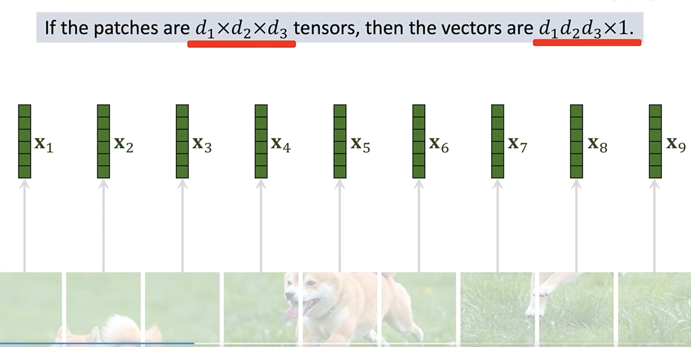
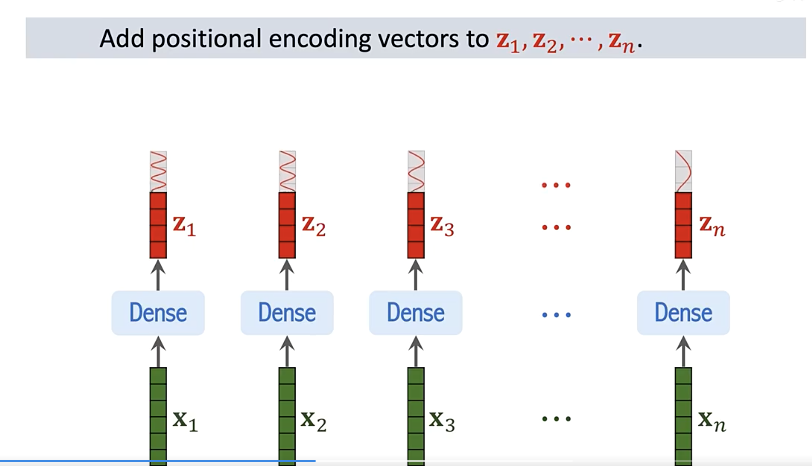
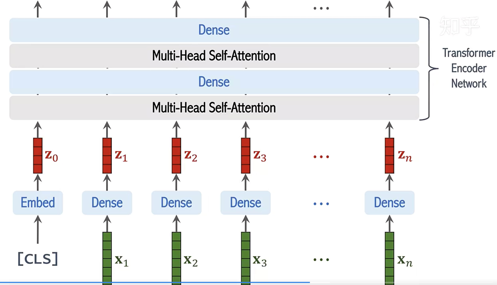
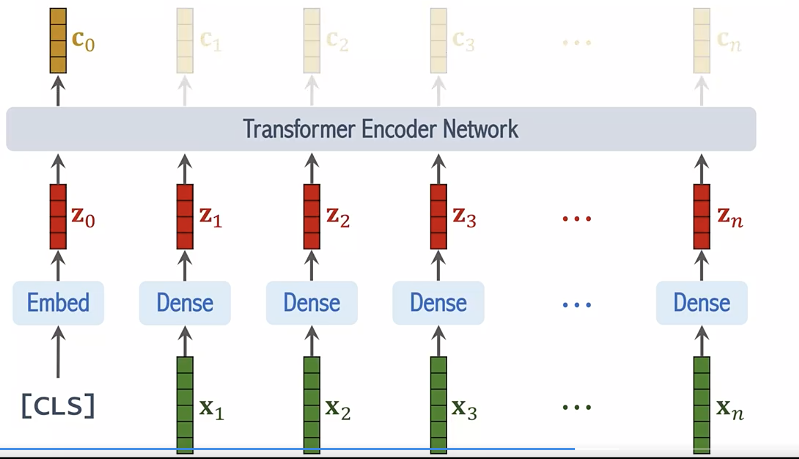
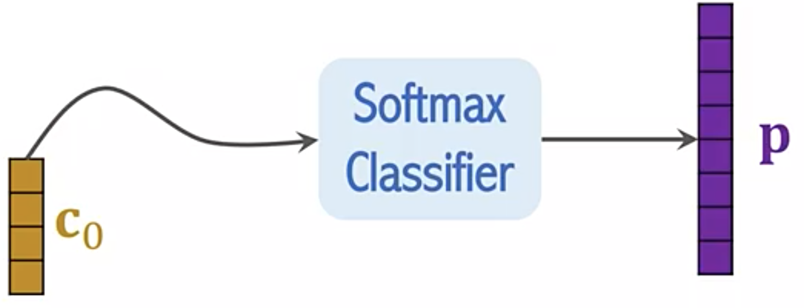
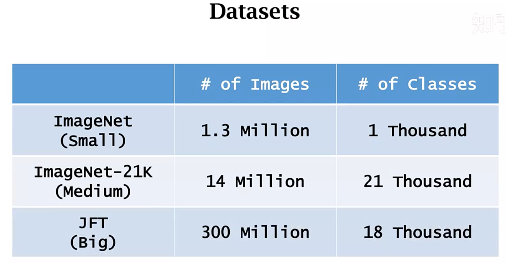
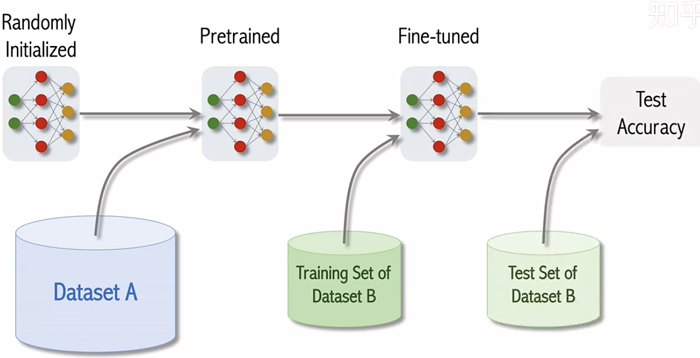
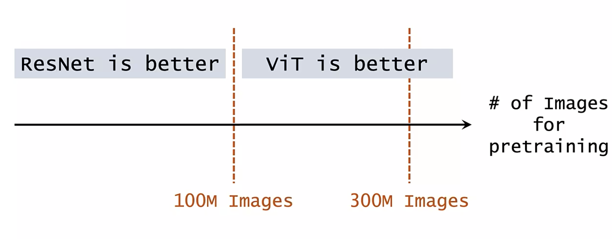

## 研究问题

卷积网络长期主导图像识别。ViT 追问：不依赖卷积骨干，只用 Transformer 编码图像 patch，能否做好分类？旧笔记先回顾了自注意力，再讨论 Transformer 在视觉中的优势和数据需求；这里保留这条理解路径。

## 核心方法

### Transformer 回顾

设输入序列 $X\in\mathbb{R}^{N\times D}$，$N$ 是词元数，$D$ 是特征维度。三个可学习线性投影得到查询 $Q$、键 $K$、值 $V$。每个词元利用查询与所有键的相似度，从值向量中聚合信息：

$$
\operatorname{Attention}(Q,K,V)=\operatorname{softmax}\!\left(\frac{QK^\top}{\sqrt{d_k}}\right)V .
$$

$d_k$ 是单个注意力头的键维度。多头注意力让不同投影子空间分别聚合信息，再拼接输出：

$$
\operatorname{MHA}(X)=\operatorname{Concat}(\text{head}_1,\ldots,\text{head}_h)W^O .
$$

旧笔记区分了 **encoder 的自注意力**和经典 encoder–decoder Transformer 中的**交叉注意力**：交叉注意力的 $Q$ 来自解码端，$K,V$ 来自编码端。ViT 分类只使用 encoder。相关基础见 [Attention Is All You Need](https://arxiv.org/abs/1706.03762)。

### ViT 的图像词元

将 $H\times W$ 图像切为 $P\times P$ 的不重叠 patch，展平后经共享线性投影得到 $N=HW/P^2$ 个词元；加上可学习的位置嵌入和一个分类词元（class token），送入多层 Transformer encoder。最后取分类词元的表示进行分类。patch 投影在空间位置间共享参数；位置嵌入补足纯注意力对二维位置缺少的显式先验。

旧笔记把长程交互、多头聚合和多模态融合视作 Transformer 值得研究的方向。这是我的技术判断，不等于 ViT 原论文已经验证了所有视觉任务。

### 原笔记逐节学习记录

以下按旧笔记的原有顺序保留推导、解释、代码片段与图示。前面的概览供快速回顾；这一节用于完整复习。代码片段保持原笔记的教学语境，未作为可运行示例重新验证。

#### Transformer

#### 自注意力机制与Transformer

###### 自注意力机制(Self-Attention Mechanism)

- 输入：长度为$l$, 特征维度为$d$的输入序列$X \in R^{l \times d}$

- 目标：对序列中的每一个元素$X_{i} \in R^{d}$以一定权重从其他元素处聚合信息

- 计算方式：

  - 将输入序列通过线性变换转换为三个不同的序列$Q, K, V \in R^{l \times d}$

  - 计算索引序列(query)和键序列(key)之间的注意力系数$ S \in R^{l \times l} $

    ​                 $ S = QK^{T} / \sqrt{d} $

  - 使用softmax对注意力系数进行归一化

    ​				$ P = softmax(S) $

  - 使用归一化的注意力系数对值序列(value)进行加权求和，得到输出$ Y = PV $

- 公式：

​					$ Attention(Q, K, V) = softmax(\frac{QK^{T}}{\sqrt{d}})V$

###### 多头自注意力(Multi-Head Self-Attention)

- softmax计算使归一化注意力系数只在个别部分有高响应

- 为增加多处信息的聚合能力，提出多头自注意力机制

- 计算过程

  - 序列$Q, K, V \in R^{l \times d}$被分为$h$组$\{Q_{i}\}_{i=1}^{h}$, $\{K_{i}\}_{i=1}^{h}$, $\{V_{i}\}_{i=1}^{h}$，每组特征维度为$d_{i} = d / h$
  - 每组$Q_{i}$, $K_{i}$, $V_{i}$分别计算自注意力
  - 结果沿特征维度拼接后经过线性变换$W^{0}$，得到输出

- 公式：

   		$ MHAttention(Q, K, V) = Concat(head_{1}, ..., head_{h}) W^{0}$

  ​						$ head_{i} = Attention(Q_{i}, K_{i}, V_{i})$

###### Transformer

- 编码器：交替堆叠多头自注意力层和MLP层（或称为前馈网络，FFN）
- 解码器：类似编码器，但在每个多头自注意力层后插入一个多头交叉注意力层，其索引序列(query)来自自注意力层的输出，而键序列(key)和值序列(value)来自编码器的输出。

大模型应用：

Transformer由Encoder、Decoder构成，其中的基础模块称作encoder block和decoder block。

语言模型里GPT-2、GPT-3用到了decoder block（GPT-2用36），Bert则是用了encoder block(24个)。

[Jay Alammar](http://jalammar.github.io/)

#### Vistion Transformer

#### Transformer在CV上的应用前景

研究方向主要两个：

1. **作为convolution的补充**

2. **替代convolution：**ViT中不同的query是share key set的，这会使得内存访问非常友好而大幅度提速。一旦解决了速度问题，self-attention module在替代conv的过程中就没有阻力了。

   注：ViT是2020年10月挂在Arxiv上，2021年发表。

ViT的特性：

1. long range带来的全局特性：

   从浅层到深层，都比较能利用全局的有效信息。multi-head机制保证了网络可以关注到多个discriminative parts，其实每一个head都是一个独立的attention。

2. 更好的多模态融合能力：

   CNN擅长的是解构图像的信息，卷积核就是以前传统数字图像处理中的滤波操作。而Transformer中，不需要保持 H×W×C 的 feature map 结构。就类似 position embedding，只要你能编码的信息，都可以非常轻松地利用进来。

3. Multiple tasks能力。

4. 更好的表征能力。

   总体而言，Transformer是NLP给CV的一个输出，我们可以去学习Transformer的长处，至于未来是否会替换CNN，或者Transformer与CNN共存，甚至互相弥补，这个还是靠整个学界去决定。CV的任务很多很难，无论是CNN还是Transformer都不会是CV的终点，保持学习、保持接纳、保持探究。

​														这里的xi到zi是都是共享参数的全连接层。

transformer encoder的输出中，有用的是向量c0。

Transformer的缺点：

需要大量的数据进行训练。ViT论文里研究了三个数据集，其中JFT甚至有3亿张图片。可惜JFT是谷歌私有的一个数据集，不对外公开。

实验结果表示，如果用ImageNet（small）预训练，ViT表现不如ResNet。用ImageNet-21K（medium），ViT表现与ResNet相当。只有在使用JFT数据集后，ViT才超越了ResNet。

而且实验的迹象表明，即便是3亿张图片的JFT也不够大，继续增大数据集，ViT的优势还会进一步增大。反观ResNet，预训练的数据量是1亿还是3亿张图片时区别不大。

## 关键发现

- 论文报告：在充足的大规模预训练后，纯 Transformer 图像分类器能达到很强的迁移表现；训练数据较少时，较弱的视觉归纳偏置反而是劣势。
- 旧笔记对比 ImageNet、ImageNet-21K 与 JFT 预训练，强调 **数据规模改变 ViT 与 CNN 的相对位置**。不要把大数据条件下的优势误读成“小数据也必然优于 CNN”。

## 我的提问

## 局限与疑问

- 自注意力的两两词元交互随 patch 数量平方增长；更高分辨率需要考虑算力与内存。
- 原笔记认为 Transformer 可能替代或补充 CNN，但尚不能仅凭分类实验推论所有视觉任务的终局。

## 我的判断

ViT 值得作为视觉表征的基础结构学习。回看实验时，应同时记录预训练数据规模、patch 大小与比较对象；这些条件会改变结论。

## 下次只看这些

1. 图像 patch → 共享线性投影 → 位置嵌入与 class token → Transformer encoder。
2. 自注意力是加权信息聚合；多头在不同投影子空间并行聚合。
3. ViT 的强表现依赖足够的预训练数据，不能忽略 CNN 的归纳偏置。
