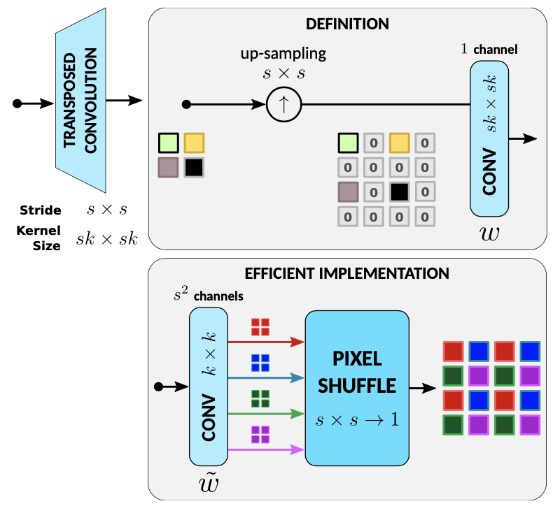

## 研究问题

**分析现有方法：**

1. 超分辨率的历史

- - 传统插值算法：linear或者bicubic上采样，在低分辨率图像上插0然后低通滤波得到，对应pytorch、tf中的反卷积(*strided transposed convolutional layer*)
  - 先进的上采样算法：利用几何原理提升质量，自适应上采样和滤波为主
  - 深度学习：用CNN的SRCNN、用ResNets的EDSR、用DenseNets的RDN、用attention的RCAN、用非局部attention的RNAN、用transformer的SwinIR等

2. FSRCNN 和 ESPCN 都在未来的 SR 研究中留下了深刻的印记，这些研究经常以低分辨率执行计算并使用pixel-shuffle layers上采样。

## 核心方法

edge-SR

WACV 2022 *BOE*

**该文观点：**

传统插值的上下采样是等效于：filter–then–downsampling和upsampling–then–filter。张量处理框架则使用跨步转置卷积层实现这种上采样。

传统插值上采样图示：


但图中的定义的升频(upscaling)显然效率低下，因为上采样(upsampling)引入了许多零，当乘以滤波器系数时会浪费资源。 一个众所周知的优化，广泛用于经典升频器的实际实现中，是将插值滤波器从图中的大小 sk×sk 拆分或解复用为 s^2 所谓的大小为 k × k 的高效滤波器。 然后，s^2 个滤波器的输出通过Pixel-Shuffle操作进行多路复用，以获得放大后的图像。

上采倍数越高，s越大，意味着实现**1**的核大小越大，或实现**2**的卷积通道数越大。

**提出模型：**

- eSR：

  卷积输出s^2个通道，最后pixel-shuffle得到超分结果。

- eSR-MAX：卷积输出C * s^2个通道，pixel-shuffle后，每C个通道取一个最大值。

  思想源自Maxout networks。

- eSR-TM：卷积输出2 * C * s^2个通道，pixel-shuffle后，前C个通道softmax，得到概率对后C个通道加权平均。

  属于自注意力，思想是Template Matching。

- eSR-TR

- eSR-CNN

### 关键图示



## 关键发现

**该文贡献：**

提出单层架构超分，详尽比较速度-效果权衡，对单层架构中的自注意力策略的分析和解释。

## 我的提问


## 局限与疑问


## 我的判断

**阅读评价：**

有启发意义，但实际由于硬件支持（比如耗时的softmax），并不如我们ZoomSR速度快。效果也是锯齿比较严重。另外，eSR-TM不一定得用softmax，用tanh，或者啥也不用应该也是有理由的。比如NAFNet的非线性激活就是个例子：

```python
class SimpleGate(nn.Module):
    def forward(self, x):
        x1, x2 = x.chunk(2, dim=1)
        return x1 * x2
```

## 下次只看这些

1. 把上采样滤波拆为低分辨率卷积和 Pixel Shuffle，并比较单层架构的速度与画质。
