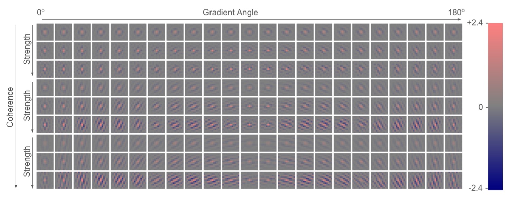

## 研究问题

**分析现有方法：**

1. 传统插值方法，是内容无关的线性方法，表达能力不足。
1. 全局滤波效果不如大量参数且非线性的神经网络；所以改全局为图像块内容自适应。

## 核心方法

RAISR

TCI 2016 *Google*

**该文观点：**

1. 倾向example-based方法，即使用外部数据集学习LR patch到HR patch的映射。

2. RAISR 背后的核心思想是通过在图像块上应用一组预先学习的过滤器来提高画质，这些过滤器由高效的散列机制选择。

   1. 过滤器是基于 LR 和 HR 训练图像块对学习的
   2. 哈希是通过估计局部梯度的统计信息来完成的。

3. 过程：

   1. 插值上采样或pixelshuffle机制，参考：edge–SR: Super–Resolution For The Masses

   2. 局部梯度的函数得到{角度, 强度, 连贯性}3个哈希表的键。最终经过散列计算得到索引值（散列意味着冲突尽可能少）

      > 用eigenvector,eigenvalue

      哈希表键是局部梯度的[函数](https://www.academia.edu/download/42362012/feng_asilomar.pdf)，哈希表条目是相应的预学习过滤器。比“昂贵”的聚类（例如 K-means、GMM、字典学习）更加高效。

      > 假如每桶有n个filter，那么可设置index = f(angle, strength, coherence)的散列函数，在f(0,0,0)=0，f(1,1,1)=n。
      >
      > 我们有trick避免冲突。

   3. 如若上采样+滤波，滤波器组只需一个(但尺寸要求较大)。如若滤波+pixelshuffle，滤波器组需要上采样倍数^2个。

      1. 上采样+滤波，会更复杂的有Pixel-Type，这是由于插值方法的特性（像素的来源不同）导致的。
      2. 滤波+pixelshuffle，不需要Pixel-Type，或者说Pixel-Type隐含在了我们有4组滤波器，即4种Type。

   4. 所有滤波器权重均由学习得到。

4. 优化点：

   1. 考虑许多上采样kernel中心对称的特性。可以减少一半冗余。
   2. 考虑使用量化。RAISR只有单层，不存在误差累积。

5. av1 CDEF 有8个方向mode，DCC就是把里面的8个方向mode简化为4个，这个方向mode，在raisr、deringing里也有机会用到。[CDEF介绍](https://blog.csdn.net/weixin_44696799/article/details/109284068)

### 关键图示

## 关键发现

## 我的提问

## 局限与疑问

## 我的判断

## 下次只看这些

1. 利用局部梯度统计选择预学习滤波器，在低计算量下实现内容自适应超分。
