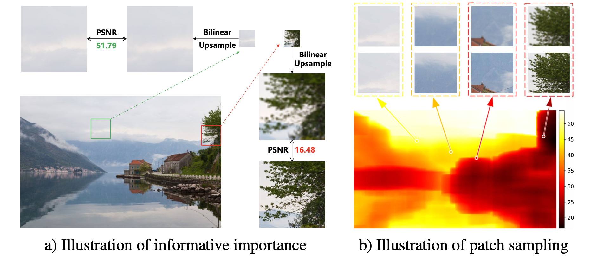

## 研究问题

**分析现有方法：**

**现有方法大多在均匀采样的 LR-HR 补丁对上训练 DNN，这使得：**
 他们未能充分利用图像中的一些提供有用信息的补丁。

最近去噪领域也有工作提出训练一个额外的 PatchNet 来选择更多信息的补丁样本进行去噪网络的训练，能显著提高网络性能。

## 核心方法

[SamplingAug](https://github.com/littlepure2333/SamplingAug)

**该文方法：**

启发式度量来评估每个补丁对的信息重要性，再据此进行采样。

具体启发是：

能被线性函数超分的patch通常提供的重要信息更少。所以本文设计的度量方式是linearSR (如bilinear插值) 和HR之间的PSNR。

做法：

- 由于对所有overlapped patch都度量，计算复杂度会高。所以这里只对整个的积分图做linearSR。

- 考虑三种采样策略：

  1. 采样根据度量前p%的informative patches

  2. NMS(Non-Maximum Suppression)方法

     > 非极大抑制，是在重叠度较大的候选框中只保留一个置信度最高的。（Fast R-CNN中提出的）。

  3. TD(Throwing-Dart)采样策略

     > dart throwing （像一个人蒙上眼睛胡乱扔飞镖的样子）常用于渲染随机均匀的点组成的图案。每次在区域内随机选择一个点，并检查该点与所有已经得到的点之间是否存在“冲突”。若该点与某个已得到的点的最小距离小于指定的下界，就抛弃这个点，否则这就是一个合格的点，把它加入已有点的集合。重复这个操作直到获得了足够多的点。

  b、c会导致非重叠的采样，a、b、c都可以提升性能，其中策略a居然是效果最好的。说明信息量较少的样本可能对 SISR 的性能没有贡献。

- 积分图（integral image）又称总和面积表（summed area table）是一个快速且有效的对一个网格的矩形子区域中计算和的数据结构和算法。（就是junlin在面试时考我的数据结构）。

- 所有patchsize训练都会受益，不过小patchsize更明显；

  小模型的采样比例p越小效果越好，大模型的p可以稍大一点。这是由模型容量决定的；

  SamlingAug不同于困难样本挖掘（OHEM），OHEM只反传每个batch中最高的损失。用于SR时难以收敛。

  > Adobe的超分方法也有类似idea：
  >
  > A second key piece is that we focused our training efforts on “challenging” examples — image areas with lots of texture and tiny details, which are often susceptible to artifacts after being resized.

### 关键图示

## 关键发现

## 我的提问

## 局限与疑问

## 我的判断

**阅读评价：**

2021、2022年SR领域提出多篇不同复杂度的网络处理不同难度的patch的工作，出发点一致，只是方法侧重略有不同。然而现有的inference engine对这类方法还不够友好。

而SamlingAug从训练样本的角度出发，则更为有意思一点。感觉和困难样本挖掘的思路有点类似，但绕了一道，不是直接SR和HR之间loss来决定是否反传。而是linearSR和HR之间的loss来决定是否反传。就成了与当前网络无关的独立因素了，避免了训练不稳定。

> 我这种思路，再结合topk的代码，还是挺好实现的。

## 下次只看这些

1. 用线性超分与真值的误差估计 patch 信息量，再调整训练采样而不依赖当前模型损失。
