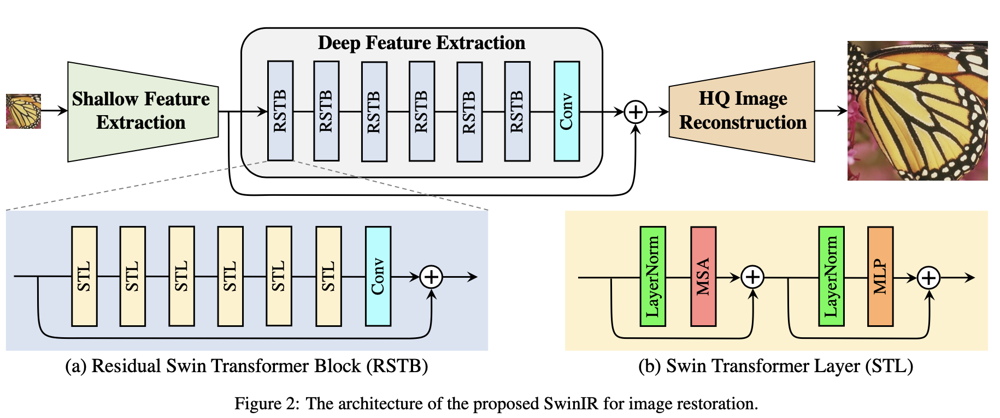

## 研究问题

能否以统一的 Transformer 骨干处理超分、去噪和压缩伪影消除等不同图像复原任务？

## 核心方法

三部分：浅层特征提取+深层特征提取+图像重建

SwinIR普遍适用于各类图像复原任务，无需改动特征提取模块，对不同的任务仅仅是使用不同的重建模块。

**1.浅层特征提取：**采用一层卷积，根据论文[Early Convolutions Help Transformers See Better](https://proceedings.neurips.cc/paper/2021/file/ff1418e8cc993fe8abcfe3ce2003e5c5-Paper.pdf)，得到特征$F_{0}$

**2.深层特征提取：**集联K个residual Swin Transformer blocks (RSTB)，最后接一层卷积。得到特征$F_{DF}$

>在特征提取的最后使用卷积层可以将卷积操作的归纳偏置带入基于Transformer的网络中，为后期浅层和深层特征的聚合打下更好的基础。

**3.图像重建：**聚合浅层和深层特征 $I_{RHQ} = H_{REC} (F_{0} + F_{DF} )$, 浅层特征主要包含低频，而深层特征侧重于恢复丢失的高频。 通过long skip connection，SwinIR可以将低频信息直接传递给重建模块，帮助深度特征提取模块专注于高频信息，稳定训练。 (1) 对于超分任务，使用亚像素卷积层对特征进行上采样。(2) 对于不需要上采样的任务，单层卷积就可以完成重建。另外SwinIR的输出会和低质量图像相加，形成残差学习。

### 关键图示

## 关键发现

## 我的提问

## 局限与疑问

## 我的判断

## 下次只看这些

1. 以共享的 Swin Transformer 特征提取骨干搭配任务特定重建模块处理多类图像复原。
