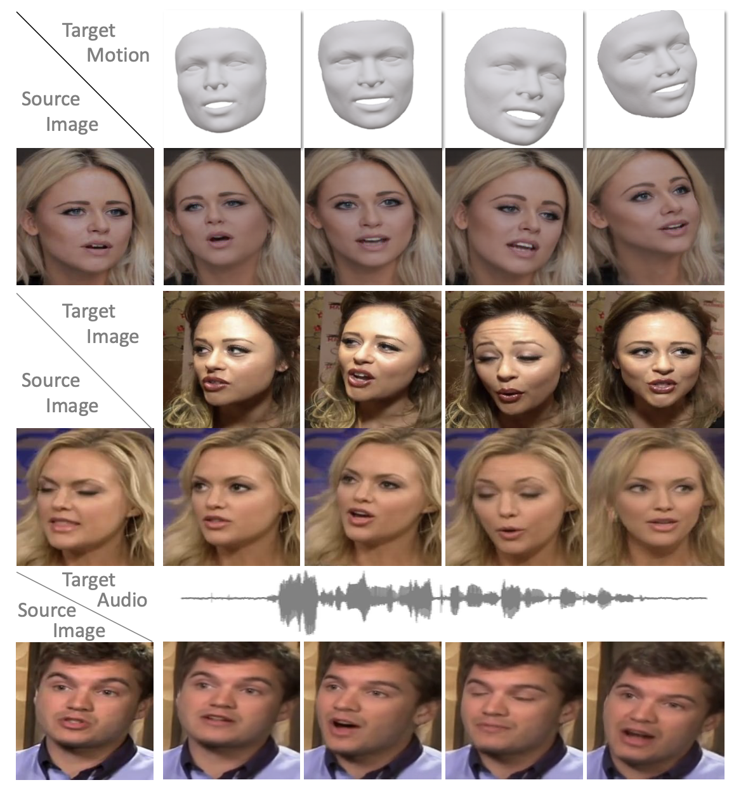
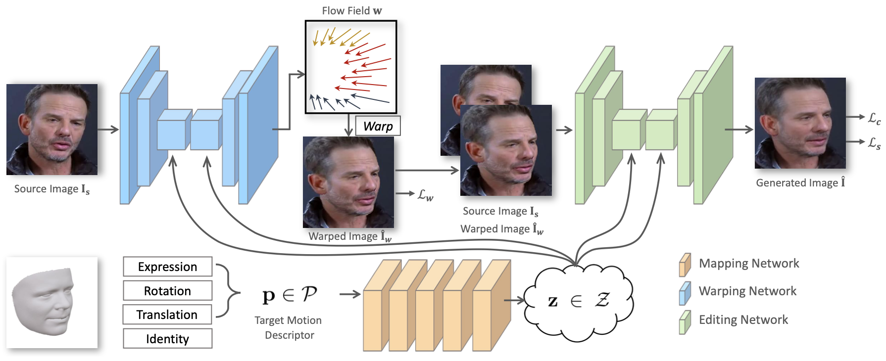

## 研究问题

怎样以具有语义的、彼此解耦的三维参数直接控制人像动作？

## 核心方法

俞睿师兄的工作，旨在得到具有语义和完全分离的参数——使用三维可变形面部模型（3DMM）的参数来控制面部运动。

> 提供细粒度控制，直观且易于使用。这是FOMM等工作所不能达成的，它们阻碍了模型以直观方式编辑肖像的能力。

结合技术的先验知识，人们可以期望控制类似于图形渲染处理的照片般逼真的肖像图像的生成。

> 为了实现直观控制，运动描述符应该在语义上有意义，这需要将面部表情、头部旋转和平移表示为完全分离的变量。

我们表明，我们的模型不仅可以通过使用用户指定的动作编辑目标图像来实现直观的（top）图像控制，而且还可以在间接（middle）肖像编辑任务中生成逼真的结果，其中目标是模仿另一个人的动作。 此外，我们通过进一步扩展模型来解决音频驱动的面部重现任务，展示了我们模型作为高效神经渲染器的潜力。 由于高层完全分离的参数化，我们可以从“弱”控制音频（bottom）中提取令人信服的动作。

>3DMM参数：人脸三维网格、模型在图像中的位置，以及当前人脸的形状特征参数和blendshape表情参数。（即 pose（包括旋转rotation和平移translation）, identity, expression）
>
>现在有些固定了pose和identity的应用场景，则只需要blendshape。

PIRenderer包含三部分网络：

> 0. 采用现成的 3D 人脸重建模型从真实世界的人像图像中提取相应的 3DMM 系数进行训练和评估；
>
>    注：为了缓解系数提取误差和噪声带来的影响，将具有**连续帧的窗口**的系数用作中心帧的运动描述符。

1. Mapping Network：将3DMM参数映射为隐向量（a latent vector）；
2. Warping Network：在隐向量的指导下，估计source和所需target之间的光流，并通过用估计的变形来warp源得到粗略的生成结果；
3. Editing Network：从粗略的结果到精细的生成结果。

其中使用AdaIN 是比较精髓的部分，值得学习。AdaIN算子负责将 z 描述的运动注入Warping和Editing网络。AdaIN非常类似于SFT层，最早在风格迁移任务中使用。

EditingNet应该有提升空间，把画质增强里面比较适用的做法用过来。

> PIRender只需要输入3DMM中表情和姿态的系数，而不需要身份（identity）。这是由于有source image提供identity。但也因此，PIRender的训练没有引入GAN，就是想保id，GAN经常可能生成不真实的信息。

PIRender的损失函数，训练refine网络时采用了VGG-style-loss，也就是在vgg特征的基础上经过格拉姆矩阵后再算L1距离。

> 格拉姆矩阵（Gram matrix）：n维欧式空间中任意k个向量之间两两的内积所组成的矩阵，称为这k个向量的格拉姆矩阵(Gram matrix)。
>
> 内积判断向量a和向量b之间的夹角和方向关系
>
> - a·b>0   方向基本相同，夹角在0°到90°之间
> - a·b=0   正交，相互垂直
> - a·b<0   方向基本相反，夹角在90°到180°之间
>
> 所以Gram矩阵可以反映出**该组向量中各个向量之间的某种关系**。

**Gram计算的实际上是两两特征之间的相关性**，哪两个特征是同时出现的，哪两个是此消彼长的等等。格拉姆矩阵用于度量各个维度自己的特性以及各个维度之间的关系。内积之后得到的多尺度矩阵中，对角线元素提供了不同特征图各自的信息，其余元素提供了不同特征图之间的相关信息。这样一个矩阵，既能体现出有哪些特征，又能体现出不同特征间的紧密程度。

>深度学习中经典的风格迁移大体流程是：
>
>1. 准备基准图像和风格图像
>2. 使用深层网络分别提取基准图像（加白噪声）和风格图像的特征向量（或者说是特征图feature map）
>3. 分别计算两个图像的特征向量的Gram矩阵，以两个图像的Gram矩阵的差异最小化为优化目标，不断调整基准图像，使风格不断接近目标风格图像
>
>关键的一个是在网络中提取的特征图，**一般来说浅层网络提取的是局部的细节纹理特征，深层网络提取的是更抽象的轮廓、大小等信息**。这些特征总的结合起来表现出来的感觉就是图像的风格，由这些特征向量计算出来的的Gram矩阵，就可以把图像特征之间隐藏的联系提取出来，也就是各个特征之间的相关性高低。
>
>

[Face3D 拓展](https://zhuanlan.zhihu.com/p/530830577)

Gram matrix扩展[1](https://blog.csdn.net/bbbeoy/article/details/108195122),[2](https://www.zhihu.com/question/49805962)

至于输出使用`nn.Sigmoid()`, `nn.Identity()`, `nn.Tanh()`, or `nn.Hardtanh`的考虑：

实验发现`nn.Identity()`即不用激活函数，似乎不如另外两种。

而$tanh(x)=\frac{1-e^{-2x}}{1+e^{-2x}} = 2*(\frac{1}{1+e^{-2x}}-1) = 2sigmoid(2x) - 1$，

它们的关系是线性关系, 所以`Tanh`和`Sigmoid`注定有很多相似点。

相似点：① 有饱和区，在输入较大或较小的区域，梯度变为0，神经元无法更新② 都有指数运算，运算量大。（基于这个原因，我考虑到更高效的`Hardtanh`）

差异点：① 首先，提到激活函数，经常会提到是否是以零为中心的。以零为中心的激活函数不会出现zigzag现象，因此相对来说收敛速度会变快。

> 当所有梯度同为正或者负时，参数在梯度更新时容易出现zigzag现象。因为梯度更新的最优方向 **不满足** 所有参数梯度正负向一致时，也就是有的参数梯度正向，有的参数梯度负向。（抛开激活函数，当参数量纲差异大时，也容易造成zigzag现象）

> zigzag现象如图所示，不妨假设一共两个参数， $w_0$ 和 $w_1$ ，紫色点为参数的最优解，蓝色箭头表示梯度最优方向，红色箭头表示实际梯度更新方向。由于参数的梯度方向一致，要么同正，要么同负，因此更新方向只能为第三象限角度或第一象限角度，而梯度的最优方向为第四象限角度，也就是参数 $w_0$ 要向着变小的方向， $w_1$ 要向着变大的方向，在这种情况下，每更新一次梯度，不管是同时变小(第三象限角度)还是同时变大(第四象限角度)，总是一个参数更接近最优状态，另一个参数远离最优状态，因此为了使参数尽快收敛到最优状态，出现交替向最优状态更新的现象，也就是zigzag现象。

所以可以看到`tanh`从效果上是优于`sigmoid`的：

优点：输出关于原点对称，0均值，因此输出有正有负，可以规避zigzag现象，另外原点对称本身是一个很好的优点，有益于网络的学习。

缺点：存在梯度消失问题，tanh的导数计算为 $\frac{4e^{2x}}{(e^{2x}+1)^2} $，取值范围为(0,1]，虽然取值范围比sigmoid导数更广一些，可以缓解梯度消失，但仍然无法避免随着网络层数增多梯度连乘导致的梯度消失问题。

### 关键图示

## 关键发现

## 我的提问

## 局限与疑问

## 我的判断

## 下次只看这些

1. 以语义解耦的 3DMM 参数控制人像动作，并用神经渲染生成肖像。
