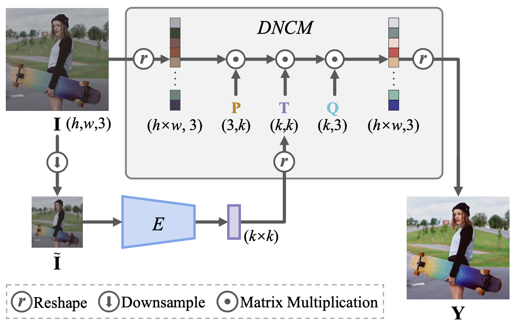
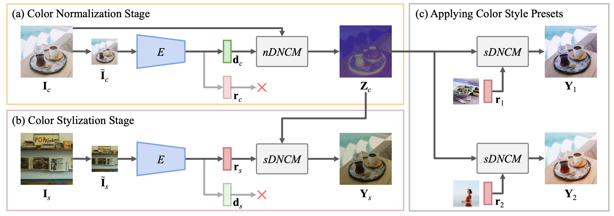
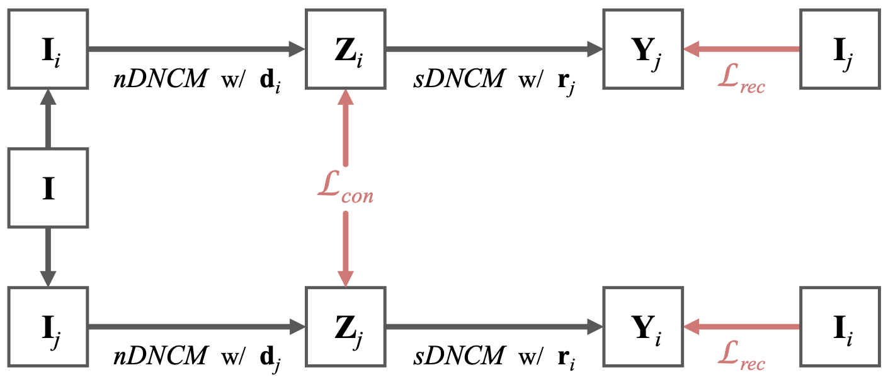

## 研究问题

**现有方法**通常在实践中受到三个明显的限制：**

1. 伪影（例如，扭曲的纹理或不和谐的颜色），因为它们执行基于卷积模型的颜色映射，卷积模型对图像块进行操作，对于相同像素值的输入可能具有不一致的输出。
2. 运行时内存占用巨大，它们无法处理高分辨率（例如8K）图像。
3. 它们在切换样式时效率低下，因为它们将颜色样式转换作为单阶段过程进行，每次都需要运行整个模型。

## 核心方法

文章有不错的应用价值。作者原来是专门研究半监督/自监督学习的，最近开始将自监督引入一些CV任务中，提出了MODNet和本文的Neural Preset。比较有意思的是，Neural Preset不需要fine-tuneing就能用在暗光增强、水下图像增强、去雾和图像和谐化等多个任务中。

> 术语了解：艺术风格迁移 不同于 颜色风格转换（也称写实风格迁移）。
>
> artistic style transfer：改变纹理和颜色。
>
> color style transfer (*aka* photoreal- istic style transfer)：仅改变颜色。

**本文方法：**

- 确定性神经颜色映射 (DNCM)：相同颜色的像素转换到相同的输出。但只需极少内存，不像3D-LUT那样耗内存。

  > 手工滤波器和3D查找表也属于确定性颜色映射。但手工滤波器功能性弱，只能处理基本的颜色调整。通过预测系数，融合LUT模板的方法，则具有大量可学习参数，难以优化。

- 两阶段：

  第一阶段由输入建立nDNCM，用于将输入归一化到仅表示“图像内容”的空间；

  第二阶段由风格图建立sDNCM，用于将归一化图像转化到目标风格。

  **两方面好处**，①可以存储sDNCM，作为预设滤镜。②可以一次nDNCM后快速切换不同滤镜。

- 由于难以获取配对数据，使用了自监督学习。

  > 自监督学习（SSL）已被广泛探索用于预训练 [4、5、19、21、25、26、58–60]。 一些作品还通过 SSL [31、37、42] 解决特定的视觉任务。本文应该属于后者。

无需工程技巧，就可以在3090显卡上实时增强4K视频，且具有帧间一致性。

DNCM：

两阶段：

在两阶段的方式中，编码器 E 被修改以输出 d 和 r，它们分别用作 nDNCM 和 sDNCM 的参数。E()共享权重，但nDNCM和sDNCM有不同的投影矩阵 P 和 Q。

自监督：

本文提出一种自监督策略：

由于难以获取GT的风格化图像，我们有输入图像$I$制作两个伪风格图像。具体方式是通过对$I$色彩的扰动，获得两个不同色彩风格的数据增强样本$I_i$和$I_j$。扰动可以由色彩滤镜或LUT完成。

损失函数细节：

内容一致损失用L2，$\mathcal{L}_{con} = || \mathbf{Z}_{i} - \mathbf{Z}_{j} ||_{2}$，

风格重建损失用L1，$\mathcal{L}_{rec} = || \mathbf{Y}_{i} - \mathbf{I}_{i} ||_{1} + || \mathbf{Y}_{j} - \mathbf{I}_{j} ||_{1}$，

最终损失函数为：$\mathcal{L} = \mathcal{L}_{rec} + \lambda \, \mathcal{L}_{con}$，$\lambda$是一个可控的权重。

### 关键图示

## 关键发现

## 我的提问

## 局限与疑问

## 我的判断

## 下次只看这些

1. 通过可复用的神经预设迁移照片颜色，同时尽量保持纹理一致。
