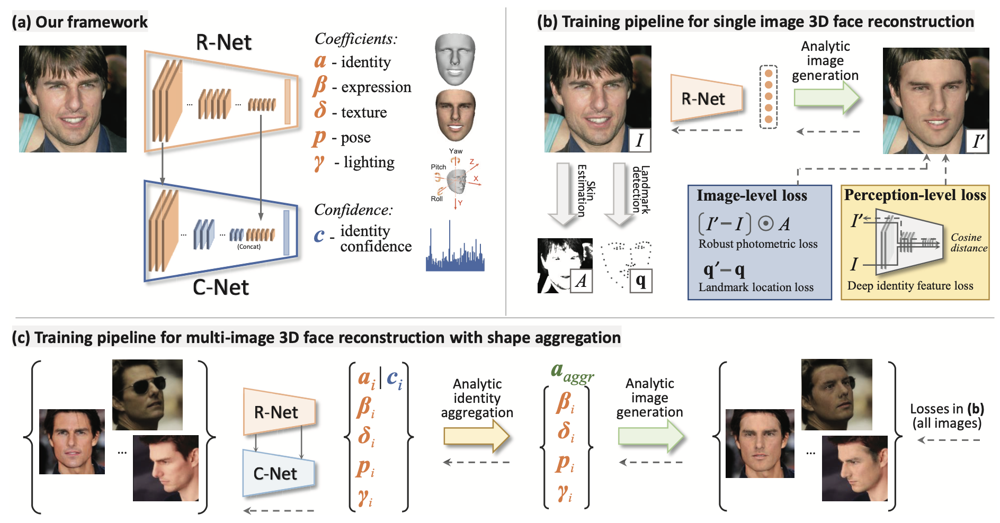

## 研究问题

缺少真实三维人脸标注时，如何从单图或多图稳定重建几何？

## 核心方法

解决face images - ground truth 3D face数据的稀缺问题。

1. 本文的思路是采用弱监督学习。组合了图像级损失和感知级损失。

2. 从一组照片重建3D face，不再朴素聚合（简单地平均每张重建出来的形状）和一些启发式策略，而是基于置信度的聚合获得。另外可以利用姿势差异的互补信息更好的融合。

   置信度预测子网络也以没有标签的弱监督方式进行训练。

> 3D face shapes主流使用的3D Morphable Model (3DMM) coefficients。使用 3DMM，人脸形状 S 和纹理 T可用仿射模型（affine model）表示，即系数加权和。

3D建模：

$$S = S(\alpha,\beta) = \bar{S} + B_{id}\alpha + B_{exp}\beta $$

$$T = T(\delta) = \bar{T} + B_t\delta$$

$B_{id}$,  $B_{exp}$,  $B_t$分别是身份、表情和纹理PCA的基。

光照建模：gamma，用[球谐函数](https://zhuanlan.zhihu.com/p/351289217)表示。用来描述不同方向光照的SH基函数我们一般用到二阶或者三阶，二阶是4个系数，三阶是9个系数。三阶拓展到rgb，就是9 * 3 = 27个系数。

相机建模：姿态包括 angle（旋转角度）和translation（平移）。

id.gamma.tex 为静态特征，**身份(80)**+光照(27)+**纹理(80)**

angle.exp.trans 为动态特征，旋转(3)+**表情(64)**+平移(3)

图像损失：仅面部区域的像素级损失，关键点损失

感知损失：注意使用的cosine距离

> 但是BFM用的PCA，不方便解耦来预设眼部表情。
>
> orthogonal PCA basis are widely used such as BFM [22] and FLAME [30];
>
> blendshapes, such as FaceWarehouse [9], FaceScape [53] and Feafa [52].

https://github.com/peterjiang4648/BFM_model/releases/tag/1.0 有人分享了mat文件。可以不用自行下载和matlab得到BFM.mat了。

### 关键图示

## 关键发现

## 我的提问

## 局限与疑问

## 我的判断

## 下次只看这些

1. 结合弱监督重建与多图置信度聚合，缓解三维人脸真值不足的问题。
