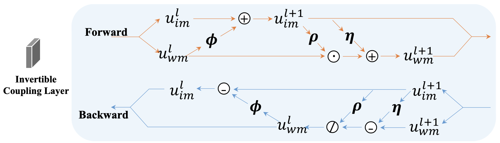

## 研究问题

盲水印怎样兼顾不可见性与强噪声攻击下的可提取性？

## 核心方法

袁粒老师组的工作，结构可逆。

Q：注意FIN的代码，图像是在-1，1之间。不确定这是不是可逆网络所需要的。

A：实验观察，应该是需要的，psnr会收敛得快很多。

### 关键图示

## 关键发现

## 我的提问

## 局限与疑问

## 我的判断

## 下次只看这些

1. 结合可逆模块的高保真嵌入和不可逆模块的强噪声鲁棒提取。
