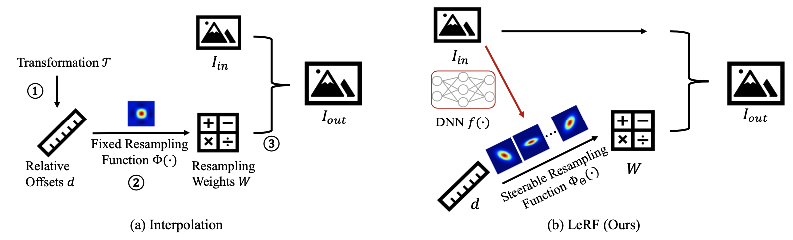
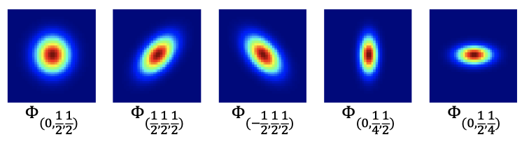
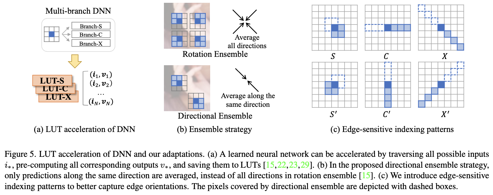
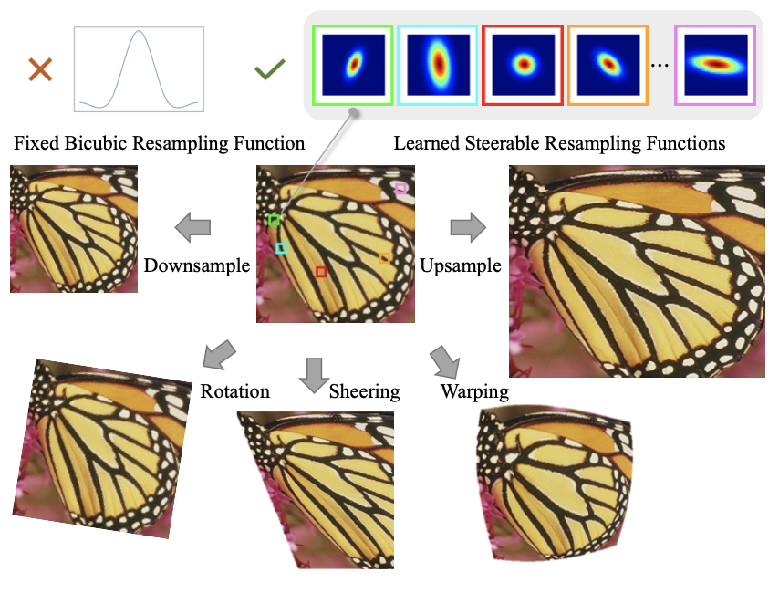

## 研究问题

如何同时实现任意倍率、内容自适应和高效率的图像重采样？

## 核心方法

感觉这篇文章非常值得看，可以对传统插值/RAISR/SR-LUT等方法的联系和区别，有更深刻的认识。

RAISR是手工的特征，基于学习的规则。

> Engineers design everything.
>
> Engineers design features. ML models learn rules from data.
>
> DL models learn both features and rules from data.

而本文的LeRF，是采用基于学习的特征（structural priors learned by DNNs）。

解决两个问题：效率和任意倍数，efficient and continuous solution

传统插值：

1. 获取相对偏移量：将变换后的目标坐标（如上采样）投影回输入图像的坐标空间，获取其支持块（their support patches）中目标像素和源像素之间的相对空间偏移量。

2. 预测重采样权重：根据相对空间偏移量，为支持块中的每个像素预测重采样权重，即重采样核。

3. 聚合像素：通过加权求和聚合源像素以获取目标像素。

**本文方法：**

1. 与插值中的固定重采样函数不同，我们假设一种可控重采样函数 $Φ_Θ$，由 $Θ$ 参数化。 具体来说，我们利用各向异性高斯，其中 ρ、σX 和 σY 是超参数，因此重采样函数变为 $Φ(ρ,σ_X ,σ_Y )$ 。

   从统计学的角度来看，$ρ$可以解释为二维变量与$σ_X$、$σ_Y$标准差之间的相关性。

   可以看到通过调整超参数$(ρ，σ_X，σ_Y)$获得不同的方向和形状，显示其对各种局部结构的建模能力。

2. 采用深度神经网络从外部数据集学习结构先验，以预测重采样函数中的超参数 $Θ$，即这里的$(ρ,σ_X ,σ_Y )$。

3. DNN-to-LUT，采用查找表来加速。索引/键是输入图像的像素组合，值是对应的超参$(ρ,σ_X ,σ_Y )$。

4. 不同于现有的基于 LUT 的方法，其 LUT 值是图像像素，本文的 LUT 存储反映结构特征的超参数。 因此，为了更好地提取结构先验，本文提出以下调整。

   - 定向集成策略。 我们提出了一种定向集成 (DE) 策略来替代现有基于 LUT 的方法中的旋转集成 (RE) 策略。即只做180度旋转的集成学习，这符合 $ρ$ 的学习特性。

     > 我注：90度旋转的集成，应该可以通过$ρ$ 反号来完成。得可视化观察才知道。

   - 如图5 (c) 所示，本文增加了模式“C”和“X”以及默认的“S”模式，以更好地捕捉不同方向的边缘。 例如，“C”和“C'”图案分别对垂直和水平边缘敏感。相应地，DNN 遵循多分支设计，每个分支都由一个 LUT 加速。

### 关键图示

## 关键发现

## 我的提问

## 局限与疑问

## 我的判断

## 下次只看这些

1. 用网络预测可转向重采样核的结构参数，并以查找表加速连续尺度重采样。
