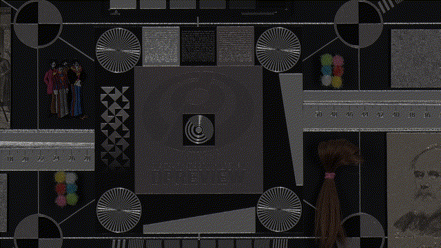

## 研究问题

能否以少量分段线性函数实现足够实用的方向分类？

## 核心方法

分段线性拟合（piecewise linear fit）可用三段直线近似方向分类函数。旧笔记记录的实现思路是用很少的代码完成角度分类；具体误差和边界处理尚未验证。

### 关键图示

## 关键发现

## 我的提问

## 局限与疑问

## 我的判断

## 下次只看这些

1. 用少量分段直线近似角度分类函数，降低实现复杂度。
