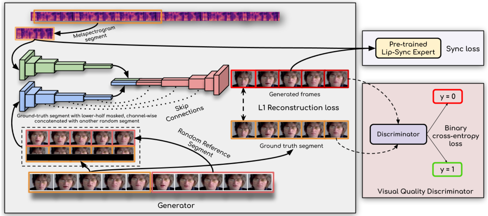
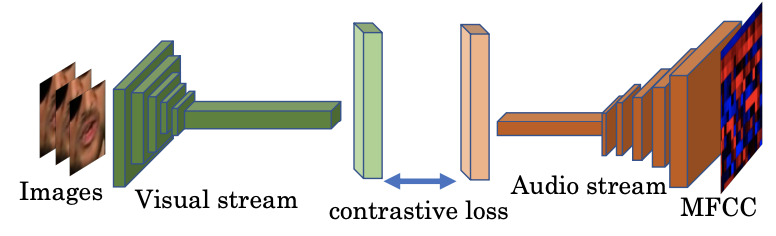
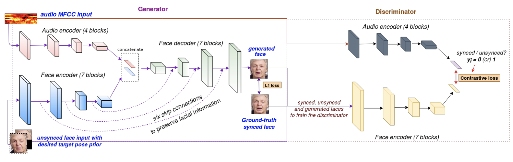

## 研究问题

怎样把任意人物的视频口型调整到新音频，同时维持同步和视觉质量？

## 核心方法

wav2lip的idea是非常自然的，和我思考的结果不谋而合。

首先是输入既有cropout掉嘴部区域的当前帧/序列（desired target pose prior），也需要有相同ID的完整帧/序列（unsynced face input）。

- cropout掉的区域选取整个下半矩形区域（cv2.rectangle），最简单高效。虽然如果是下颌区域分割出来进行mask会更精准，效果可能更好。但这样会增加复杂度。（其实根据关键点，cropout一个小patch会好收敛，但也更可能出现训练集泄漏和过拟合）用identity/sigmoid/tanh和输入的形式关系挺大。
- 其他时序的同ID序列可以提供嘴部的ID。（或许只需要同ID的下半区域，但需要一点overlap）

它的网络组成部分包括一个生成器，两个判别器。

1. 判别器SyncNet：输入$T_v$时间戳的视频序列和$T_a$时间戳的音频序列，$T_a$的时间戳与$T_v$是否对齐构成了真假样本。

   Wav2lip对SyncNet改造，提出了expert lip-sync discriminator，①将输入灰度图改为输入彩色图，②将网络加深并加入残差跳跃连接，③使用另一种损失函数，余弦相似度+BCE。

2. 生成器LipGAN：[Towards automatic face-to-face translation](https://dl.acm.org/doi/abs/10.1145/3343031.3351066), 是Wav2lip同一作者的前序工作。

### 关键图示

## 关键发现

## 我的提问

## 局限与疑问

## 我的判断

## 下次只看这些

1. 用预训练同步专家约束生成器，让任意人脸视频与目标语音更准确对齐。
