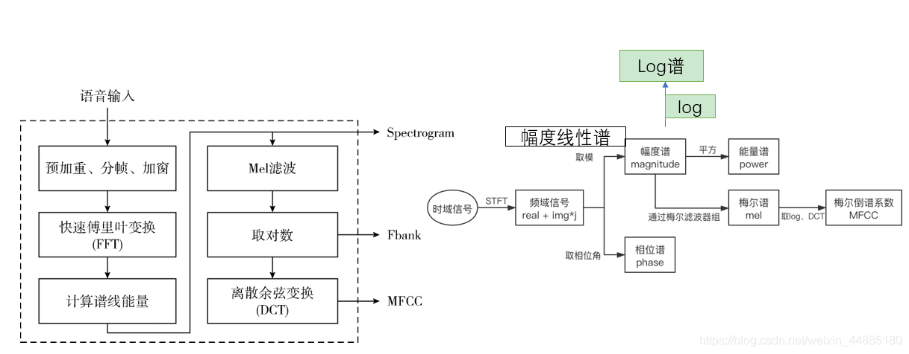

## 研究问题

怎样仅凭音频与口部画面估计视频中的同步偏移？

## 核心方法

Out of time: automated lip sync in the wild

> 音视频同步对于制作者和观众来说是电视广播/电影制作中的一个问题。 在电视中，高达数百毫秒的口型同步误差并不罕见。 如果错误原因在于传输，则视频通常会滞后于音频。 这些错误通常很明显——普通观众的可检测性阈值约为 -125 毫秒（音频滞后于视频）到 +45 毫秒（音频领先于视频）。

音频：

输入音频数据是MFCC值。 这是非线性梅尔频率上声音的短期功率谱的表示。 每个时间步使用 13 个梅尔频带。 这些特征以 100Hz 的采样率计算，为 0.2 秒的输入信号提供 20 个时间步长。

视频：

视觉网络的输入格式是一系列嘴部区域的灰度图像，如图 1 所示。5 帧的输入尺寸为 111×111×5 (W×H×T)，以 25Hz 的帧率计算，为 0.2 秒的输入信号。

> 它取特征的方式值得思考下，一个是音频特征的采样率是视频帧率的4倍。另一个是SyncNet的视觉网络只输入嘴部周围，而不是下半张脸。

SyncNet原版输入是

```python
audio = torch.randn(32, 1, T=5*4, Mel=13).cuda()
video = torch.randn(32, 5, 120, 120).cuda()
```

Wav2Lip版SyncNet输入是

```python
audio = torch.randn(32, 1, Mel=80, T=16=5*16/5).cuda()
video = torch.randn(32, 3*5, 48, 96).cuda()
```

注：SyncNet原版输入是MFCC特征，而Wav2Lip版输入是Mel Spectrogram

[参考](https://blog.csdn.net/weixin_44885180/article/details/115718723)




https://github.com/Rudrabha/Wav2Lip/blob/master/audio.py#L45 实现的这个，和torchaudio.compliance.kaldi.fbank是非常类似的，基本是等价，

> 有些不一致的地方，可以通过参数调整

但kaldi用了一些trick，使得更适合ASR项目。所以只能说几乎等价，但不能做到训推不一致那种替换着用。

> https://librosa.org/doc/main/generated/librosa.stft.html 的center boolean参数值得注意，这个影响了音频特征帧数，也决定用idx:idx+step，还是是idx-radius:idx+radius。

不过训练对数据集的精度要求非常高。尤其要确保AVsync。但real-world的数据集很少有满足要求的，所以要预处理：

>- download dataset
>- convert to 25fps.
>- change sample rate to 16000hz.
>- split video less than 5s.
>- using syncnet_python to filter dataset in range [-3, 3], model works best with [-1,1].
>- detect faces.
>- train expert_syncnet with evaluation loss < 0.25 then you can stop your training
>- train wav2lip model

VoxCeleb的头文件dev_txt有如下信息：

```shell
Identity  : 	id10661
Reference : 	lSI69L4DidQ
Offset    : 	-1 # Offset is about time offset between video and audio
FV Conf   : 	17.997 # FV: Face Verification
ASD Conf  : 	6.338 # ASD: Active Speaker Detection

FRAME 	X 	Y 	W 	H
002316 	223 	80 	130 	130
002317 	223 	80 	130 	130
002318 	218 	75 	130 	130
002319 	213 	71 	130 	130
```

要针对这个Offset做一些音视频对齐的调整。

AVSync要求高，主要是负样本的选取：

wav2lip里，v差一帧：https://github.com/Rudrabha/Wav2Lip/blob/master/color_syncnet_train.py#L79

lipgan里，mfcc差10帧，相当于v差3帧左右，https://github.com/Rudrabha/LipGAN/blob/master/train.py#L136

## 关键发现


## 我的提问


## 局限与疑问


## 我的判断


## 下次只看这些

1. 学习音频和嘴部视频的共同嵌入空间，用于估计音视频同步偏移。
1. 有潜力用于Active Speaker Detection (ASD)、Lip Reading、Dubbing等下游任务。
