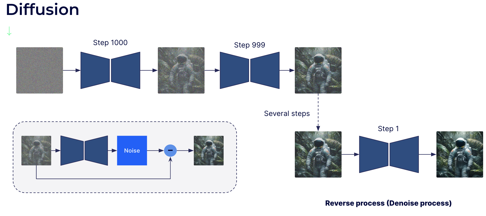
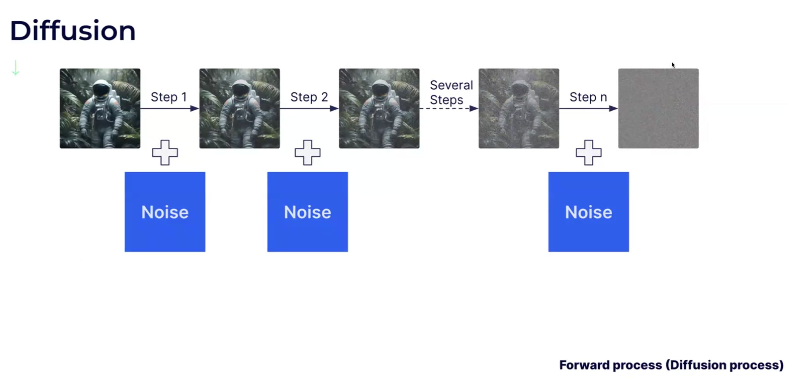
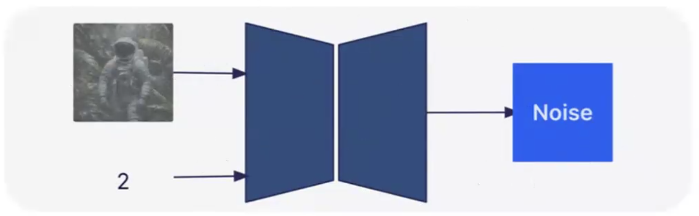
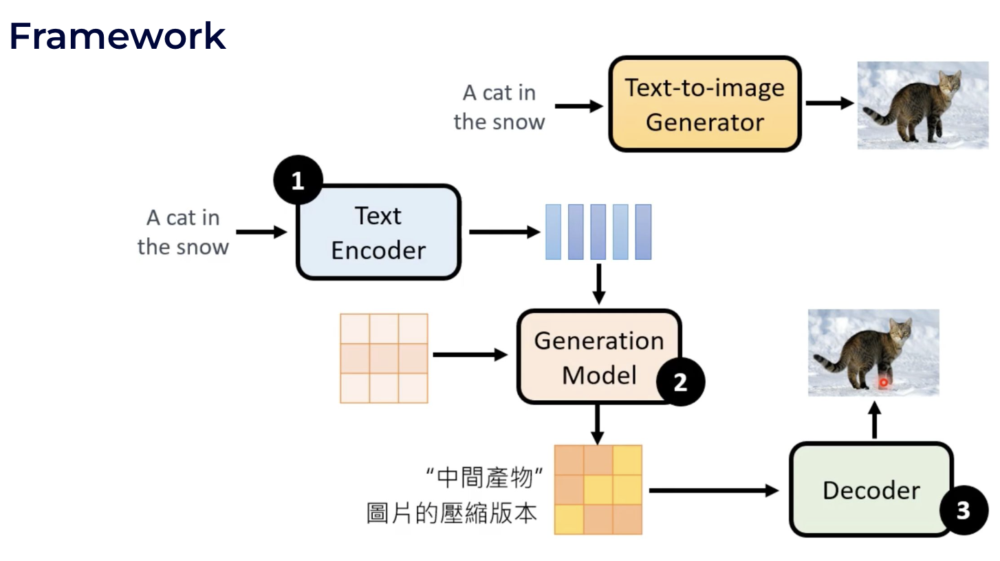
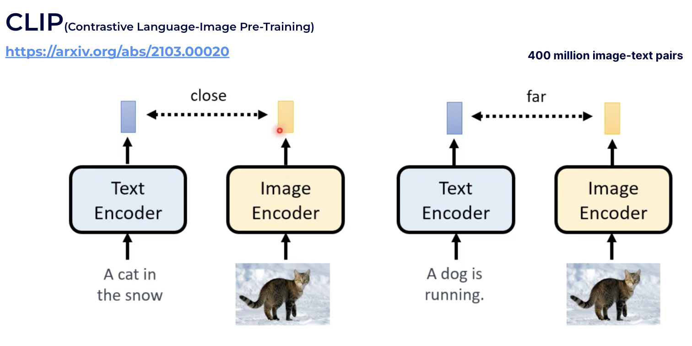
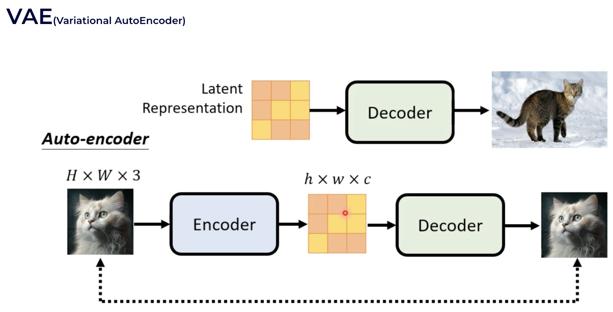
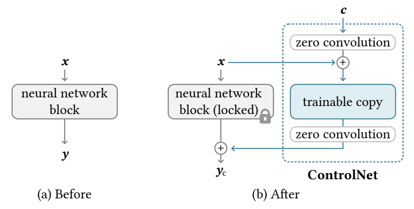
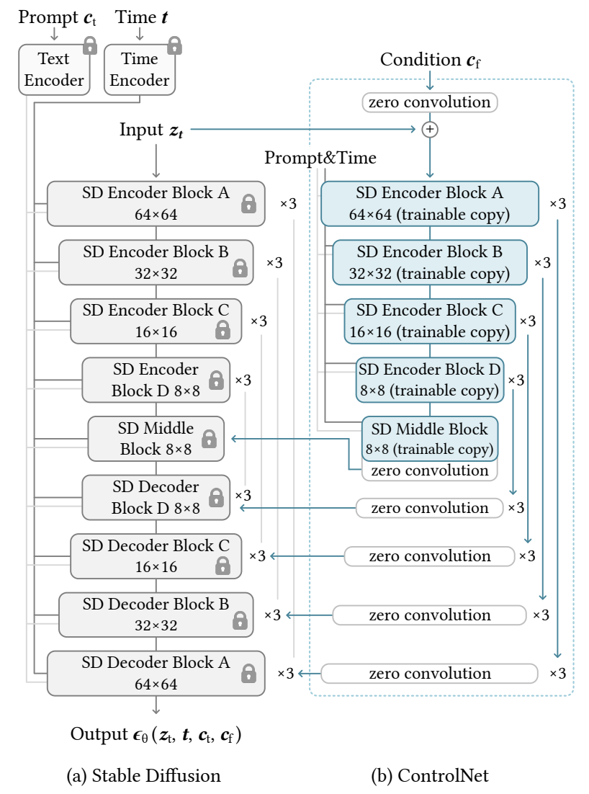

## 研究问题

旧笔记按方法演进梳理文生图：扩散模型怎样兼顾生成质量、计算成本、文本对齐、可控性和推理速度？这是一篇多论文学习综述，不是单篇论文的实验复现。

## 核心方法

| 阶段 | 关键改变 | 回看原文 |
| --- | --- | --- |
| DDPM | 在像素空间学习噪声预测，逆向多步生成 | [DDPM 笔记](2023-02-08-ddpm.md) / [原论文](https://arxiv.org/abs/2006.11239) |
| LDM / Stable Diffusion | 先用自编码器压缩图像，在潜空间扩散；以交叉注意力注入文本等条件 | [LDM](https://arxiv.org/abs/2112.10752) |
| SDXL | 更大的 U-Net、两个文本编码器、尺寸与裁剪条件、后续 refiner | [SDXL](https://arxiv.org/abs/2307.01952) |
| ControlNet | 冻结预训练骨干，另接条件分支和零初始化卷积，接收边缘、深度、姿态等空间条件 | [ControlNet](https://arxiv.org/abs/2302.05543) |
| LCM | 蒸馏潜空间的一致性映射，减少推理步数 | [LCM](https://arxiv.org/abs/2310.04378) |
| DiT | 用 Transformer 替代常见的 U-Net 去噪骨干，在潜变量 patch 上建模 | [DiT](https://arxiv.org/abs/2212.09748) |

旧笔记中的三段式理解是：**文本编码器**产生条件，**生成模型**在潜空间迭代去噪，**自编码器解码器**把潜变量还原为图像。它适合解释 LDM/Stable Diffusion 系列，不应套到所有文生图系统。像素扩散、级联生成及其他条件方式仍存在。

### 控制与加速的不同位置

ControlNet 解决“文字说不清空间布局”的问题：边缘、深度和人体姿态作为额外条件进入去噪网络。旧稿将零卷积视作安全接入预训练主干的机制；更准确地说，它让新分支初始输出为零，随后逐步学习条件残差，不能保证完全避免遗忘或过拟合。

LCM 和采样器主要针对**迭代次数**；DiT 针对**去噪骨干**；SDXL 更侧重**模型容量与条件设计**。这几条优化轴彼此独立，可以组合讨论。

### 原笔记逐节学习记录

以下按旧笔记的原有顺序保留推导、解释、代码片段与图示。前面的概览供快速回顾；这一节用于完整复习。代码片段保持原笔记的教学语境，未作为可运行示例重新验证。

按论文的进化顺序来介绍

###### DDPM

DDPM是比较早的diffusion模型，奠定了基础框架，主要做生成任务，不涉及跨模态。

可以看到生成任务是通过去噪完成的，在N个step里渐步地预测噪声，来进行去噪。这在扩散模型里也称为逆过程（去噪过程）。

> 它的速度比较慢，比现在的stable diffusion慢很多，因为它是直接在图像空间的一个降噪。

至于step怎么取，论坛里基于数学推导和经验，贡献了五花八门不少的sampler。一般是递减的，也有复杂、经过精巧设计的。

> sampler是预测降噪比较好的一组steps。例如

正向过程是逐步地加高斯噪声。

逆过程降噪如果一步一步会很慢，所以网络也接收step的一个编码，可以理解成降噪的强度：

> 1. training：最终训练的过程便是 GT + t step noise 和 t 作为输入，和 GT形成数据对。t在1000 (max)以内随机选取。
> 2. inference：纯噪声 和 1000 (max )step 输入网络，并不能一次得到理想的图像。这与其他的优化过程类似，1步很可能只能到一个局部最优点。大部分sampler都需要20～50步。
> 3. about sampler：比如sampler是[1000, 800, 700, 660, ...]，每步输入的step是[200, 100, 40, ...]的一个编码，逐步去噪。步长一般由大到小。
> 4. 目前大部分sampler都是纯基于数学规则的，并没有自适应性，这也是由于没有很好的图像质量评价。但这也是未来一个很好的研究方向。

###### Latent Diffusion Models

是Stable Diffusion主要基于的论文，在跨模态和降低复杂度方面有贡献。它的训练数据集是LAION，大小有5.85B。

它的文生图模型主要分为三部分：

1. text encoder，目前就是CLIP系列
2. generation model，就是用的扩散模型
3. (VAE) decoder，从压缩形态还原高清图片
4. 一般工程上CLIP text encoder是frozen的不会去动它，SD generation model可以finetune，VAE则可以重新设计和训练。

**text encoder (CLIP)**

是OpenAI的工作，text-visual 多模态领域很多都用到CLIP的能力。

**VAE**

图像压缩部分。和DDPM生成图片不同，SD中的扩散模型是生成latent space（VAE encoder得到的紧凑压缩空间）的表征。最后再经过VAE decoder得到图片。

> 1. **SD的扩散过程是用cross attention来在text embedding的条件下，从纯噪声生成latent space。**
> 2. 不同版本的SD，SD/SD2.0/SDXL主要是模型参数量上有差距。
> 3. 谷歌的Imagen和OpenAI的DallE，和SD结构上略有不同。但它们的组成部分中，CLIP和扩散模型也是必需的。
>    1. Imagen的扩散过程不是在latent space，而是直接生成64x64的低分辨率图像，再经过两个做超分的扩散模型。
>    2. DallE的扩散过程也不是在latent space，而是生成CLIP里的img embedding，再经过(diffusion model based) img decoder得到图片。
> 4. SD受关注，主要是由于它是开源的。DallE效果也很好，它有些trick比如prompt生成器，从用户输入的粗糙的prompt得到一个高质量prompt。（我的idea：结合Q-Align和AGI-IQA的模型来训练prompt生成器）

###### SDXL

对latent diffusion models效果上进行优化，比较有代表性的落地的工作。

1. 结构上，对扩散模型中UNe增加了参数量；增加cross-attetion所用的transformer blocks的数目（这也是由于第2点，用了两个文本编码器）。

2. text encoder利用了两个版本的CLIP，将text embedding concat在一起。文本的编码能力更强。

3. 原先SD的扩散过程相当于有两个条件：step和text embedding。最终经过VAE decoder生成图像都是512x512的（那时训练集是固定crop成512x512的）。但这满足不了大多数用户需求。SDXL将img size也作为条件加入，支持生成给定分辨率的图。进一步也可以把crop的参数作为条件加入。

   > size和step类似，也是用postion embedding。

4. VAE训练用了更大的batchsize，并且用了EMA。训练出来指标好很多。

5. 用了两阶段方法，即引入一个Refiner。

Refiner，是借鉴eDiff-I这篇。eDiff-I发现的现象：

> 1. 前面采样倾向处理低频信息，后面采样处理高频信息
>
> 2. 前面采样更依赖文本条件，后面则做些细节上的优化
>
>    在采样早期，生成强烈依赖于文本提示来生成文本对齐的内容，而后来，文本条件几乎完全被忽略，并且任务转变为生成高视觉保真度的输出。

这表明，在整个生成过程中共享模型参数（文献中的标准做法）对于最好地捕获这些截然不同的生成过程模式可能并不理想。

因此，与现有的工作相比，eDiff-I建议训练专门针对不同合成阶段的文本到图像扩散模型的集合。 为了保持训练效率，它首先训练单个模型，然后逐步将其拆分为专门的模型，并针对迭代生成过程的特定阶段进一步训练。

###### ControlNet

这篇论文思路比较顺畅，也比较直觉。

动机：普通的提示语控制（prompt-based）是否满足我们实际的生产需求？不太够的，一方面文本很难彻底描述清楚想法，另一方面模型本身的理解能力没有那么强。

待解决问题：

1. 什么样的框架可以更大范围支持各种条件和用户控制（如sketch、depth map、canny edge、human pose）

2. 大模型可以保持其优点吗？

   > 直接在大模型上finetune中可能造成灾难性遗忘（overfitting）。

**网络结构**

作者提出的方法非常简单，利用了Zero convolution（权重和偏置都初始化为零的 1×1 卷积），下面x→y可以理解是扩散模型一次降噪的过程：

具体到UNet网络结构部分，展开会是这样：

从这里可以看出，ControlNet模型大小大概会是原SD模型1.5倍的样子。

由于SD是Latent Diffusion Model，实际是在分辨率比较小（64×64）的隐空间进行扩散过程的。所以ControlNet没有画出来的一点是也用了个小的下采样网络将condition下采样到和latent同样的size（512×512 to 64×64）。

**训练方式**

1. 训练目标和SD一致
2. 以50%的概率将text prompt置零（空字符串）
3. 发现训练过程中有突然收敛（sudden convergence）的现象

> 这篇论文还是每个条件（如sketch、depth map、canny edge、human pose） 单独训练。后面有一篇Uni-ControlNet可以支持多条件。

###### LCM

Score-based generative modeling through stochastic

###### DiT

###### DPO

Direct Preference Optimization

###### Sampler

https://www.youtube.com/watch?v=ZnzoSkRFrQc

第一类 - 老派采样器

- ~~DDIM、PLMS~~（SD第一版就提出的最早的采样算法，已过时）

- Euler a、Euler、Heun、LMS、LMS Karras 都是经典的ODM求解器 ，只保留介绍最经典的代表即可，最稳妥是Euler和Euler a。

  - 其中Euler简单直接，不容易出错
  - Heun是Euler的改进算法，画质更好但速度慢一倍
  - LMS是线性多步法，理论上不错但实测没Euler稳定，容易出色块

- Euler & Euler a

  - （Euler a）a代表祖先采样器，画面不能收敛。

    > 这一类祖先采样器，在每一步采样步骤中，都会向图像添加随机噪声。于是每一步采样的画面都会有一点点随机性。随着采样步骤的增加，它的画面或多或少会有一些变化，这就是不收敛。

  - （Euler）可收敛则表示随着采样步数的增加，最终会趋向于一个固定的定性画面。

    > 收敛的好处是画面稳定，向着目标画面生成。
    >
    > 不收敛的好处为画面带来一些随机的细节。

第二类 - DPM采样器

根据2022年发布的DPM算法，也是用得最多的采样器。此后stable diffusion绝大部分都是DPM算法。

-

## 关键发现

- 原稿认为像素空间 DDPM 的高分辨率生成成本较高，LDM 用有损潜空间压缩降低计算量；代价是最终细节也受自编码器影响。
- SDXL 原论文明确描述更大 U-Net、双文本编码器、额外尺寸条件和 refiner。原稿关于“所有 Stable Diffusion 版本只是参数量不同”的概括过宽，应回到具体版本比较。
- 旧稿把 Euler、Heun、DPM 等采样器放在同一演进图里；它们改变数值求解和随机性，不能仅按“新旧”决定优劣。比较时应固定模型、提示词、步数与评价标准。

## 我的提问

## 局限与疑问

- 旧稿的 LCM、DiT、DPO 部分只有标题或术语，尚不足以形成实验结论；DPO 与这里的图像采样器也不是同一层问题。
- “早期采样偏结构、后期采样偏细节”在旧稿中来自 [eDiff-I](https://arxiv.org/abs/2211.01324) 的讨论，可作研究线索，不能推广为所有模型的严格定律。

## 我的判断

未来比较文生图系统时，分开记 **表示空间、条件注入、去噪骨干、采样器** 四个维度。最值得继续细读的是 LDM 的压缩取舍，以及 ControlNet 的条件分支为何能有效利用预训练能力。

## 下次只看这些

1. DDPM → LDM：从像素去噪转向潜空间去噪。
2. SDXL、ControlNet、LCM、DiT 分别改进容量/条件、空间控制、步数、骨干。
3. 采样器比较需要同等条件，不能只按流行程度排序。
