## 研究问题

旧笔记想弄清：为什么 U-Net 预测从 $x_0$ 到 $x_t$ 的噪声，却能执行单步 $x_t\to x_{t-1}$ 的反向采样？本篇是 [DDPM 原论文](https://arxiv.org/abs/2006.11239) 的独立推导伴读，侧重数学步骤；总体机制和实现线索见 [DDPM 主笔记](2023-02-08-ddpm.md)。原笔记还参考了[扩散模型数学教程](https://shao.fun/blog/w/how-diffusion-models-work.html)及开源实现。

## 核心方法

### 1. 由单步扩散得到闭式加噪

令 $\alpha_t=1-\beta_t$、$\bar\alpha_t=\prod_{s=1}^{t}\alpha_s$，独立噪声 $\epsilon_t\sim\mathcal N(0,I)$。单步过程

$$
x_t=\sqrt{\alpha_t}x_{t-1}+\sqrt{\beta_t}\epsilon_t
$$

反复代入并合并独立高斯项，得到

$$
q(x_t\mid x_0)=\mathcal N(\sqrt{\bar\alpha_t}x_0,(1-\bar\alpha_t)I).
$$

于是训练时可直接抽 $\epsilon\sim\mathcal N(0,I)$ 并算 $x_t=\sqrt{\bar\alpha_t}x_0+\sqrt{1-\bar\alpha_t}\epsilon$。

### 2. 已知 $x_0$ 时的后验

注意后验必须写作 $q(x_{t-1}\mid x_t,x_0)$，而非把未知 $x_0$ 消掉的 $q(x_{t-1}\mid x_t)$。由马尔可夫性和贝叶斯公式：

$$
q(x_{t-1}\mid x_t,x_0)\propto
q(x_t\mid x_{t-1})q(x_{t-1}\mid x_0).
$$

右边是两个关于 $x_{t-1}$ 的高斯因子。配方后，后验方差与均值分别为

$$
\tilde\beta_t=\frac{1-\bar\alpha_{t-1}}{1-\bar\alpha_t}\beta_t ,
$$

$$
\tilde\mu_t(x_t,x_0)=
\frac{\sqrt{\bar\alpha_{t-1}}\beta_t}{1-\bar\alpha_t}x_0+
\frac{\sqrt{\alpha_t}(1-\bar\alpha_{t-1})}{1-\bar\alpha_t}x_t .
$$

这里“已知 $x_0$”只在训练分析中成立；真实生成时没有 $x_0$。

### 3. 用预测噪声代替未知真图

闭式加噪可反解出 $x_0=(x_t-\sqrt{1-\bar\alpha_t}\epsilon)/\sqrt{\bar\alpha_t}$。将其代入 $\tilde\mu_t$，并把真噪声换成 U-Net 的 $\epsilon_\theta(x_t,t)$，化简为

$$
\mu_\theta(x_t,t)=\frac{1}{\sqrt{\alpha_t}}
\left(x_t-\frac{\beta_t}{\sqrt{1-\bar\alpha_t}}\epsilon_\theta(x_t,t)\right).
$$

采样时取 $x_{t-1}=\mu_\theta(x_t,t)+\sigma_t z$，$z\sim\mathcal N(0,I)$；末步通常不再加噪。原 DDPM 的方差选择与后来采样器的选择应分开看，不能把 $\tilde\beta_t$ 当成所有采样器唯一合法的 $\sigma_t^2$。

### 4. 从变分目标到噪声损失

最小化负对数似然的变分上界可拆成终端先验项、各步后验与模型反向分布的 KL 项、以及重建项。在固定方差参数化下，逐步 KL 的可优化部分成为带时间权重的噪声均方误差。原论文采用更简洁的重加权形式：

$$
\mathcal L_{\mathrm{simple}}
=\mathbb E_{t,x_0,\epsilon}
\|\epsilon-\epsilon_\theta(x_t,t)\|_2^2 .
$$

所以“预测噪声”既方便构造训练监督，也对应反向均值的参数化；它本身并不保证生成多样性。


### 原笔记逐节学习记录

以下按旧笔记的原有顺序保留推导、解释、代码片段与图示。前面的概览供快速回顾；这一节用于完整复习。代码片段保持原笔记的教学语境，未作为可运行示例重新验证。

##### DDPM介绍

（余济闻师弟  研究领域AIGC-related Applications & Generation Models）

推荐阅读：[扩散模型是如何工作的：从零开始的数学原理](https://shao.fun/blog/w/how-diffusion-models-work.html#%E9%80%9A%E8%BF%87%E9%9A%8F%E6%9C%BA%E5%BE%AE%E5%88%86%E6%96%B9%E7%A8%8B-sde-%E8%BF%9B%E8%A1%8C%E5%9F%BA%E4%BA%8E%E8%AF%84%E5%88%86%E7%9A%84%E7%94%9F%E6%88%90%E6%80%A7%E5%BB%BA%E6%A8%A1)

###### 1-0 前置知识

1. Markov：当前位置的概率只会受前一时刻概率影响

2. 正态分布（高斯分布）叠加性

   $E(N1+N2) = \mu_1 + \mu_2$​

   $Var(N1+N2) = \sigma^2_1 + \sigma^2_2$

3. 贝叶斯

   $P(A|B) = \frac{P(B|A)P(A)}{P(B)}$​

   给定条件C下的贝叶斯

   $P(A|B,C)=\frac{P(B|A,C)P(A|C)}{P(B|C)}$

###### 1-1 概述

扩散模型相比GAN的优势是：训练难度（调参）、训练的稳定性、损失函数的简易程度（损失的指向性、可观测性）等方面。

###### 1-2 扩散阶段


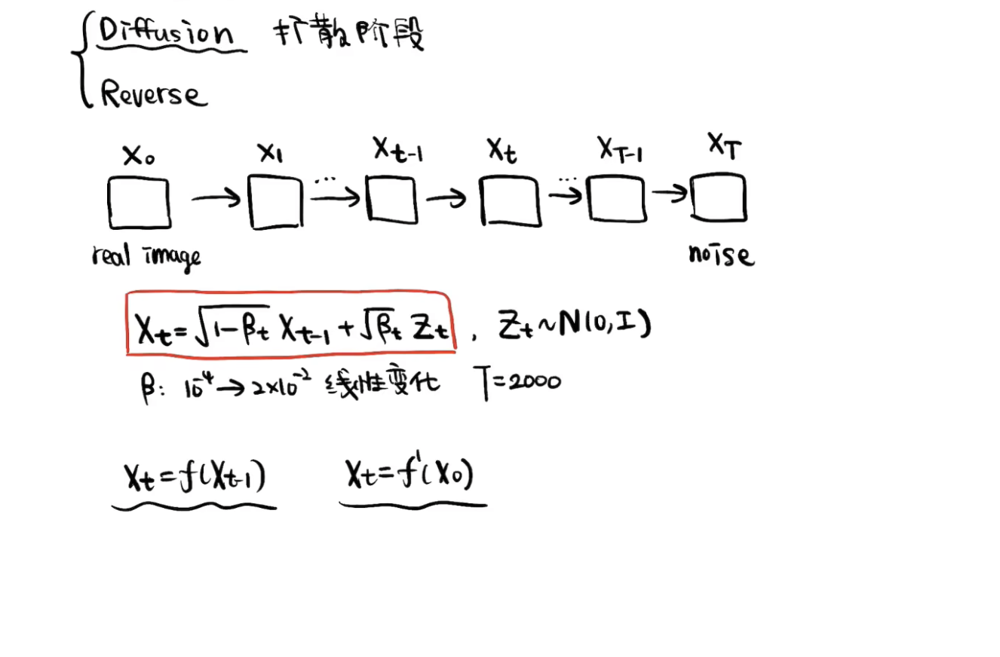


首先，$X_{t-1}$到$X_t$​的加噪公式是：

**$X_t = \sqrt{1-\beta_t}X_{t-1} + \sqrt{\beta_t}Z_t,$**    $$Z_t \sim N(0,I)$$

- 可想而知，$\beta$是逐渐变大的，因为干净图像加一点噪声就有明显变化，但后期已经被比较大的噪声扰动的图像必须加很大的噪声才能有明显变化。
- T也要足够大，才能得到完全的噪声图。

构造$X_t=f^\prime (X_0)$，希望一步加噪声，从干净图像得到$X_t$​，推导：


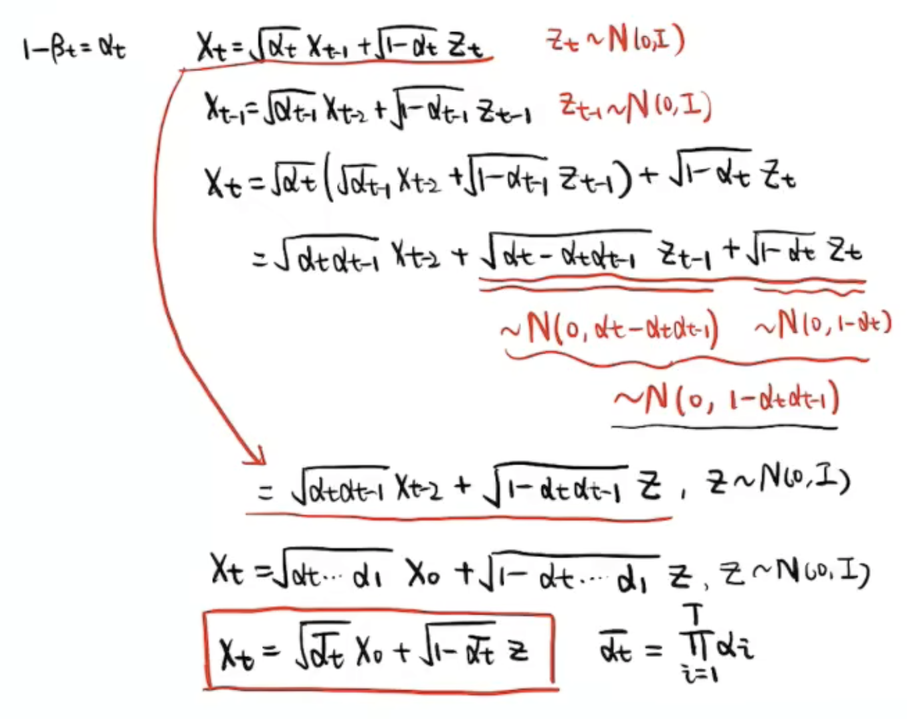


通过公式代入，推导一次$X_t$和$X_{t-2}$的关系，可以找到规律/归纳法得到$X_t=f^\prime (X_0)$​：

>  [!IMPORTANT]
>
> ****核心公式**** **$X_t = \sqrt{\bar{\alpha_t}} X_0 + \sqrt{1 - \bar{\alpha_t}}Z$,  $\bar{\alpha_t}=\prod_{i=1}^{t}\alpha_i$**

$X_t=f^\prime (X_0)$使得我们获取某一步的扩散数据变得非常方便。

> $X_T = \sqrt{\bar{\alpha_T}} X_0 + \sqrt{1 - \bar{\alpha_T}}Z$，而$X_T \approx Z$​ 是完全的噪声图。所以，实际上我们 $\beta_t$ 的设计和 $T$ 的选择需要保证$\bar{\alpha_T} \approx 0$。

逆过程再通过神经网络将噪声 $Z$ 估计出来，进行**去噪**：

$X_0 = \frac{X_t - \sqrt{1 - \bar{\alpha_t}}\tilde{Z}}{\sqrt{\bar{\alpha_t}}}$

但实际推理时，真实的reverse过程没法这么做，因为从完全的噪声图直接得到$X_0$​是困难的，步数过少的reverse也是比较模糊的。

> 重建的过程是一步一步推的，效果比较好。

###### 1-3 重建阶段（上）

前面知道，重建的公式是：$X_0 = \frac{1}{\sqrt{\bar{\alpha_t}}}({X_t - \sqrt{1 - \bar{\alpha_t}}\tilde{Z}})$​

能估计噪声 $\tilde{Z}$ 的神经网络UNet是如下的训练流程：


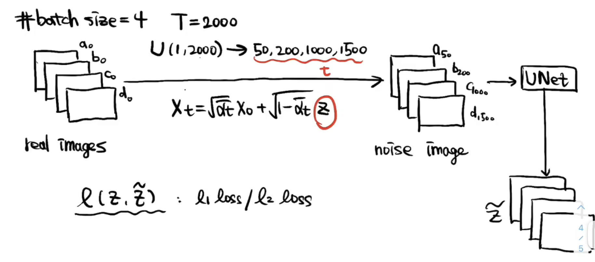


但是一步到位的重建的效果会差、很模糊。我们需要得到一步一步重建的公式：


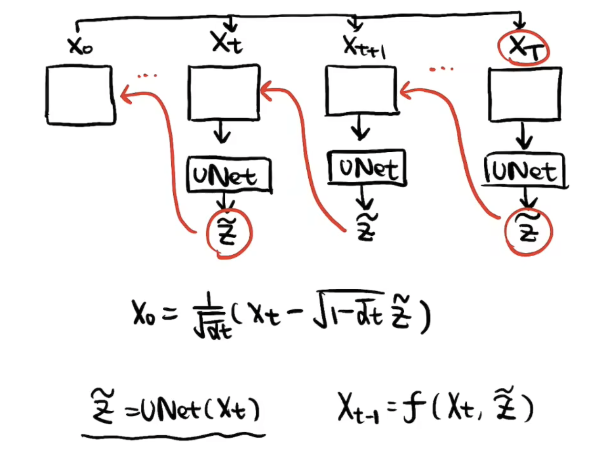


###### 1-4 重建阶段（下）

上面提到我们训练了一个UNet可以将加的噪声采样估计出来。写得再准确一点呢，这个UNet的输入还有t，因为不同的$X_t$，它的噪声强度是不一样的。所以实际上是一个**条件去噪过程**。

$\tilde{Z} = UNet(X_t, t)$

虽然两个变量可以逆变换，

$X_{t-1} = \frac{1}{\sqrt{\alpha_t}}(X_t - \sqrt{1-\alpha_t}Z_{t-1→t})$

但可能因为这里的$Z_{t-1→t}$是$X_{t-1}$到$X_t$加的噪声，而我们训练时都是$X_0$到$X_t$直接加噪（更方便训练收敛）。UNet预测的是$\tilde{Z}_{0→t}$而不是$\tilde{Z}_{t-1→t}$，所以**reverse过程没法简单的进行公式逆变换。而是要推导构造出$\tilde{Z}_{0→t}$。**

已知

$q(X_t|X_{t-1}) \sim N(\sqrt{\alpha_t}X_{t-1}, (1-\alpha_t)I)$​​​

$q(X_{t-1}) \sim N(\sqrt{\bar{\alpha}_{t-1}}X_0, (1-\bar{\alpha}_{t-1})I)$

$q(X_t) \sim N(\sqrt{\bar{\alpha}_t}X_0, (1-\bar{\alpha}_t)I)$​

$N(\mu, \sigma^2) \propto exp(-\frac{1}{2}\frac{(x - \mu)^2}{\sigma^2})$

让我们推一下：

$q(X_{t-1}|X_t)=\frac{q(X_{t-1},X_t)}{q(X_t)}=\frac{q(X_t|X_{t-1})q(X_{t-1})}{q(X_t)}=\frac{q(X_t|X_{t-1},X_0)q(X_{t-1}|X_0)}{q(X_t|X_0)}=\frac{q(X_t|X_{t-1})q(X_{t-1}|X_0)}{q(X_t|X_0)}$

> 这里$q(X_t|X_0,X_{t-1})$可以写为$q(X_t|X_{t-1})$，是因为马尔可夫性质，$X_t$时刻只和$X_{t-1}$有关。

$\propto exp(-\frac{1}{2}(\frac{(X_t-\sqrt{\alpha_t}X_{t-1})^2}{1-\alpha_t} + \frac{(X_{t-1}-\sqrt{\bar{\alpha}_{t-1}}X_0)^2}{1-\bar{\alpha}_{t-1}} - \frac{(X_t-\sqrt{\bar{\alpha}_t}X_0)^2}{1-\bar{\alpha}_t}))$​

我们最希望构造出$exp(-\frac{1}{2}\frac{(x - \mu)^2}{\sigma^2})$，其中$x$是这里的$x_{t-1}$

$\propto exp(-\frac{1}{2}((\frac{\alpha_t}{\beta_t}+\frac{1}{1-\bar{\alpha}_{t-1}})x^2_{t-1} - 2(\frac{\sqrt{\alpha_t}x_t}{\beta_t}+\frac{\sqrt{\bar{\alpha}_{t-1}}x_0}{1-\bar{\alpha}_{t-1}}) x_{t-1} + C))$

$\propto exp(-\frac{1}{2}(Ax^2_{t-1} +Bx_{t-1} + C))$​

$\propto exp(-\frac{1}{2}(A(x_{t-1} +\frac{B}{2A})^2 + C'))$

$\therefore \mu=-\frac{B}{2A}, \sigma^2=\frac{1}{A}$

其中$A=\frac{\alpha_t}{\beta_t}+\frac{1}{1-\bar{\alpha}_{t-1}}， B=- 2(\frac{\sqrt{\alpha_t}x_t}{\beta_t}+\frac{\sqrt{\bar{\alpha}_{t-1}}x_0}{1-\bar{\alpha}_{t-1}})$​

**$\sigma^2 = \frac{1}{A} = 1/(\frac{\alpha_t-\alpha_t\bar{\alpha}_{t-1}+\beta_t}{\beta_t(1-\bar{\alpha}_{t-1})}) = \frac{\beta_t(1-\bar{\alpha}_{t-1})}{1-\bar{\alpha}_t}$​**

> 我们可以发现**方差**实际是由$\alpha_t$、$\beta_t$组合而来，所以方差是确定的

$\mu = -\frac{B}{2A} = -\frac{\beta_t(1-\bar{\alpha}_{t-1})}{2(1-\bar{\alpha}_t)} * - 2(\frac{\sqrt{\alpha_t}x_t}{\beta_t}+\frac{\sqrt{\bar{\alpha}_{t-1}}x_0}{1-\bar{\alpha}_{t-1}}) = \sqrt{\alpha_t}\frac{1-\bar{\alpha}_{t-1}}{1-\bar{\alpha}_t}x_t + \sqrt{\bar{\alpha}_{t-1}}\frac{\beta_t}{1-\bar{\alpha}_t}x_0$

由于$X_0$是未知的，我们继续代入$X_0 = \frac{X_t - \sqrt{1 - \bar{\alpha_t}}\tilde{Z}_{0→t}}{\sqrt{\bar{\alpha_t}}}$，只留下先验$X_t$，和UNet预测的是$\tilde{Z}_{0→t}$​：

> 前面是为了以示区分，我们后面就将$\tilde{Z}_{0→t}$简称$\tilde{Z}$

$\mu = \sqrt{\alpha_t}\frac{1-\bar{\alpha}_{t-1}}{1-\bar{\alpha}_t}X_t + \sqrt{\bar{\alpha}_{t-1}}\frac{\beta_t}{1-\bar{\alpha}_t}\frac{X_t - \sqrt{1 - \bar{\alpha_t}}\tilde{Z}}{\sqrt{\bar{\alpha_t}}}$​

$ = \sqrt{\alpha_t}\frac{1-\bar{\alpha}_{t-1}}{1-\bar{\alpha}_t}X_t + \frac{\beta_t}{(1-\bar{\alpha}_t)\sqrt{\alpha_t}}X_t - \frac{\beta_t}{\sqrt{\alpha_t} \sqrt{1-\bar{\alpha}_t}}\tilde{Z}$

$= \frac{\alpha_t -\alpha_t\bar{\alpha}_{t-1} +\beta_t}{(1-\bar{\alpha}_t)\sqrt{\alpha}_t}X_t - \frac{\beta_t}{\sqrt{\alpha_t} \sqrt{1-\bar{\alpha}_t}}\tilde{Z}$

$= \frac{1-\bar{\alpha}_t}{(1-\bar{\alpha}_t)\sqrt{\alpha}_t}X_t - \frac{\beta_t}{\sqrt{\alpha_t} \sqrt{1-\bar{\alpha}_t}}\tilde{Z}$

**$= \frac{1}{\sqrt{\alpha}_t}(X_t - \frac{\beta_t}{\sqrt{1-\bar{\alpha}_t}}\tilde{Z})$**

> 我们发现**均值**经过推导可以得到$X_t$和$\tilde{Z}$​的一个线性组合，一个比较简洁的形式。

总结一下，$q(X_{t-1}|X_t)$服从：

**$q(X_{t-1}|X_t) \sim N(\frac{1}{\sqrt{\alpha}_t}(X_t - \frac{\beta_t}{\sqrt{1-\bar{\alpha}_t}}\tilde{Z}), \frac{\beta_t(1-\bar{\alpha}_{t-1})}{1-\bar{\alpha}_t})$​**

即

**$X_{t-1} = \frac{1}{\sqrt{\alpha}_t}(X_t - \frac{\beta_t}{\sqrt{1-\bar{\alpha}_t}}\tilde{Z}) +  \sqrt{\frac{\beta_t(1-\bar{\alpha}_{t-1})}{1-\bar{\alpha}_t}}Z$**

> 1. 方差的部分实际上是从标准正态分布采样的
> 2. 最后$X_1$到$X_0$这步是不加后面一项噪声的。前面的$T-1$

$\tilde{Z} = UNet(X_t, t)$，$Z \sim N(0, I)$

> Tips：每一次$X_t$到$X_{t-1}$​的去噪过程，还要再加一个新的噪声。这也是希望在它整个reverse过程中增加一些不确定性。实际上整个reverse过程也是想模拟一个分子热运动的布朗运动的过程：**每一步既有确定性的部分，也有随机的扰动**。
>
> Q：为什么UNet预测噪声，而不是直接预测$X_{t-1}$
>
> 一方面UNet预测噪声比预测图像更容易，另一方面如果是预测图像就形成了Deterministic的过程，失去多样性，最后一方面，论文将变分下界（Variational LB）作为优化目标。

###### 1-5 整理总结

1.Diffusion（扩散阶段）

$X_t \sim N(\sqrt{\alpha_t} X_{t-1}, (1-\alpha_t)I)$​

$X_t \sim N(\sqrt{\bar{\alpha_t}} X_0, (1-\bar{\alpha}_t)I)$

$X_t = \sqrt{\alpha_t} X_{t-1} + \sqrt{1 - \alpha_t}Z_t$

$X_t = \sqrt{\bar{\alpha_t}} X_0 + \sqrt{1 - \bar{\alpha_t}}Z$​​

> $\alpha_t$都是我们预先设定好的数值，$Z_t$是我们从标准正态分布里采样的一个噪声。然后由于一步一步加噪不够高效，我们经过一番推导得到从$X_0$直接推任意$X_t$的退化公式。然后$X_t$本身也可以写成正态分布。

2.Reverse（重建阶段）

$X_{t-1} = f(X_t, UNet(X_t, t)) = f(X_t, \tilde{Z})$

$X_{t-1} = \frac{1}{\sqrt{\alpha}_t}(X_t - \frac{\beta_t}{\sqrt{1-\bar{\alpha}_t}}\tilde{Z}) +  \sqrt{\frac{\beta_t(1-\bar{\alpha}_{t-1})}{1-\bar{\alpha}_t}}Z$​

> - 推导过程的前置知识$X = \mu + \sigma Z \sim N(\mu, \sigma^2I)$​，也属于一种重参数技巧。
> - 先验 & 后验，已知 & 未知 & 估计。
> - $\mu = \sqrt{\alpha_t}\frac{1-\bar{\alpha}_{t-1}}{1-\bar{\alpha}_t}x_t + \sqrt{\bar{\alpha}_{t-1}}\frac{\beta_t}{1-\bar{\alpha}_t}x_0$​
>   - $t$越小，$\tilde{Z}_{0→t}$（对$x_0$​​的估计）是越来越准的。
>   - $x_t$和$x_0$加权，$x_t$的权重越来越小，$x_o$​的估计越来越准，其权重也越来越大。
>   - 可以把扩散过程理解为$x_T$，$\tilde{x}_{0@T}$，$\tilde{x}_{0@(T-1)}$，...，$\tilde{x}_{0@1}$的一个加权，只不过$x_T$​这个完全的噪声，它的权重非常小。


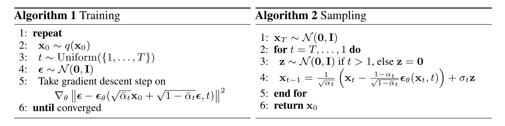


> 这里添加的扰动$\sigma_tZ$，$\sqrt{\frac{\beta_t(1-\bar{\alpha}_{t-1})}{1-\bar{\alpha}_t}}$只是适合采用的$\sigma_t$的上界，实际小一点，极端来说一直为 $0$​不扰动也是可以的。

以上的流程和公式已经比较详尽了，足以手撸DDPM的训练代码。

###### 1-6 代码实现

>  [!NOTE]
>
> 只讲关键部分的代码实现，可以一定程度上减轻复现或者读懂代码的难度。

- 比较简单的玩具代码：https://github.com/abarankab/DDPM
- 比较实用的代码：https://github.com/Janspiry/Image-Super-Resolution-via-Iterative-Refinement

> 扩散模型实际的代码实现非常简单，进而会让人感叹为什么这样一个简单的设计能够达到这么好的生成效果。

为了复现DDPM，我们需要考虑哪些细节问题？

（1）alpha、beta这些预先定义好的参数怎么获得？

https://github.com/abarankab/DDPM/blob/main/ddpm/diffusion.py

```python
# 这个函数提供betas
def generate_linear_schedule(T, low, high):
    return np.linspace(low, high, T)
```

```python
# $alpha_t$
alphas = 1.0 - betas
# $\bar{\alpha}_t$
alphas_cumprod = np.cumprod(alphas)
'''
partial（偏函数）：把一个函数的某些参数给固定住（也就是设置默认值），返回一个新的函数，调用这个新函数会更简单
'''
# 定义一个函数将任何的numpy array转换为pytorch tensor
to_torch = partial(torch.tensor, dtype=torch.float32)

# 接下来将各种公式里用到的各种alpha、beta相关的表达式保存起来
self.register_buffer("betas", to_torch(betas))
self.register_buffer("alphas", to_torch(alphas))
self.register_buffer("alphas_cumprod", to_torch(alphas_cumprod))

self.register_buffer("sqrt_alphas_cumprod", to_torch(np.sqrt(alphas_cumprod)))
self.register_buffer("sqrt_one_minus_alphas_cumprod", to_torch(np.sqrt(1 - alphas_cumprod)))
self.register_buffer("reciprocal_sqrt_alphas", to_torch(np.sqrt(1 / alphas)))

self.register_buffer("remove_noise_coeff", to_torch(betas / np.sqrt(1 - alphas_cumprod)))
self.register_buffer("sigma", to_torch(np.sqrt(betas)))
# 实际需要用的时候，用t对保存的向量进行索引就可以了
```

（2）训练过程？

```python
def get_losses(self, x, t, y):
        # 得到标准正态分布噪声Z
        noise = torch.randn_like(x)
				# 调用一步加噪的公式，得到X_t
        perturbed_x = self.perturb_x(x, t, noise)
        # 从X_t, t预测噪声
        estimated_noise = self.model(perturbed_x, t, y)

        if self.loss_type == "l1":
            loss = F.l1_loss(estimated_noise, noise)
        elif self.loss_type == "l2":
            loss = F.mse_loss(estimated_noise, noise)

        return loss

    def forward(self, x, y=None):
        # 输入一个batch的干净图x
        b, c, h, w = x.shape
        device = x.device
        # 得到这个batch的t
        t = torch.randint(0, self.num_timesteps, (b,), device=device)
        return self.get_losses(x, t, y)
# 经过训练得到一个条件去噪网络（这里是UNet）
```

>  [!TIP]
>
> 在这套代码展开的细节中，运用了很多python的实用的语法。

（3）推理过程？

```python
@torch.no_grad()
def remove_noise(self, x, t, y, use_ema=True):
    if use_ema:
        return (
            (x - extract(self.remove_noise_coeff, t, x.shape) * self.ema_model(x, t, y)) *
            extract(self.reciprocal_sqrt_alphas, t, x.shape)
        )
    else:
        return (
            (x - extract(self.remove_noise_coeff, t, x.shape) * self.model(x, t, y)) *
            extract(self.reciprocal_sqrt_alphas, t, x.shape)
        )

@torch.no_grad()
def sample(self, batch_size, device, y=None, use_ema=True):
    if y is not None and batch_size != len(y):
        raise ValueError("sample batch size different from length of given y")
		# X_T
    x = torch.randn(batch_size, self.img_channels, *self.img_size, device=device)
		# loop(X_t → X_{t-1})
    for t in range(self.num_timesteps - 1, -1, -1):
        t_batch = torch.tensor([t], device=device).repeat(batch_size)
        x = self.remove_noise(x, t_batch, y, use_ema)
        # 最后一步 X_1 → X_0 是不需要加扰动噪声的
        if t > 0:
            x += extract(self.sigma, t_batch, x.shape) * torch.randn_like(x)

    return x.cpu().detach()
```

> 前面提到扰动的噪声，实际比上界小一点也是可以的。$\frac{1-\bar{\alpha}_{t-1}}{1-\bar{\alpha}_t} \gt 1$，所以我们将$\sqrt{\frac{\beta_t(1-\bar{\alpha}_{t-1})}{1-\bar{\alpha}_t}}$可以简化为$\sqrt{\beta_t}$​使用，使得代码也更为简洁。

（4）UNet的结构？

https://github.com/abarankab/DDPM/blob/main/ddpm/unet.py

```python
# 一个非常典型的UNet结构
x = self.init_conv(x)

skips = [x]

for layer in self.downs:
    x = layer(x, time_emb, y)
    skips.append(x)

for layer in self.mid:
    x = layer(x, time_emb, y)

for layer in self.ups:
    if isinstance(layer, ResidualBlock):
        x = torch.cat([x, skips.pop()], dim=1)
    x = layer(x, time_emb, y)

x = self.activation(self.out_norm(x))
x = self.out_conv(x)
```

关键：`time_emb`是怎么得到的，是怎么作为条件输入的。

```python
# 1. 怎么得到的：
self.time_mlp = nn.Sequential(
            PositionalEmbedding(base_channels, time_emb_scale),
            nn.Linear(base_channels, time_emb_dim),
            nn.SiLU(),
            nn.Linear(time_emb_dim, time_emb_dim),
        ) if time_emb_dim is not None else None

time_emb = self.time_mlp(time)
# 2. 怎么作为条件的：
self.time_bias = nn.Linear(time_emb_dim, out_channels)
out += self.time_bias(self.activation(time_emb))[:, :, None, None]
# 很类似transformer里的位置编码，只不过又增加了点复杂度（activation和time_bias）
```

> x → norm/act/conv →  + time_emb → norm/act/conv + shortcut → attention → out  （这算是一种比较简单的调控，实际上你可以想到任何条件网络的控制方式都有可能能够用在这里）

##### DDPM的应用

DDPM的流程图：


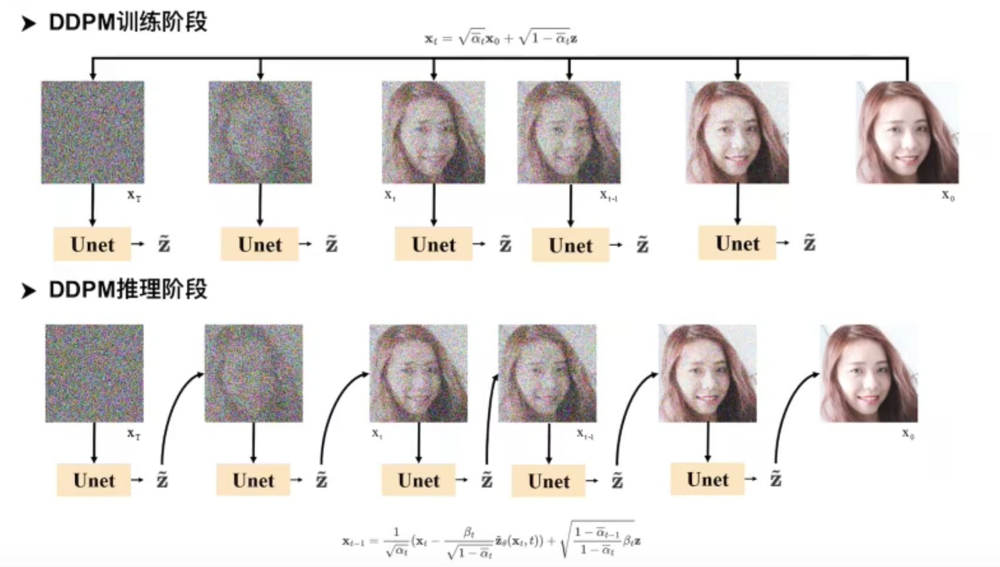


###### 2-1 SR3

Image Super-Resolution via Iterative Refinement（https://ar5iv.labs.arxiv.org/html/2104.07636）


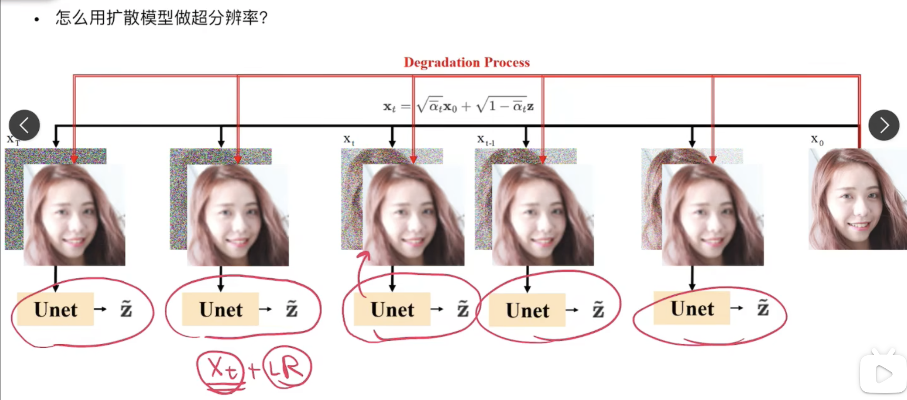


相对DDPM的改动：

- 改动1：将LR作为condition，与噪声图concat之后送给UNet重建，即UNet现在是输入6通道，输出3通道
- 改动2：不再直接取$\bar{\alpha}_t$，而是取均匀分布$U[\bar{\alpha}_{t-1}, \bar{\alpha}_t]$
- 改动3：不再输入$t$给UNet，而是直接输入noise level，也就是改动2中均匀采样的值

> 个人解读：
>
> 1. UNet处似乎可以改为pixel-shuffle减少复杂度
> 2. 之前有文章认为与其隐晦地给一个 $t$，不如将噪声强度  $\bar{\alpha}_t$ 作为条件。
> 3. 改动2是为改动3作铺垫的，二者连用。从均匀分布 $U[\bar{\alpha}_{t-1}, \bar{\alpha}_t]$ 里取噪声强度，它更**连续**，也给后面我们为了推理加速设定新的 $T$​ 提供了支持。

改动2是为可以**任意改变采样的步数**铺路，不然UNet只见过离散的条件。

对于 `np.linspace(low, high, T)`，假设训练时 `low=1e-4, high=2e-2, T=2000`，推理时 我们可以设定 新的 $\beta_T$ 和 $T$，比如`low=1e-4, high=0.1, T=100`，只要最后满足$\bar{\alpha}_T \approx 0$。从`T=2000`到`T=100`推理速度快了20倍。

###### 2-2 deblur

Deblurring via Stochastic Refinement（https://openaccess.thecvf.com/content/CVPR2022/papers/Whang_Deblurring_via_Stochastic_Refinement_CVPR_2022_paper.pdf）

> Stochastic Refinement 就是指的扩散模型

提出问题：目前的图像去模糊问题主要是deterministic的方法，重建的视觉质量不好

提出解决方案：1. 提出一个新框架，基于条件扩散模型 2. 同时也提出一个有效的predict-and-refine的方法，并给出扩散模型在PD曲线上遍历的方法


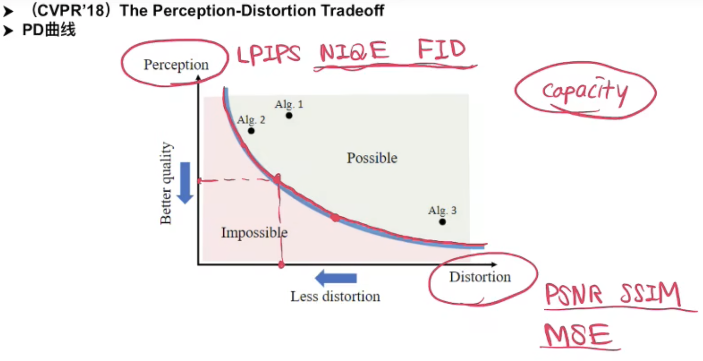


> 以前的经验和分析得出，在模型能力（size）一定的情况下，它的Perception和Distortion的指标是有trade-off的。

- 改进1：predict and refine策略，实际上就是扩散模型的$x_0$​不再是原图，而是原图和predictor的残差。

  > 由于学残差相对容易，Denoiser（UNet）可以设计得更轻量。
  >
  > 这篇文章补充材料就提到initial predictor和denoiser结构是一样的，只是base channel不一样，前者是64，后者是32。参数量上前者约26M，后者约7M。


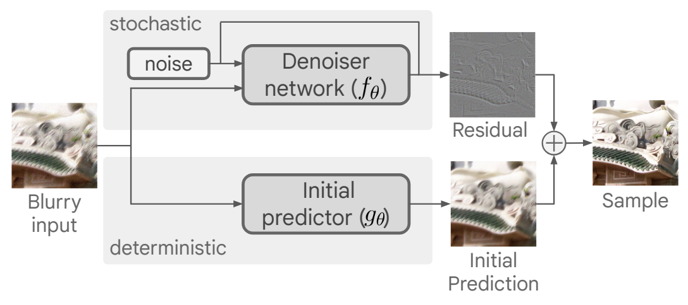


- 改进2：Sample averaging：由于每一次的采样具有随机性，所以可以多重建几次，然后取平均。这是一种比较简单的self-ensemble的方法。

- 改进3：Traversing the PD curve：采样的步数越多，则主观质量越好，反之则客观质量越好。


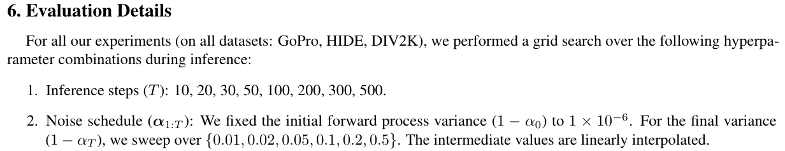


- 改进4：训练时使用小patch，测试时用整张图。很多low-level模型训练都是这么做。

###### 2-3 DDIM

Denoising Diffusion Implicit Models（https://ar5iv.labs.arxiv.org/html/2010.02502）

回顾DDPM（去噪扩散概率模型）：

> 在 DDPM 中，生成过程被定义为马尔可夫扩散过程的反向过程，在逆向采样过程的每一步，模型预测噪声。


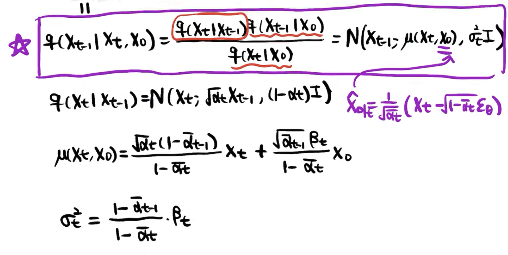


DDIM（去噪扩散隐式模型）：

> DDIM 的作者发现，扩散过程并不是必须遵循马尔科夫链， 在之后的基于分数的扩散模型以及基于随机微分等式的理论都有相同的结论。 基于此，DDIM 的作者重新定义了扩散过程和逆过程，并提出了一种新的采样技巧， 可以大幅**减少采样**的步骤，极大的提高了图像生成的效率，代价是牺牲了一定的多样性， 图像质量略微下降，但在可接受的范围内。

去马尔可夫化，DDIM用待定系数法推导：

回到$q(X_{t-1}|X_t,X_0)=\frac{q(X_t|X_{t-1},X_0)q(X_{t-1}|X_0)}{q(X_t|X_0)}$​​

> $q(X_s|X_k,X_0)=\frac{q(X_k|X_s,X_0)q(X_s|X_0)}{q(X_k|X_0)} \sim Non-Markov, s<k-1$
>
> 由于不是马尔可夫过程，等式右边$q(X_k|X_s,X_0)$, $q(X_s|X_0)$, $q(X_k|X_0)$理论上我们都不知道，左边分布的解的可能性会更多。但由于DDIM只是采样方法，我们用的UNet模型还是DDPM一样的方式训练的，所以$q(X_s|X_0)$, $q(X_k|X_0)$​需要满足DDPM的公式。
>
> 现在仅仅是$q(X_k|X_s,X_0)$是未知的。在DDPM里是转换成了$q(X_t|X_{t-1})$，但这个**马尔可夫的强假设，并不是必要的**，因为训练过程中并没有$X_{t-1}$到$X_t$​的加噪。我们不妨使用待定系数法，不限制它的形式。
>
> 其实DDIM里前向的增噪过程$q(X_k|X_s,X_0)$也已经和DDPM不一样了，但是因为训练过程中没用到，就没事，只要训练中一步到位加噪的$q(X_t|X_0)$一致，我们的噪声预测模型就依然是DDPM/DDIM通用的。

假设$q(X_{t-1}|X_t,X_0)$为任意满足上述等式的分布

###### 待定系数

> [!IMPORTANT]
>
> **以下推导中的$t-1$都可以替换为$s$，$t$都可以替换为$k$。同样成立**

设：$q(X_{t-1}|X_t,X_0) \sim N(kX_0 + mX_t, \sigma^2I)$​,

$X_{t-1} = kX_0 + mX_t + \sigma Z_t, Z_t \sim N(0, I)$​

$\because X_t = \sqrt{\bar{\alpha}_t} X_0 + \sqrt{1 - \bar{\alpha}_t}Z$

（DDIM论文里的$\alpha_t$、$\beta_t$符号和DDPM里区别很大，我们还是调整一致）

$\therefore X_{t-1} = kX_0 + m(\sqrt{\bar{\alpha}_t} X_0 + \sqrt{1 - \bar{\alpha}_t}Z_t) + \sigma Z$

$= (k + m\sqrt{\bar{\alpha}_t})X_0 + m\sqrt{1 - \bar{\alpha}_t}Z_t + \sigma Z$​

$= (k + m\sqrt{\bar{\alpha}_t})X_0 + {Z}', {Z}' \sim N(0,m^2(1-\bar{\alpha}_t)+\sigma^2)$

$\because X_{t-1} = \sqrt{\bar{\alpha}_{t-1}} X_0 + \sqrt{1 - \bar{\alpha}_{t-1}}Z_{t-1}$

$\therefore k + m\sqrt{\bar{\alpha}_t} = \sqrt{\bar{\alpha}_{t-1}} $ 和 $m^2(1-\bar{\alpha}_t)+\sigma^2 = 1 - \bar{\alpha}_{t-1}$​

求得：$m = \frac{\sqrt{1 - \bar{\alpha}_{t-1} - \sigma^2}}{\sqrt{1 - \bar{\alpha}_t}}$ 和 $k = \sqrt{\bar{\alpha}_{t-1}} - \sqrt{1 - \bar{\alpha}_{t-1} - \sigma^2}\frac{\sqrt{\bar{\alpha}_t}}{\sqrt{1 - \bar{\alpha}_t}}$​

$\therefore q(X_{t-1}|X_t,X_0) \sim N((\sqrt{\bar{\alpha}_{t-1}} - \sqrt{1 - \bar{\alpha}_{t-1} - \sigma^2}\frac{\sqrt{\bar{\alpha}_t}}{\sqrt{1 - \bar{\alpha}_t}})X_0 + \frac{\sqrt{1 - \bar{\alpha}_{t-1} - \sigma^2}}{\sqrt{1 - \bar{\alpha}_t}}X_t, \sigma^2I)$，代入预测的 $X_0$ 后得到 $\sim N((\sqrt{\bar{\alpha}_{t-1}} - \sqrt{1 - \bar{\alpha}_{t-1} - \sigma^2}\frac{\sqrt{\bar{\alpha}_t}}{\sqrt{1 - \bar{\alpha}_t}})(\frac{X_t - \sqrt{1 - \bar{\alpha_t}}\tilde{Z}_\theta}{\sqrt{\bar{\alpha_t}}}) + \frac{\sqrt{1 - \bar{\alpha}_{t-1} - \sigma^2}}{\sqrt{1 - \bar{\alpha}_t}}X_t, \sigma^2I)$​

$\sim N(\sqrt{\bar{\alpha}_{t-1}}(\frac{X_t - \sqrt{1 - \bar{\alpha_t}}\tilde{Z}_\theta}{\sqrt{\bar{\alpha_t}}}) + \sqrt{1 - \bar{\alpha}_{t-1} - \sigma^2}\tilde{Z}_\theta, \sigma^2I)$​

**$X_{t-1} = \sqrt{\bar{\alpha}_{t-1}}(\frac{X_t - \sqrt{1 - \bar{\alpha_t}}\tilde{Z}_\theta}{\sqrt{\bar{\alpha_t}}}) + \sqrt{1 - \bar{\alpha}_{t-1} - \sigma^2}\tilde{Z}_\theta + \sigma^2 Z$**

> DDIM仅用待定系数法假设满足$q(X_{t-1}|X_t,X_0)=\frac{q(X_t|X_{t-1},X_0)q(X_{t-1}|X_0)}{q(X_t|X_0)}$，没有任何其他强假设。推导过程中也没有用到$q(X_t|X_{t-1})$。
>
> DDIM 可以看做是 DDPM 的扩展， DDPM 是 DDIM 的一个特例

因为DDIM不是马尔可夫假设，所以不需要严格遵守$X_t \to  X_{t-1}$​​​

$s = t-1, z = t$

**$\therefore X_s = \sqrt{\bar{\alpha}_s}(\frac{X_k - \sqrt{1 - \bar{\alpha_k}}\tilde{Z}_\theta}{\sqrt{\bar{\alpha_k}}}) + \sqrt{1 - \bar{\alpha}_s - \sigma^2}\tilde{Z}_\theta + \sigma^2 Z$**

$s < k, k \le T, s和k不需要连续$

由于推导中$\sigma^2$全程没有用到，所以神奇的是$\sigma$​取任何值，等式都成立。

> DDIM推导中的**$\sigma$**是待定系数法假设来的，是一个**自由随机变量**。

- 如果 $\sigma=0$ 就是一个Deterministic的过程（除了一开始的 $X_T$​​ 引入了随机性），牺牲了多样性。

- 如果 $\sigma=\sqrt{\frac{\beta_t(1-\bar{\alpha}_{t-1})}{1-\bar{\alpha}_t}}$​ ，代回去推导发现，DDIM和DDPM是等价的。

- 作者发现 $\sigma=0$ 时效果最好。做了一个实验 令$\sigma = \eta \sqrt{\frac{\beta_t(1-\bar{\alpha}_{t-1})}{1-\bar{\alpha}_t}}$​


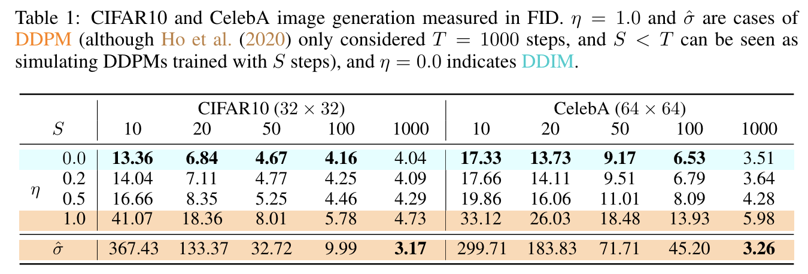


> DDIM牺牲了多样性，提升了图片质量。

**总结，DDIM特点：多样性↓，速度↑，图像质量↑**

在DDIM里，取了$X_T$，后面过程是有一个确定（Deterministic）路径的，已经对应了生成的图像。这也带来一个好处，这使得$X_T$​有点类似VAE、GAN里的latent space，方便进一步研究它的性质（如transfer, similarity, editting）。

###### 直接分析构造（高视角）


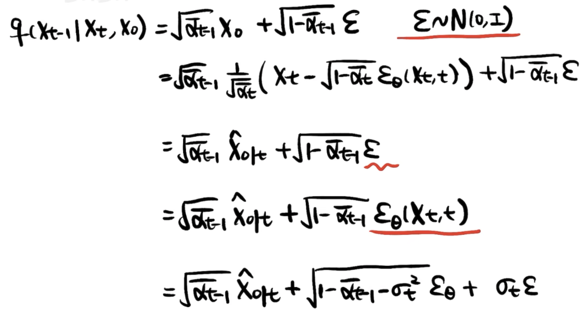


可以看到这每一步都好理解，

- 前三个等式就是解释训练过程中加噪的方式和UNet学到的去噪能力。
- 第三个等式到第四个等式的转换（$\varepsilon$ 到 $\varepsilon_\theta$）就是一般到特殊。
- 第五个等式再将噪声拆开，只要满足二者方差相加等于原先的方差。折中回到一个相对比较一般的公式。且当$\sigma \ne 0$时可以增加多样性。

> 等式中用特殊代替一般是成立的。而且确定性更强。

**$X_s = \sqrt{\bar{\alpha}_s}\hat{X}_{0|k}+\sqrt{1-\bar{\alpha}_s-\sigma^2_k}\varepsilon_\theta(X_k,k)+\sigma_k\varepsilon $**

###### 2-4 guided-diffusion

Diffusion Models Beat GANs on Image Synthesis （https://proceedings.neurips.cc/paper_files/paper/2021/file/49ad23d1ec9fa4bd8d77d02681df5cfa-Paper.pdf）

> 扩散模型提出后有两大优势：1.生成效果较好，保真度高，2.生成图像多样性高。但直到guided-diffusion这篇文章发表之前，扩散模型在保真度的指标（FID）上一直没有超过GAN。

- 改进1：网络结构优化。
- 改进2：引入classifier guidance的采样方法，分类器做监督。
  - 条件生成既可以使得模型可控，又可以增加保真度（研究conditional GAN的学者发现条件生成可以提高FID）。
  - 不影响训练过程，和DDIM一样，只作为一种采样方式。

设 $y$​ 是类别条件，首先根据贝叶斯公式：

> $\hat{q}(X_{t-1}|y) = \frac{\hat{q}(y|X_{t-1})\hat{q}(X_{t-1})}{\hat{q}(y)}$，再添$X_t$的条件。但数学功底够好，可以直接看出得到下面的等式。

$\hat{q}(X_{t-1}|X_t,y) = \frac{\hat{q}(y|X_{t-1},X_t)\hat{q}(X_{t-1}|X_t)}{\hat{q}(y|X_t)}$​

如果沿用DDPM的训练，只是在采样阶段使用classifier guidance，有：

$\hat{q}(X_t|X_{t-1},y) = q(X_t|X_{t-1})$

$\hat{q}(X_0) = q(X_0)$

$\hat{q}(X_T|X_0,y) = \prod_{t=1}^{T}\hat{q}(X_t|X_{t-1},y) $  `Markov`

我们继续推：

classifier guidance和classifier-free guidance


##### 其他优秀博客

[科学空间 生成扩散模型漫谈-系列](https://spaces.ac.cn/archives/9119)

## 关键发现

- **训练与推理的已知量不同**：训练知道 $x_0$，可构造后验和噪声标签；推理只持有 $x_t$，必须用模型估计。
- 配方得到的 $\tilde\beta_t$ 与 $\tilde\mu_t$ 把“逐步还原”写成了可计算的高斯形式。
- 旧笔记延伸阅读还讨论 DDIM、超分和去模糊；这些应用不等同于本篇基础推导。

## 我的提问

### Q1：为什么 U-Net 预测噪声，而不是直接预测上一时刻的图像？

旧笔记提出了这一问。给定真图和随机时刻时，前向公式能直接构造噪声标签 $\epsilon$；其均方误差又对应原论文采用的简化变分目标。网络估计的是从 $x_0$ 构造 $x_t$ 的总体噪声，再由后验公式推得上一时刻的均值。直接预测上一时刻图像也是可能的参数化，并非“必然没有随机性”；随机性取决于采样算法和方差选择。

## 局限与疑问

- 这些等式依赖固定的高斯前向日程。改用连续时间 SDE、不同预测目标或学习方差时，表达式需重新对应。
- 原笔记把 $q(x_{t-1}\mid x_t,x_0)$ 简写为 $q(x_{t-1}\mid x_t)$；保留条件 $x_0$ 才不会混淆真实后验和模型逆过程。

## 我的判断

推导中最关键的是“有 $x_0$ 的后验”到“没有 $x_0$ 的模型反向均值”这一步。复现前应先核对代码使用的方差日程、预测目标和采样器是否匹配。

## 下次只看这些

1. $q(x_t\mid x_0)$ 让任意时刻训练样本可一次构造。
2. 配方对象是 $q(x_{t-1}\mid x_t,x_0)$；代入噪声估计才得到 $\mu_\theta$。
3. 简化损失是噪声 MSE；采样方差是另一项设计选择。
