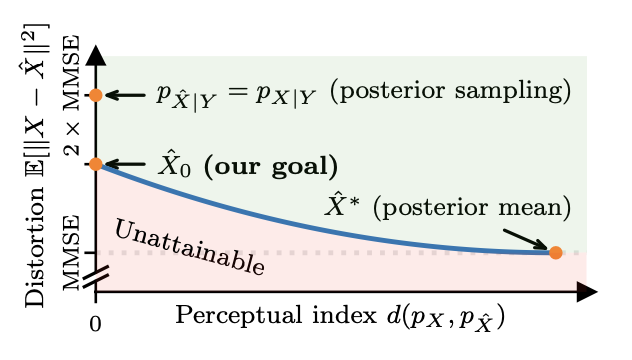

## 研究问题

**现有方法：图像复原算法的目标是在保持感知质量的同时，尽可能降低失真度。通常，这些算法会尝试 [方案1] 从后验分布中采样（比如一些基于扩散模型的方法），或者 [方案2] 优化失真损失（例如均方误差MSE）和感知质量损失（例如生成对抗网络GAN）的加权和。：**

## 核心方法

**本文方法：本文专注于寻找一个最优估计器，这个估计器在保持完美感知指数（即重建图像的分布与真实图像的分布完全相同）的约束下，最小化均方误差（MSE）。这是一个理论上的挑战，因为通常在降低失真度的同时，感知质量可能会受到影响。：**

作者引用了一个理论结果，表明可以通过最优传输（optimal transport）后验均值预测（MMSE估计）到真实图像的分布来构建这样的估计器。基于这个理论结果，作者介绍了一种名为后验均值校正流（Posterior-Mean Rectified Flow，简称PMRF）的算法。PMRF首先预测后验均值，然后使用一个校正流模型将结果传输到高质量的图像，这个模型近似于所需的最优传输映射。

总结来说，这篇论文提出了一个新的图像恢复算法PMRF，它基于最优传输理论，旨在在不牺牲感知质量的情况下最小化图像恢复的失真度。

理论：

posterior sampling 和 posterior mean 是两个极端，一个posterior sampling的感知指数是完美的，但MSE一般很高，PSNR指标差。而posterior mean 的MSE，一般非常低（称作Minimum MSE，MMSE estimate），但感知质量就比较差。

而且posterior sampling 的MSE恰好是MMSE的两倍。

> 参考 CVPR2018 The perception-distortion tradeoff  这篇通过数学证明表明，降低失真度往往会牺牲感知质量，反之亦然。
>
> 然而，作者通过实验表明，对于某些度量标准（例如VGG特征之间的距离），这种矛盾的影响较小。此外，他们还展示了生成对抗网络（GANs）为解决感知-失真界限提供了一种原则性的方法，这为GANs在低级视觉任务中的成功提供了理论支持。（即现有方法的 [方案2]）

虽然现有方法里 [方案2] 挺优雅的，但实践证明不论是失真度还是感知质量，GAN都不如扩散模型，这一部分是由于GAN很难优化。

论文中引用了Frierich等人在2021年的研究成果，该研究表明 $\hat{X}_0$ 可以通过以下两步构建：

>  NIPS2021 A theory of the distortion-perception tradeoff in wasserstein space.

1. 首先预测后验均值 $\hat{X}∗:=E[X∣Y]$，即在给定观测数据Y的情况下，X的期望值。
2. 然后通过最优传输（optimal transport）将这个后验均值的预测结果转移到真实图像的分布上。

受到这一理论结果的启发，PMRF框架的工作流程如下：

1. 使用一个模型来近似后验均值，这个模型通过最小化重建输出和真实图像之间的MSE来实现。

2. 接着，训练一个校正流模型（rectified flow model），这个模型基于Liu等人在2023年的研究，用于预测后验均值预测和真实图像之间的直线路径的方向。

   > ICLR2023 Flow straight and fast: Learning to generate and transfer data with rectified flow.

3. 在测试时，给定一个退化的测量值，PMRF使用这样的流模型解决一个常微分方程（ODE），并以后验均值预测作为初始条件。

我觉得越来越偏理论和数学了，可能还是再结合代码看一下，直观一点。

我测了下，效果确实挺惊艳。

### 关键图示

## 关键发现

## 我的提问

## 局限与疑问

## 我的判断

## 下次只看这些

1. 先估计后验均值，再用校正流将其映射到真实图像分布，平衡失真与感知质量。
