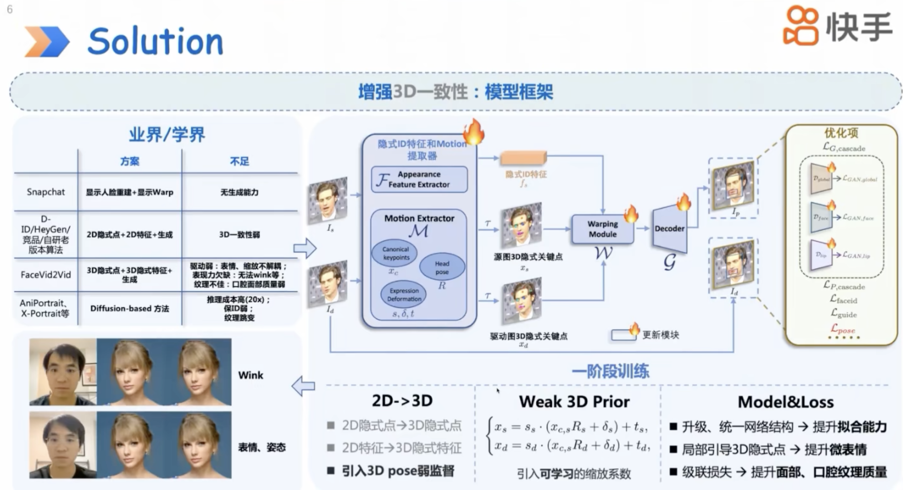
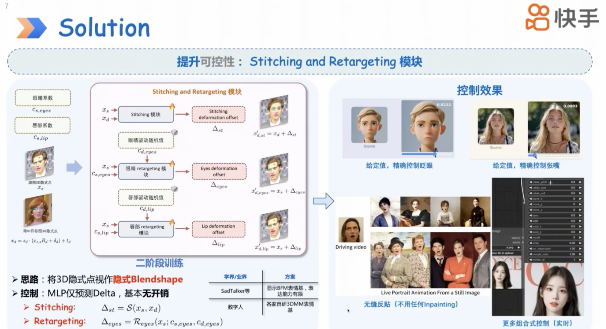

## 研究问题

单图肖像驱动如何在低延迟下保持自然表情与可控运动？

## 核心方法

https://liveportrait.github.io/

快手的工作，效果很精细。沿用了FOMM、face-vid2vid的基于隐式关键点的框架（implicit-keypoint-based framework），可达到计算复杂度和可控性的平衡。4090显卡上可以跑到12.8ms每帧。LivePortrait在视频驱动照片的领域里，确实是一个很坚实的框架。其他相似任务里，可看下是否有可借鉴之处。

回顾face vid2vid：

implicit-keypoint-based framework主要就是在source提取canonical keypoints。然后假定driving图像复用该canonical keypoints（同一个id就可以复用），便无监督地学习获得提取canonical keypoints的能力。

然后$x_s=x_{c,s}R_s(旋转)+δ_s(表情)+t_s(平移)$ 和 $x_d=x_{c,d}R_d+δ_d+t_d$。

face vid2vid也没有像FOMM那样预测每个关键点的雅可比矩阵（Jacobian），因为它认为人头的运动是比较刚性的，每个关键点局部patch的旋转与整个人头的旋转是一致的，即$J_s = R_s$。而且这样也剩下不少带宽。

> 1. 因为face vid2vid研究的应用场景是视频会议，所以不传输$J_s$可以节省带宽。
> 2. 也正因为face vid2vid的应用场景是视频会议，所以source和driving是相同id。canonical keypoints可以复用，driving不需要再提取canonical keypoints。
> 3. 相当于最后就是传输一张source图，和drving帧的紧凑表征$R_d$、$δ_d$、$t_d$（码率极低）。


创新点：

1. Landmark-guided implicit keypoints optimization.

   我们之前看FOMM的隐式关键点完全是无监督学习出来的，位置非常地不定，看不大出来语义。但LivePortrait还是给一部分（10个）keypoints加上了监督，用2D landmark（eye、mouth）来做监督。认为这样对驱动微表情更有利。

   另外作者在issue里也表达出全用2D landmark也可以，只是现实中2D landmark的提取会有歧义以及不稳定。这也是隐式关键点存在的价值。

   最后，用多少个隐式关键点最佳（K=?），作者也无法给出答案。

2. 图像视频数据混合训练

   因为style视频数据比较稀缺，但style图像比较丰富。所以采用了将style图像视作静态视频的训练方式，扩充了这部分数据。

3. 表情拼接与重定向（Stitching and Retargeting）

   a stitching module

   an eyes retargeting module

   a lip retargeting module

郭建珠在Valse的报告：

HeyGen是这个领域最成功的一家初创，它的方案也是2D。

> 它可能用face swapping的方式，保人脸ID。

贴回去这个操作的专业术语叫Stitching，无缝反贴。


FaceVid2Vid的不足：

- 无监督学的点没法捕捉很local的细节
- 生成质量也较弱

训练和推理：

- 除了训stitching和retargeting module，主框架训练是同id内进行的。然后推理时，如果用了其他id的驱动视频，使用相对变化进行建模。即$S_d = S_s * \frac{S_{d,i}}{S_{d,0}}$，$t_d = t_s + t_{d,i} - t_{d,0}$，$R_d = R_{d,i}R_{d,0}^{-1}R_s$


这个stitching训练还是比较麻烦的，要有一个可反传的2d landmark model。

> 我认为这里可能有口误，应该是retargeting module才是必须要可反传的2d landmark model。 因为$Condition_{eyes}, Condition_{lip}$就是眼睛、嘴唇之间的距离。

- 首先stitching、retargeting module都是只操作驱动关键点的，也就是$x_d$ 到 $x_d^{'}$。 不涉及生成器的改动。可以看到warping module和decoder都是冻结的。

  都是经过mlp处理：

  ```yaml
  stitching:
        input_size: 126 # (21*3)*2 两份隐式关键点
        hidden_sizes: [128, 128, 64]
        output_size: 65 # (21*3)+2(tx,ty)
      lip:
        input_size: 65 # (21*3)+2 源隐式关键点+源上下嘴唇间距+随机的嘴唇间距
        hidden_sizes: [128, 128, 64]
        output_size: 63 # (21*3)
      eye:
        input_size: 66 # (21*3)+3 源隐式关键点+源双眼间距元组+随机的眼部间距
        hidden_sizes: [256, 256, 128, 128, 64]
        output_size: 63 # (21*3)
  ```

- stitching module为了造出肩膀移动比较大的情形，是用了cross-id的源图像和驱动图像。与同id重建的图像做loss，且mask掉脸部区域，只对肩膀等区域做loss。

  这是当贴回效果不好时可以做的二阶段弥补训练。

- eyes/lip-retargeting modules是mask掉eyes或lip区域，对其他区域做loss保持一致。保证对眼部、嘴部参数控制$Condition_{eyes}, Condition_{lip}$时不影响其他区域。

二次开发，实时表情编辑：https://github.com/PowerHouseMan/ComfyUI-AdvancedLivePortrait；由于是MIT License，许多公司也拿去商用了，Poe/某映/某图/Cooraft等等，但需要将InsightFace用比如MediaPipe替换掉。

### 关键图示





## 关键发现


## 我的提问


## 局限与疑问


## 我的判断


## 下次只看这些

1. 以隐式关键点建模肖像运动，并加入拼接与重定向控制实现高效动画。
