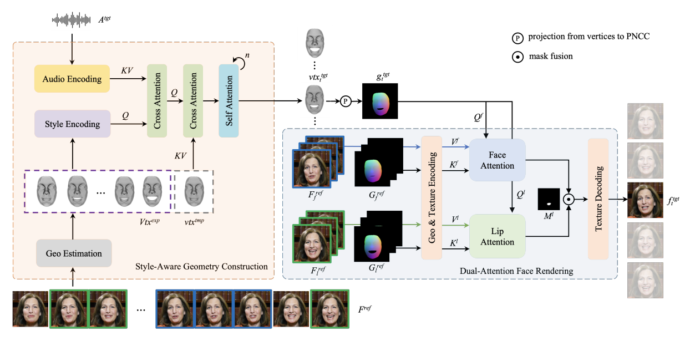

## 研究问题

视觉配音如何让口型与音频同步，同时保留人物独特的说话风格？

## 核心方法

https://github.com/sicxu/Deep3DFaceRecon_pytorch

https://github.com/georgeretsi/smirk

https://grisoon.github.io/PersonaTalk/

和Smirk思路相似，只是提供了一整套方案，如何将3dmm用到音频驱动数字人中。（不过它也是驱动单图）

1. stage1：将一个视频片段的geometry 和 模版的geometry，作为style。再将其注入audio，得到stylized audio features，作为驱动信号。

   > 其中geometry用的[3D Face Reconstruction](https://github.com/sicxu/Deep3DFaceRecon_pytorch)提取。 但会用[Ganfit](https://github.com/barisgecer/ganfit)的思路再精炼一下它。主要用了时域稳定 和 避免shape、expression耦合的正则化损失。
   >
   > 风格geometry用到expression-only mesh vertices（shape和pose取0），它会经过mlp提特征，并且在时域算均值和方差，这些统计值能反映风格。

   > 模版 geometry 则是  shape-only mesh vertices。shape由整个参考片段的shape均值得到。
   >
   > 最后，GT geometry就是  shape & expression mesh vertices，只是不考虑pose。

   1. 风格注入音频特征：音频为KV，风格为Q。

   2. 风格感知的音频特征 再驱动 模版geometry：模版geometry为KV，风格感知的音频特征为Q，一次cross attention后反复几次self-attention。

      就可以得到口型对齐的geometry，称作目标geometry。

   不过音频驱动只生成下半张脸网格顶点，所以目标geometry的上半张脸网格顶点就是来自GT。 $𝑣𝑡𝑥_𝑡^{target} = 𝑣𝑡𝑥_𝑡^{target}[\text{𝑖𝑑𝑥}_{𝑙𝑜𝑤}]∪𝑣𝑡𝑥_t^{𝑔𝑡}[\text{𝑖𝑑𝑥}_{𝑢𝑝}]$

2. 加上head pose后再映射得到 [PNCC](https://github.com/cleardusk/3DDFA)，这个看起来是个彩色图。

   > **注**
   >
   > PNCC 是 一种特殊颜色编码的渲染结果，它包含了3D信息，
   >
   > PNCC = Projected Normalized Coordinate Code
   >
   > 它是把 3DMM 模型的标准人脸顶点坐标（归一化到一个固定范围，比如 [-1, 1]）投影到输入图像上的结果
   >
   > 换句话说：
   >
   > - 对于每个像素，PNCC 提供它在 **标准人脸模型坐标系**中的 (x, y, z) 位置
   > - 这是一种 dense correspondence（密集点对应关系）编码
   > - 看起来像一张彩色图 （R=归一化X，G=归一化Y，B=归一化Z）

   它是face renderer需要的表达形式。PNCC看起来挺适合用作神经网络的输入。

3. stage2：训练一个face renderer，给目标geometry 渲染出纹理。

   具体来说，有预测的口型对齐的PNCC。 然后提供ref 及其对应的PNCC。

   > 本文分了face-ref和lip-ref，表达说前者需要平滑、背景稳定，才能学到细节，后者需要丰富。
   >
   > 二者就是采样方式不同，face-ref在一个小的窗口连续采样，lip-ref在整个视频随机采样。
   >
   > 而推理阶段：
   >
   > 1. face-ref可以选择当前帧的窗口。这样更好的还原背景信息，也就是理解为face-selfref。
   > 2. lip-ref则在整个视频采样 标准几何形状 $\{\alpha_t,\beta_t,0\}$，也就是排除pose的影响，并且嘴巴开合大小可以根据$\beta$排序后，均匀采样，并且采样的数目可以更多。提供更丰富的嘴部纹理。
   >
   > 注： 在 3D 人脸建模或 3DMM 语境下，canonical geometry（规范几何）通常就是指 统一到一个标准姿态（pose）下的几何形状。

   关注这儿cross-attention的设计，几个QKV。

   > **注**
   >
   > 输入: 音频特征 + 风格参考几何(expression_vertices序列)
   >   ↓
   > [音频特征提取器 + 风格编码器]
   >   ↓
   > 有表情运动风格的音频特征
   >   ↓
   > [修改 shape_only_vertices]
   >   ↓
   > 下半张脸顶点 (带表情风格的口型)
   >   ↓
   > [组合] + GT的FLAME参数 → 上半张脸顶点
   >   ↓
   > 完整人脸顶点 (上半脸来自GT，下半脸来自音频驱动)
   >   ↓
   > [根据pose变换]
   >   ↓
   > Target顶点
   >   ↓
   > [渲染]
   >   ↓
   > Target PNCC图像
   >   ↓
   > [Face Attention]
   >   Query: Target PNCC特征
   >   Key: 脸部参考帧PNCC特征
   >   Value: 脸部参考帧纹理特征
   >   ↓
   > Face特征
   >   ↓
   > [Lip Attention]
   >   Query: Target PNCC特征
   >   Key: 嘴部参考帧PNCC特征
   >   Value: 嘴部参考帧纹理特征
   >   ↓
   > Lip特征
   >   ↓
   > [依据嘴部mask加权融合]
   >
   > 嘴部区域: Lip特征
   >
   > 其他区域: Face特征
   > ↓
   > [解码器]
   >   ↓
   > 生成的人脸图像
   >   ↓
   > [损失] vs GT图像

   audio2mesh的模型结构可以参考成熟的：https://github.com/yerfor/MimicTalk

   heygen已经开始做半身驱动了，参考：https://github.com/antgroup/echomimic_v2

   不论是[Deep3DFaceRecon_pytorch](https://github.com/sicxu/Deep3DFaceRecon_pytorch) 还是 [*smirk*](https://github.com/georgeretsi/smirk)，它们的时域稳定性都是不怎么样的。它们训练过程中没有考虑时域的稳定。

   可以参考 [GANFIT](https://openaccess.thecvf.com/content_CVPR_2019/papers/Gecer_GANFIT_Generative_Adversarial_Network_Fitting_for_High_Fidelity_3D_Face_CVPR_2019_paper.pdf) 做时域优化。

### 关键图示

## 关键发现

## 我的提问

## 局限与疑问

## 我的判断

## 下次只看这些

1. 将个人说话风格注入音频特征，再以双注意力渲染保留人脸细节。
