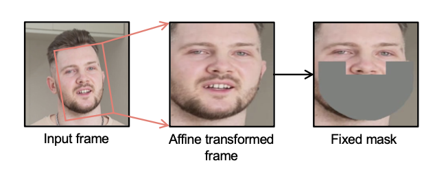
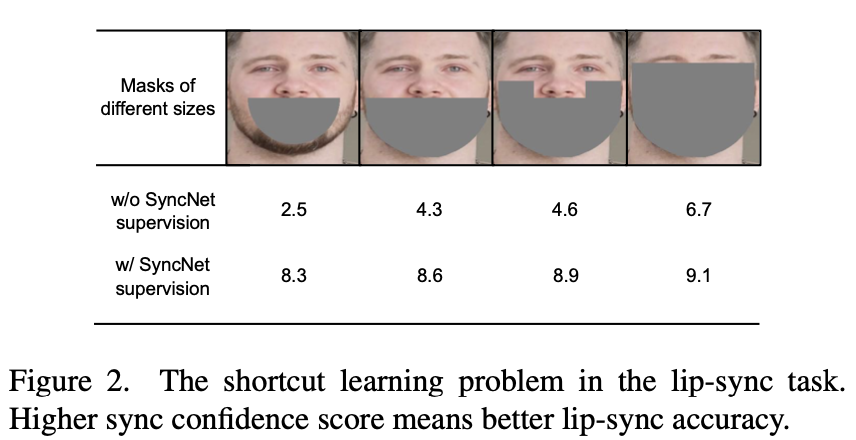

## 研究问题

潜空间扩散口型同步如何处理音视频对齐与相邻帧不一致？

## 核心方法

mask好像推理时是根据landmark来制作更精准的。

而训练时，只是将输入做仿射变换，进行face frontalization，然后使用这张固定的mask.png。

> **谨慎**
>
> 因为作者认为用landmark来获取mask，也会提供嘴唇移动的线索。

由于SyncNet的效果对于lipsync模型的训练很重要，本文细致的研究了影响SyncNet收敛的核心因素。

分析了在口型同步中的捷径学习（Shortcut Learning）问题：

因为口型同步任务经常基于嘴部重绘（inpainting）的框架。意外的是，音频条件的模型倾向于基于嘴唇周围的视觉信息（如面部肌肉、眼睛和脸颊）来预测嘴唇运动，而忽略音频信息。

本文还提出TREPA（Temporal Representation Alignment）的方法，和我想到的temporal (gram) perceptual loss很像，只是用了更强大的预训练模型VideoMAE-v2。

### 关键图示

## 关键发现

## 我的提问

## 局限与疑问

## 我的判断

## 下次只看这些

1. 在潜空间直接学习音频驱动口型，并用时序表示对齐改善视频连续性。
