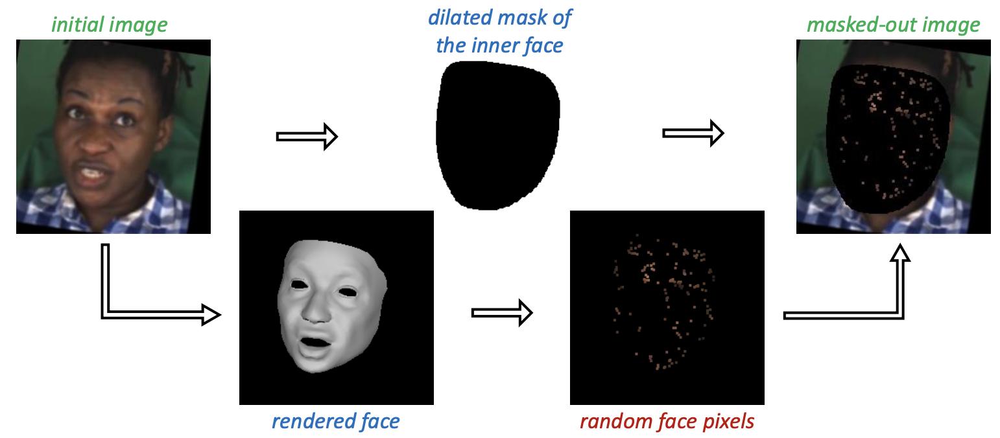

## 研究问题

**现有方法大多基于可微分渲染，：**

> **3D Morphable Model** 是一种基于统计的方法，用一组参数去描述人脸的几何形状（shape）和外观（appearance/albedo）。
>
> 预测 3D Morphable Model (3DMM)，然后通过可微分渲染，进行自监督训练。

> [!TIP]
>
> 两种3DMM的侧重差异：
>
> - **BFM**：高保真静态人脸建模
> - **FLAME**：动态、可驱动的表情和姿态

而Smirk提出用神经渲染。简而言之，它是先只预测 head pose、identity、expression，然后单色渲染出几何。 再提供脸部稀疏的采样像素，令Image-to-Image Translator（一个UNet）重建出最终的人脸。

实际推理时，替换expression即可更改表情。

> 本文分析 可微分渲染的缺陷：
>
> 1. 联合优化 几何、相机、外表、光照 是病态的（ill-posed）优化问题。
> 2. 可微分渲染的图像 和  自然图像 有巨大的domain gap。

> **注**
>
> 其实Smirk思路非常简单，它只进行可微单色渲染。 之后再进行图像风格转换，得到重建人脸。
>
> 而不像过去的方式，还预测albedo参数，完全由参数化人脸模型（BFM、FLAME，它们也都被称为3DMM）渲染出重建人脸。
>
> 相较之下，Smirk的方法 避免了重建人脸 和 自然人脸的 domain gap，继而避免了复杂的loss设计。

还提出cycle loss，也就是换了表情后重建的图片，提取表情要一致。

## 核心方法

https://github.com/sicxu/Deep3DFaceRecon_pytorch

https://github.com/georgeretsi/smirk

mediapipe看这个SVG图像，索引看得更清晰：

https://7thsoftware.co.uk/misc/mediapipe/index.html?utm_source=chatgpt.com

本文认为现有方法重建3D face效果不错，但面对微表情、极端表情、非对称表情、罕见表情时，还是有不足。提出SMIRK（Spatial Modeling for Image-based Reconstruction of Kinesics(动力学)）

### 关键图示

## 关键发现

## 我的提问

## 局限与疑问

## 我的判断

## 下次只看这些

1. 用神经渲染重建监督聚焦三维表情几何，改善罕见和非对称表情。
