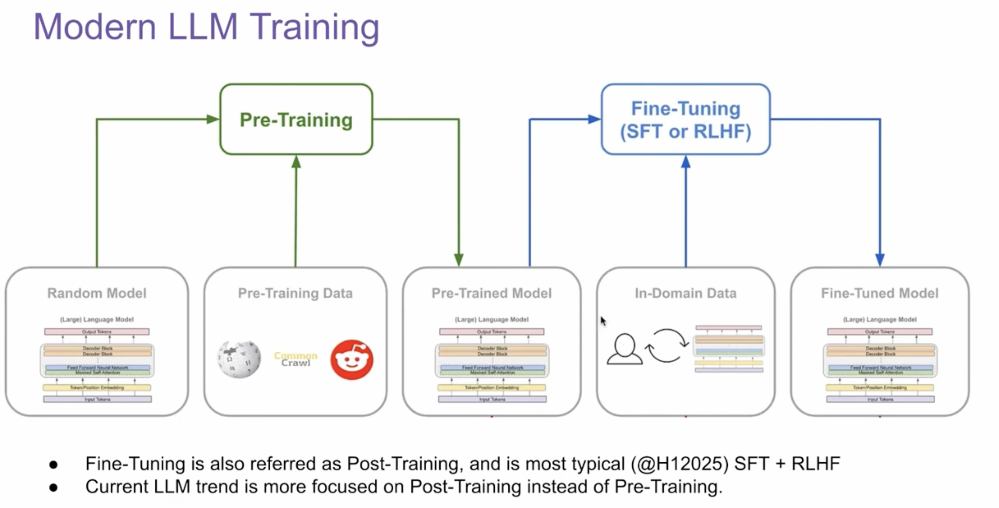
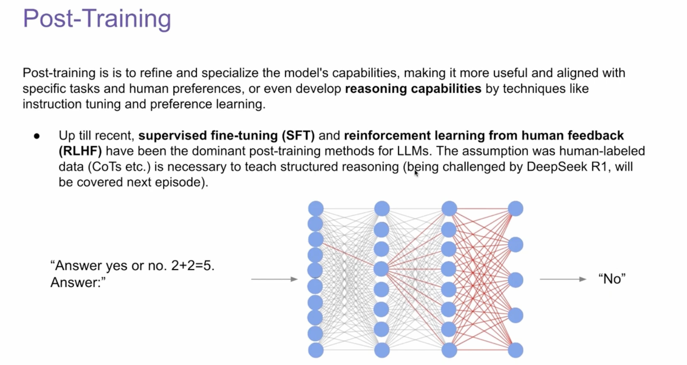
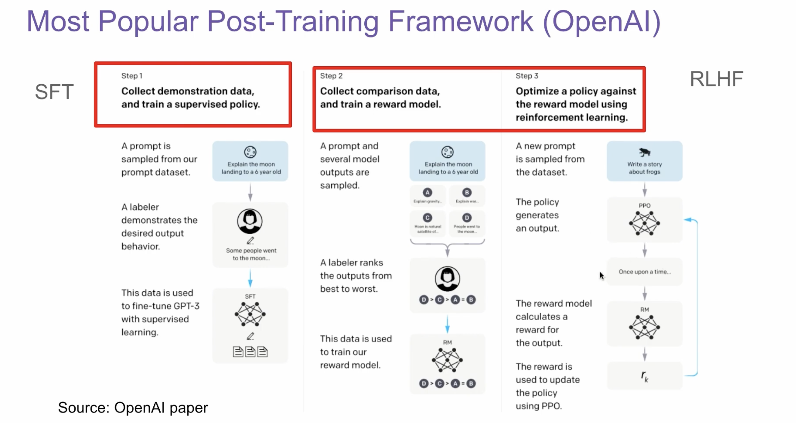
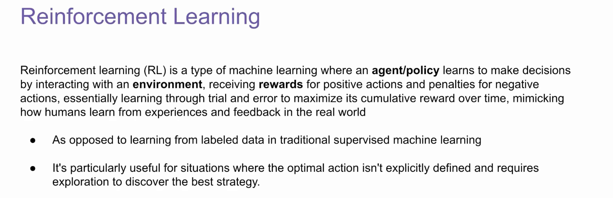
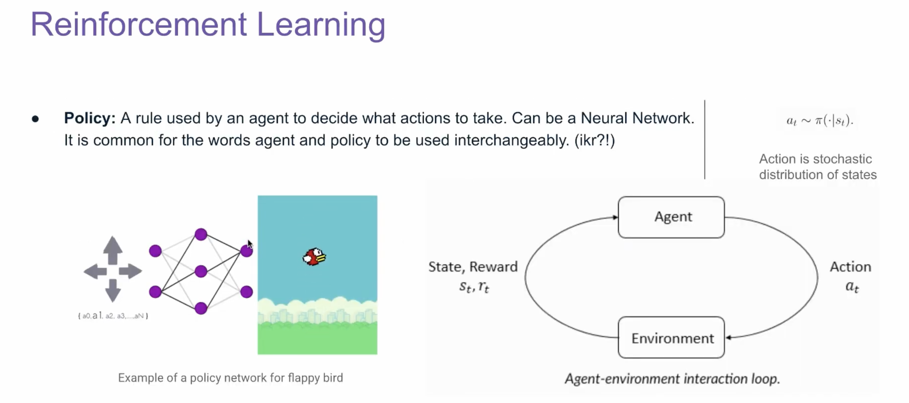
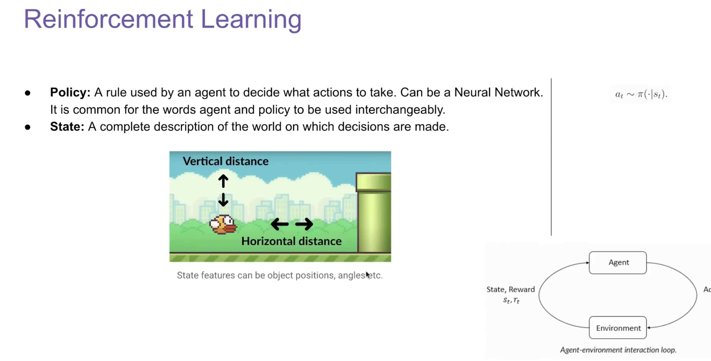

## 研究问题

旧稿只有 [LLM Training & Reinforcement Learning 课程视频](https://www.youtube.com/watch?v=aB7ddsbhhaU)链接与六张讲座截图，没有独立实验、推导或文字评论。本篇据截图整理入门框架；PPO、GRPO、DPO 在标题中出现，但旧稿并未展开它们的公式或比较。

## 核心方法

- **预训练与后训练**：截图把大规模预训练放在前面，再用面向任务或偏好的数据调整模型行为。这里的“后训练”是一类阶段，不对应单一算法。
- **SFT**：从示范输入与期望输出做监督微调。
- **RLHF 典型流程**：截图引用 [InstructGPT 原论文](https://arxiv.org/abs/2203.02155) 的流程——收集示范进行 SFT，收集候选答案的人工偏好训练奖励模型，再用 PPO 按奖励更新策略。这是特定工作流，不表示所有后训练都必须使用独立奖励模型或 PPO。
- **强化学习术语**：策略 $\pi(a\mid s)$ 给定状态 $s$ 选择动作 $a$；环境返回新状态与奖励。截图用游戏交互解释这一闭环。映射到语言模型时，状态、动作与奖励的定义需依据具体训练设置明确。

旧稿仅列出 GRPO、DPO 名称，尚未提供能支持两者差别的笔记。后续读 [GRPO 所在的 DeepSeekMath 论文](https://arxiv.org/abs/2402.03300) 与 [DPO 原论文](https://arxiv.org/abs/2305.18290) 后再补全。

### 原笔记的六张讲座截图

以下按旧稿顺序保留截图，便于对照讲座中的图示和术语。截图来自上方链接的课程视频；二次使用许可待核对。

## 关键发现

- 讲座截图可支持的是概念和训练流程，不能支持 PPO、GRPO、DPO 的实验性能比较。
- 原稿没有自己的复现数据或定量结论。

## 我的提问

## 局限与疑问

- 讲座截图的二次使用许可尚未核对；上面的六张图保留用于对照原笔记，公开发布前应确认许可。
- 需要进一步厘清语言模型中 token 级动作、整句奖励和信用分配的关系。

## 我的判断

## 下次只看这些

1. 预训练建立基础能力；SFT 学示范；偏好数据与奖励可用于进一步后训练。
2. InstructGPT 的 RLHF 流程是一个具体范例。
3. 待读 PPO、GRPO、DPO 原论文，再比较目标函数和代价。
