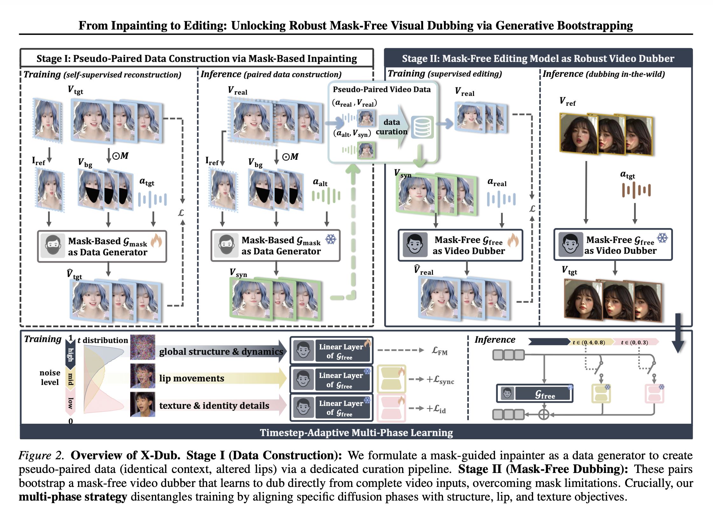

## 研究问题

配对训练视频稀缺时，如何把口型修复任务改成有完整视觉上下文的编辑任务？

## 核心方法

浩贤师兄 lead 的一个工作

和我们思路相似 https://www.ofweek.com/ai/2026-01/ART-201700-8330-30678076.html

> 本文提出了 **X-Dub**，一个自我引导框架：
>
> **生成器（数据构建者）**：一个通过自重建训练的DiT模型，用于为每个真实训练视频生成一个“伴侣视频”。这个伴侣视频具有改变后的嘴部运动（由不同的音频驱动），但保留了原始身份和场景，从而构成了合成的“对齐视频对”。
>
> **编辑器（富上下文配音者）**：第二个DiT模型在这些视频对上进行训练。因为它接收完整的（未被遮挡的）伴侣视频作为输入，所以它执行的是“编辑”而非“修复”，能够利用完整的视觉上下文进行精确的嘴部修改和身份保持。

称作generative bootstrapping，生成式引导。

mask-based inpainting model 来引导 mask-free editing model。因为mask会带来artifacts（虽然能提供参考图像，但模型对于遮挡、光线、阴影还是会存在幻觉，而且当大角度运动时，pose-misaligned references会带来id漂移和artifacts），还可能导致id drift和较差的鲁棒性。

> Our core insight is to relegate a mask-guided inpainting-based model to the role of a dedicated data generator, utilizing it to synthesize scalable paired pseudo-training data (Stage I), which is subsequently utilized to train and bootstrap a robust, mask-free editing-based final video dubber for final inference (Stage II).

考虑mask-based inpainting model 效果不尽完美，离线做了data curation。并且最终GT是原始视频，conditioned on the original speech，inpainting model 的产出只做为输入。

另外一个创新点是 训练分治：

1. high noise，主要是flow-matching loss训练生成器。
2. mid noise，主要是syncnet loss训练LoRA。
3. low noise，主要是identity loss训练另一个LoRA。

### 关键图示

## 关键发现

## 我的提问

## 局限与疑问

## 我的判断

## 下次只看这些

1. 先合成仅口型变化的配对视频，再训练利用完整上下文的音频驱动编辑器。
