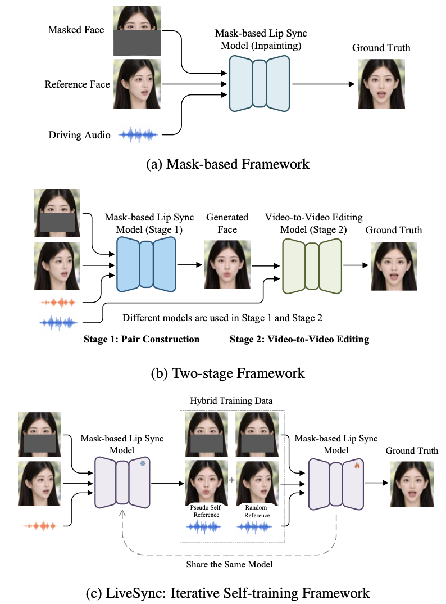

## 研究问题

训练时的掩码参考与推理时的自参考不一致，能否通过同一模型自训练缩小差距？

## 核心方法

> SyncAnyone [27] and X-Dub [9] explicitly construct the missing supervision: a mask-based generator synthesizes pseudo pairs, which train a separate mask-free model.
>
> We ask whether better editing supervision can instead improve the same mask-based model.
>
> Unlike two-model bootstrapping, the same model is refined throughout, without a separate mask-free student.

感觉这个方法的好处，主要是形成了基于一套mask-based模型的不断迭代训练，形成提升效果的飞轮：模型构造的pseudo self-reference质量越好，则模型把它作为数据集训练的模型效果越好，从而使pseudo self-reference的质量更好。

提到了boundary-aware padding的技巧，如果desired face box超出了画面外，如果直接resize，可能会使得数据OOD，造成时域上的抖动或几何形变。其实就是超出的部分填黑。

### 关键图示

## 关键发现

## 我的提问

## 局限与疑问

## 我的判断

## 下次只看这些

1. 让同一掩码模型生成伪配对数据并迭代自训练，缩小训练与推理的参考差异。
