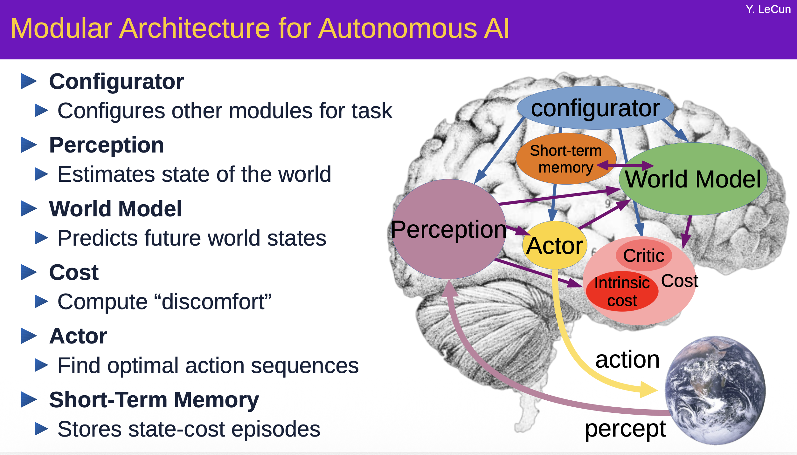
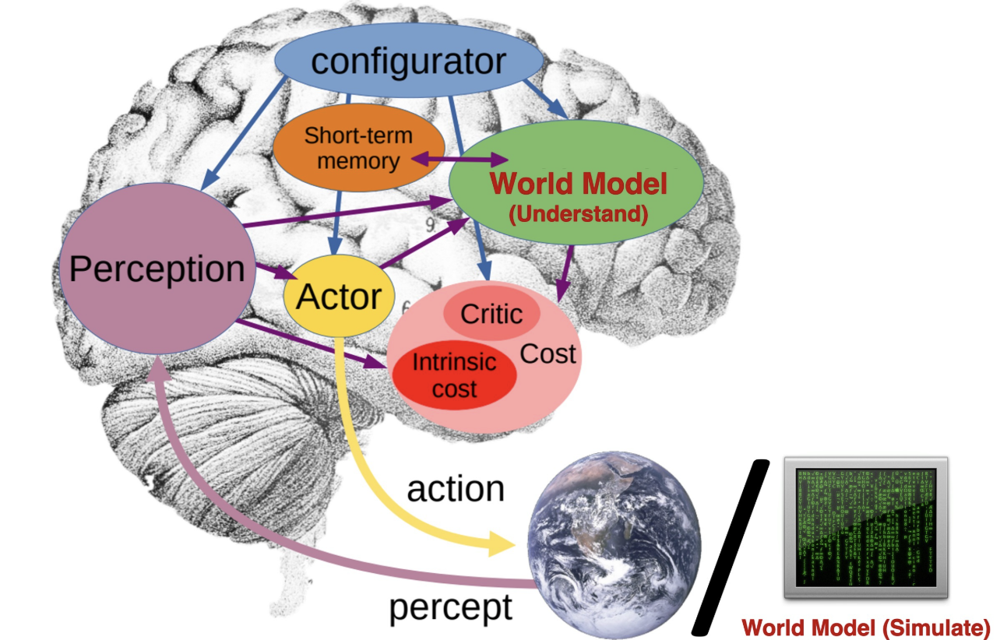
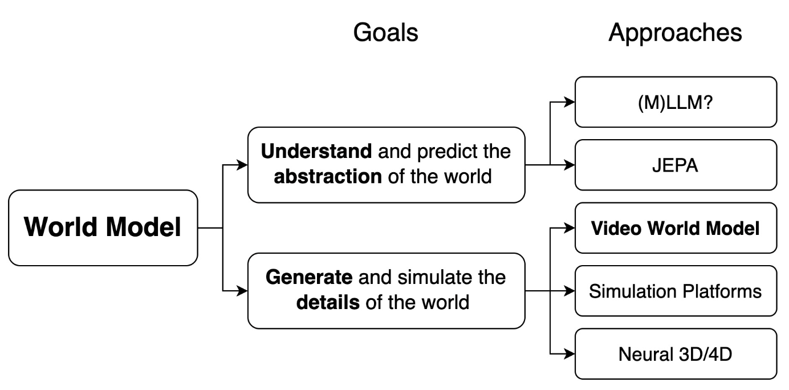
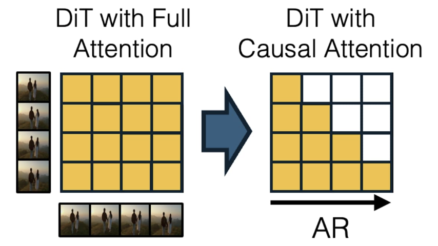
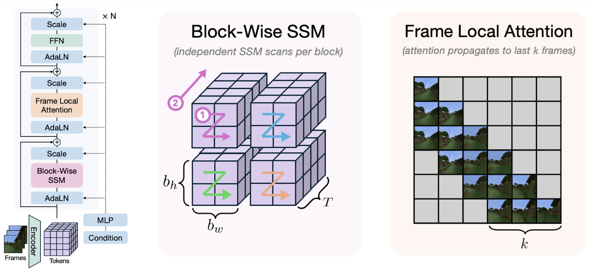
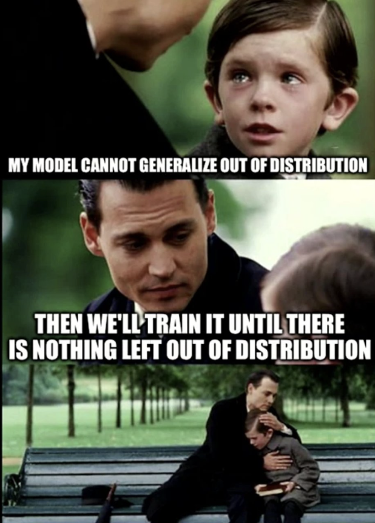
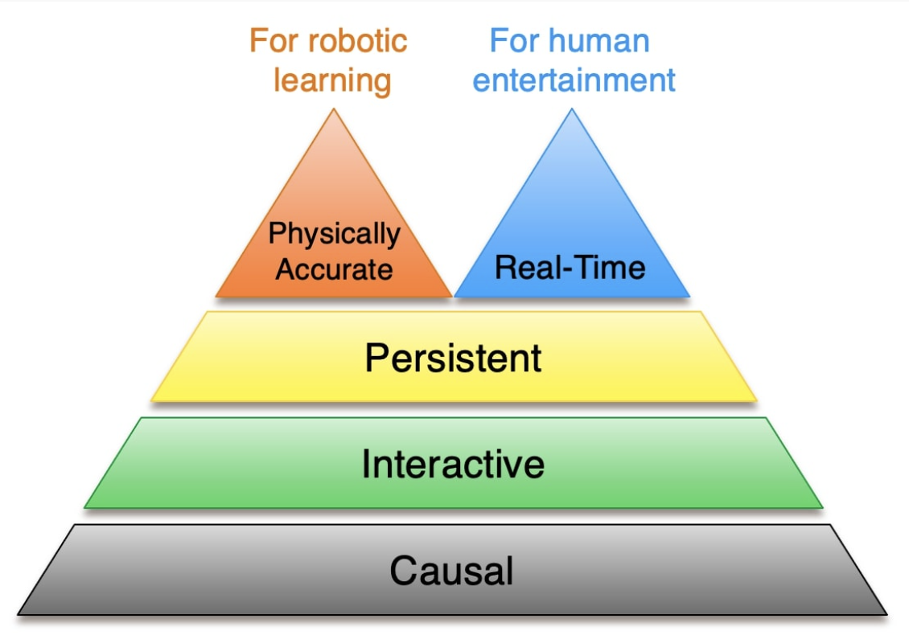

## 研究问题

这是一篇对 [Xun Huang《Towards Video World Models》](https://www.xunhuang.me/blogs/world_model.html) 的阅读报告，不是提出单一新模型或新实验的论文。它追问：**为什么画面逼真的 Sora、Veo 3 一类视频生成器还不能直接等同于世界模型？要从视频生成走到可交互的世界模拟，还缺哪些能力？** 原文发表于 2025 年 7 月 11 日；本笔记按原稿的“定义—五项要求—其他路径—结论”顺序整理。

### 同一个名称下的两类目标

通常可以把世界模型写成“给定当前状态和行动，预测后续状态”的机制；争议在于“状态”究竟包含什么。原文从 Demis Hassabis 关于视频生成与交互游戏潜力的讨论切入，指出画面逼真只说明视频技术进步，并未回答交互式模拟的问题。

1. **内部的世界理解模型**预测抽象、语义层面的未来，供推理、规划和行动使用。它类似人脑的认知世界模型。仅从文本学习的 LLM 可能缺少对真实世界的扎根；[Sergey Levine 的讨论](https://sergeylevine.substack.com/p/language-models-in-platos-cave)提出了这一疑问。结合长上下文视频和语言的 [LWM](https://arxiv.org/abs/2402.08268)，以及预测抽象视频表征的 [V-JEPA 2](https://ai.meta.com/blog/v-jepa-2-world-model-benchmarks/)，是向视觉与交互靠近的例子。
2. **外部的世界模拟模型**试图生成细节充分、可感知的未来，包括逼真的画面和动态。像素级复现未必是智能的必要条件，却对机器人仿真和人的沉浸式体验很有价值：机器人需要足够精细的视觉输入以缩小 sim-to-real 差距，人需要可信的视觉反馈。机器人还可以通过与外部模拟器交互，学到用于规划和行动的内部模型。

两者可以协同，而不应因都叫“世界模型”就被混为一谈。Figure 1 改编自 [LeCun 的讲义](https://leshouches2022.github.io/SLIDES/compressed-yann-1.pdf)，对比内部理解与外部模拟；Figure 2 把抽象预测对应到多模态模型、JEPA，把细节模拟对应到视频、传统仿真和神经 3D/4D。本报告接下来讨论的是第二类中的**视频世界模型**。

## 核心方法

### 判断视频世界模型的五项要求

过去几年，视频生成技术取得了显著进步，目前最先进的系统能够生成具有逼真细节和物理真实感的动态效果（例如谷歌的Veo3）。谷歌DeepMind首席执行官Demis Hassabis暗示，利用视频生成技术可以开发出具有游戏应用潜力的交互式世界模型。

<iframe
  src="https://platform.twitter.com/embed/Tweet.html?id=1940248521111961988&lang=zh-cn&theme=light&dnt=true"
  width="550" height="350"
  frameborder="0" scrolling="no"
  style="display:block;margin:0 auto;border:none;overflow:hidden;">
</iframe>

但为什么当前的视频生成模型还不能被视为真正的世界模型呢？究竟缺少什么？我们又该如何弥合这一差距？我认为，一个真正的视频世界模型必须具备**因果性（Causal）、交互性（Interactive）、持久性（Persistent）、实时性（Real-Time）和物理精确性（Physically Accurate）**。在接下来的章节中，我将详细探讨每个属性，强调其重要性并回顾相关研究。

#### 1. 因果性：生成的过去不能依赖尚未发生的未来

这里的“因果”指**时间的单向依赖**：未来受已发生的状态与行动影响，不是因果机器学习中区分干预与相关性的那套问题。常见视频 DiT 用双向注意力同时生成固定的一段帧，某帧可读取其后的帧；这样生成的片段一旦确定，用户随后插入的行动就无法自然改变片段中尚未播放的结果。逐帧或逐块自回归生成，才为持续响应新行动提供结构基础。

LLM 式离散 token 自回归路线已有 [CogVideo](https://arxiv.org/abs/2205.15868) 和 [VideoPoet](https://sites.research.google/videopoet/)；原文认为早期方案受有损向量量化和逐 token 解码的质量、速度限制。另一条路线尝试把高质量扩散与因果生成结合：[Diffusion Forcing](2026-11-04-diffusion-forcing.md)让不同帧处于独立噪声等级，可以使模型具备自回归生成能力；[CausVid](2026-11-04-causvid.md)把预训练的双向视频 DiT 改造成少步的因果自回归扩散模型；[MAGI-1](https://github.com/SandAI-org/MAGI-1)则探索从零预训练 AR-DiT 的架构与基础设施。Figure 3 直观画出双向注意力矩阵转为因果矩阵的变化。CausVid 与分布匹配的细节可继续看 [DMD](2026-11-04-dmd.md) 笔记。

> [!NOTE]
>
> 因果生成只保证未来可以在时间上接续；如果没有动作控制，它仍是“观察者模式”的被动模拟器。

#### 2. 交互性：行动必须能在生成过程中注入

玩家的移动和物体操作、机器人的运动指令、自动驾驶中的转向和加速，虽处于不同动作空间，却都要求模型在**收到新动作后改变后续预测**。早期世界模型常用循环 VAE，例如 [Ha 与 Schmidhuber](https://worldmodels.github.io/) 和 Dreamer 系列的 [Dream to Control](https://arxiv.org/abs/1912.01603)、[Atari 世界模型](https://research.google/blog/mastering-atari-with-discrete-world-models/)。

近期的动作条件生成扩展到游戏环境：[GameNGen](https://gamengen.github.io/)、[DIAMOND](https://diamond-wm.github.io/)、[The Matrix](https://thematrix1999.github.io/)、[GameGen-X](https://gamegen-x.github.io/)、[Hunyuan-GameCraft](https://hunyuan-gamecraft.github.io/)；专门的动作空间还有自动驾驶的 [GAIA-1](https://wayve.ai/science/gaia/) 和机器人导航的 [Navigation World Models](https://www.amirbar.net/nwm/)。

关键瓶颈是**帧与动作对齐的数据**：游戏能输出动作标签，互联网视频通常不能。[Genie](https://sites.google.com/view/genie-2024/home)尝试从无标签视频学习潜在动作，[Genie 2](https://deepmind.google/discover/blog/genie-2-a-large-scale-foundation-world-model/)展示了动作控制的后续方向。原文 Figure 4 是不同动作导致不同未来的视频演示；本地旧稿没有保存该视频，可到 [原文对应章节](https://www.xunhuang.me/blogs/world_model.html)观看。

#### 3. 持久性：长时间保持状态与一致性

几秒的片段不足以承载多数世界模拟任务。理想模型应能持续生成，至少在任务需要的时长内保持对象、场景和历史事件的一致性。单纯扩展 Transformer 上下文会增加计算和延迟；交互式系统尤其不能越运行越卡。

原文梳理了三条路线及各自代价：

- **压缩远处历史**：[FAR](https://farlongctx.github.io/) 和 [FramePack](https://lllyasviel.github.io/frame_pack_gitpage/)偏重最近帧，计算可控；若决定未来的线索藏在很久以前，可能出现类似长上下文检索“大海捞针”的失败。
- **持续的 3D 条件**：[GEN3C](https://research.nvidia.com/labs/toronto-ai/GEN3C/)、[World Video Diffusion](https://zqh0253.github.io/wvd/)、[Spatial Memory](https://spmem.github.io/) 及[相关工作](https://arxiv.org/abs/2505.05495)有助于静态场景一致性；明确表示动态 4D 世界更复杂。
- **递归状态或 SSM**：[State-Space Video World Models](https://ryanpo.com/ssm_wm/)用分块状态空间扫描、3D 隐状态和局部注意力，使长期记忆不必让每帧计算量随完整历史线性增长；它让人联想到较早的 [ConvLSTM](https://proceedings.neurips.cc/paper_files/paper/2015/file/07563a3fe3bbe7e3ba84431ad9d055af-Paper.pdf)。Figure 5 展示了这一组合。

#### 4. 实时性：分别看吞吐量和响应延迟

**吞吐量**是每秒能生成多少帧；**交互延迟**是动作发生到相应画面出现的时间。帧率至少要跟得上播放，但高帧率不保证低延迟。原文引用的[延迟研究](https://papers.ssrn.com/sol3/papers.cfm?abstract_id=4654242)给出应用参考量级：直播约 1 秒、游戏约 0.1 秒、VR 约 0.01 秒；这些是场景参考，不应当作所有系统通用的硬门槛。

若模型每次不可中断地联合生成 $t$ 秒片段，逐帧动作至少要等待相应片段的生成/更新边界；因此原文主张把**因果的逐帧或逐块生成**与**快速少步扩散**结合。[CausVid](2026-11-04-causvid.md)以 [DMD](2026-11-04-dmd.md) 做少步蒸馏；[Self-Forcing](2026-11-04-self-forcing.md)在训练时使用带 KV cache 的自回归 rollout，缩小训练和推理的上下文差异。原文报告后者在单 GPU 上达到 **17 FPS 和亚秒级延迟**，并称质量接近当时的强开源视频扩散模型；这一数字属于原工作设置，具体部署仍要核对分辨率、GPU 与测量口径。[APT2](https://seaweed-apt.com/2)沿训练时展开路线进一步研究交互控制。[Decart](https://oasis.decart.ai/welcome)、[Odyssey](https://experience.odyssey.world/)、[Wayfarer Labs](https://wayfarerlabs.ai/blog)、[Dynamics Lab](https://blog.dynamicslab.ai/)等也展示过实时生成系统；原文认为质量和通用性仍落后于领先的视频生成器。原文 Figure 6 的视频演示可在[博客](https://www.xunhuang.me/blogs/world_model.html)查看。

> [!IMPORTANT]
>
> 阅读这条路线时，始终分开记：因果性决定能否响应新动作；少步蒸馏和缓存决定能否在可接受的延迟内响应。

#### 5. 物理精确性：画面真实不等于规律可外推

最终的世界模拟器应在视觉之外遵循物理规律。扩大数据和参数可能改善训练分布内的逼真度，但不等于学到能外推的定律。[物理规律泛化评测](https://phyworld.github.io/)用模拟生成的简单 2D 场景测试速度、质量等属性：论文报告组合泛化有希望，观测属性落到训练范围之外时，现有视频模型仍失败。原文也提醒，很多实际场景可能与大规模互联网数据较接近；因此不能由这一评测直接断言视频模型对所有应用都无用。Figure 7 用一张关于分布外泛化的梗图表达这个张力。

改进方向不止扩大模型。[VideoJAM](https://hila-chefer.github.io/videojam-paper.github.io/)指出像素重建目标不够约束运动连贯性，加入光流去噪；[Ctrl-Crash](https://anthonygosselin.github.io/Ctrl-Crash-ProjectPage/)利用车祸视频，[PISA](https://github.com/vision-x-nyu/pisa-experiments)利用物体下落数据，把少见、物理后果重要的事件加入后训练。

### 视频之外的世界模拟路线

传统仿真平台把动力学引擎和渲染器组合起来，例如 [MuJoCo](https://github.com/google-deepmind/mujoco)、[Isaac](https://developer.nvidia.com/isaac)、[Genesis](https://github.com/Genesis-Embodied-AI/Genesis)。它们能提供较一致的物理行为，也便于接入机器人学习，但高保真、任务特定的场景常需人工搭建；用 LLM Agent 自动生成环境是正在探索的方向。

另一条路线学习显式的神经 3D/4D 世界表示，例如 [Wonderland](https://snap-research.github.io/wonderland/)、[WonderWorld](https://kovenyu.com/wonderworld/)、[Bolt3D](https://szymanowiczs.github.io/bolt3d)。[World Labs](https://www.worldlabs.ai/blog) 和 [SpAItial](https://www.spaitial.ai/)也在探索相关方向。原文的 Figure 9 是一种**定性**比较，转为下表便于修改和搜索；High/Mid/Low 不是统一 benchmark 的测量值。

| 维度 | 物理仿真平台 | 神经 3D/4D | 视频世界模型 |
| --- | --- | --- | --- |
| 动态物理 | 好 | 不适用或较弱 | 中等 |
| 3D 一致性 | 高 | 高 | 低 |
| 照片级真实感 | 中等 | 中等 | 高 |
| 速度 | 中等 | 高 | 低 |
| 泛化性 | 低 | 中等 | 高 |

这张表表达的是原文写作时的路线取舍：物理平台较可靠但建场景费力；神经 3D 渲染快且结构稳定，动态世界难；视频方法适应性和画面强，但长期 3D 一致性与实时性未解决。[WonderPlay](https://kyleleey.github.io/WonderPlay/)尝试把物理模拟器、3D 高斯和视频扩散结合，用混合系统互补。

## 关键发现

- 这份报告的主要贡献是**提出判别框架并组织研究脉络**，而不是新的模型指标。因果与交互是能否成为主动世界模拟器的基础；持久性、实时性和物理精确性决定其可用程度。
- 现实的取舍依应用而异：面向人类娱乐，低延迟和足够可信的画面更重要；面向机器人学习，物理正确性优先，训练期仿真未必必须实时。原文 Figure 8 的双顶结构正是在表达这两个不同目标。
- 持久性不能只看生成时长，还要同时看**历史信息是否保留**以及**每帧耗时是否随运行时间增长**。压缩历史、持续 3D 条件、SSM 各解决一部分问题，也各引入新的盲点。
- 物理泛化需要单独验证。视觉分布内质量、组合泛化和物理属性外推是不同问题；[相关评测](https://phyworld.github.io/)支持这一拆分，而不支持“视频模型完全没有世界知识”的绝对结论。

## 我的提问

以下问题由原稿中的重点和对照关系提炼，原稿没有独立的 Agent 问答记录。

### Q1：画面足够逼真的视频生成器，为什么仍不是交互式世界模型？

因为一次性生成固定片段只解决了可见结果；新动作能否改变尚未生成的未来、历史状态能否延续、动作后多久给出正确反馈，都需要另外验证。作者把因果性和交互性视作硬门槛。

### Q2：为什么高 FPS 仍可能不好用？

FPS 是长期生成吞吐量。玩家需要的是当前动作对应画面很快出现；若每次要等一整段不可中断的视频完成，即使批量产出很多帧，交互延迟仍可能很高。评测必须同时报告 FPS 与动作到画面的延迟。

### Q3：长上下文 Transformer 是否自然解决持久性？

它可以访问更长历史，但计算和缓存成本可能随历史增长；在固定延迟预算下，这会变成新问题。需要进一步看压缩历史是否丢掉久远关键事件、3D 记忆能否覆盖动态场景、SSM 状态是否真的保留任务所需细节。

### Q4：内部理解模型与外部模拟器应该如何配合？

前者可在抽象状态上规划和选择动作，后者生成可交互的观测和反馈；机器人可以通过与后者交互来训练前者。二者目标不同，不能仅凭像素逼真度衡量规划能力，也不能仅凭抽象预测能力衡量仿真质量。

## 局限与疑问

- 原文是研究者的路线图和定性判断，五项要求尚无统一阈值。Figure 9 的路线比较不是同一数据集、算力和任务下的公平实验；尤其“泛化性高/低”应作为讨论起点。
- “非因果模型永远无法低延迟交互”针对原文所讨论的**固定片段联合生成**。具体系统若可局部重算、修改未来或采用分层控制，需按实际动作注入边界和端到端延迟再判断。
- 17 FPS、亚秒级延迟及质量接近强基线，均来自所引工作的特定实验设置；还需要核对硬件、分辨率、首帧延迟、稳态速度和长时间漂移。
- 对物理规律的分布外外推仍弱；相反，训练数据覆盖常见场景也不能保证碰撞、遮挡、罕见事故等高风险事件正确。可考虑把 [VideoJAM](https://hila-chefer.github.io/videojam-paper.github.io/) 的目标设计与 [Ctrl-Crash](https://anthonygosselin.github.io/Ctrl-Crash-ProjectPage/) 的选数思路分开评估。
- 原作者明确说明自己不是物理仿真或神经渲染专家。旧稿保存的七张图片已按原文位置保留；它们来自该博客及其引述资料，转载许可仍待逐一核对。原文 Figure 4 和 Figure 6 是视频演示，旧稿未保存视频文件，可到[原文](https://www.xunhuang.me/blogs/world_model.html)查看。

## 我的判断

这篇文章适合作为**视频世界模型的研究地图**：先分清内部理解和外部模拟，再按五项要求检查具体系统。读模型论文时，我会把“支持新动作”“历史一致性”“吞吐量”“动作响应延迟”“物理泛化”分成不同问题，避免用单一画质分数代替世界建模能力。原文预期世界模型将推动交互媒体和机器人学习；这值得关注，但具体系统是否已满足五项要求，仍需回到原论文、代码和可复现的评测，不能仅据这篇博客下结论。

## 下次只看这些

1. 世界模型有内部理解与外部模拟两种目标；这篇报告聚焦**视频模拟**。
2. 五项要求：**因果 → 交互 → 持久 → 实时 → 物理精确**；吞吐量和动作响应延迟要分开测。
3. 按应用选择取舍：娱乐偏实时，机器人偏物理可信；对照 [CausVid](2026-11-04-causvid.md)、[Self-Forcing](2026-11-04-self-forcing.md) 与物理泛化评测继续阅读。
