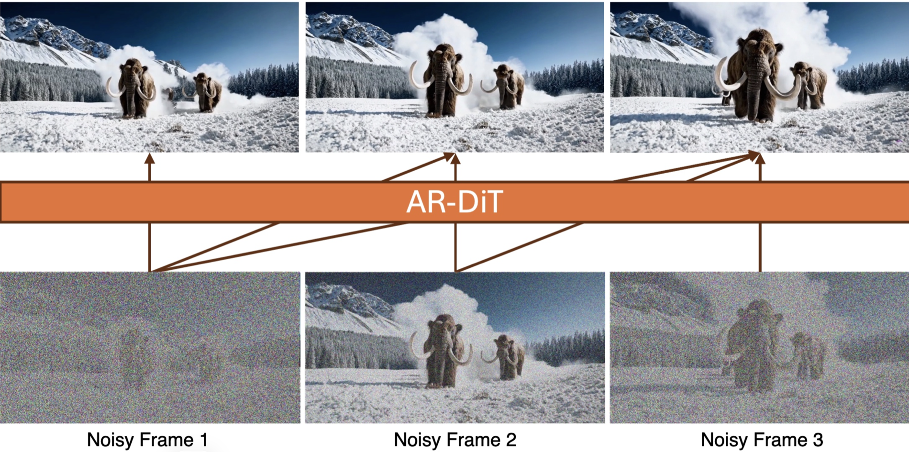
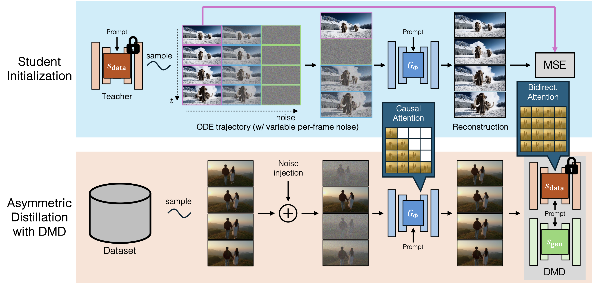
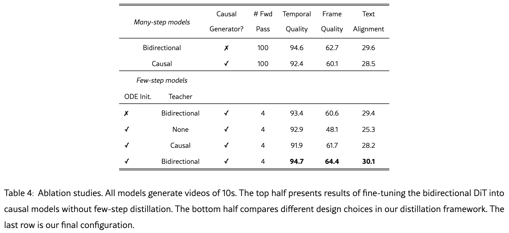
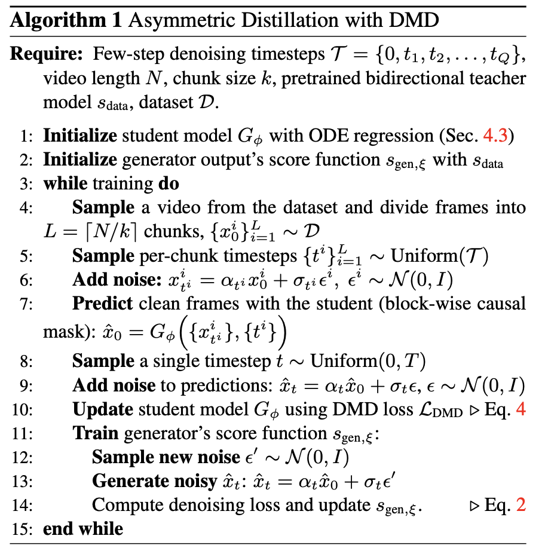
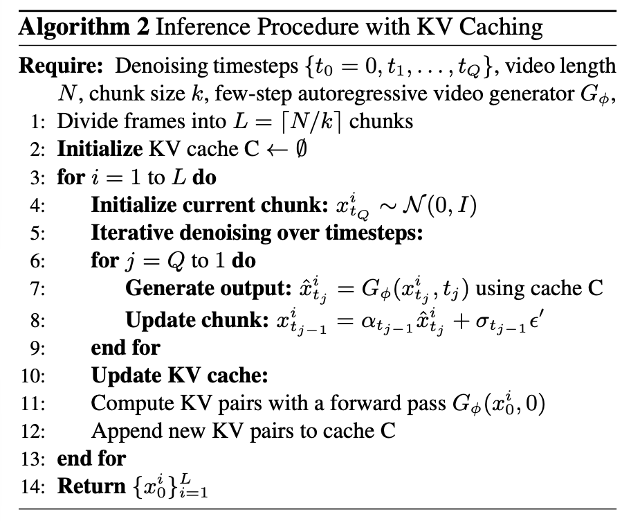

## 研究问题

传统视频扩散模型对整段视频做双向注意力，每次去噪都要处理全部帧，生成速度慢，也难以在视频尚未结束时持续输出。自回归生成能够逐块延长视频，却会把前面块的瑕疵带到后面，产生误差累积。CausVid 试图同时获得**双向教师的画质**和**因果模型的流式速度**。

作者的具体目标是：把一个需要 50 步采样的双向视频扩散模型，蒸馏为按块生成、每块只需 4 步的学生。相关背景可接着读 [DMD](2026-11-04-dmd.md)、[DMD2](2026-11-04-dmd2.md)、[Diffusion Forcing](2026-11-04-diffusion-forcing.md) 和 [CogVideoX](2026-11-04-cogvideox.md)。[Self Forcing](2026-11-04-self-forcing.md) 则是理解训练与推理上下文差异的后续阅读。


### Introduction：原笔记逐节学习记录

回顾了普通的DiT模型（慢）和自回归模型（误差累积）。

> **DiT 回顾**：扩散模型学习从噪声中逐步去噪。DiT 把 U-Net 换成 Transformer：视频的 latent 先切成 patch 变成 token，时间步和条件通过 AdaLN 等方式注入，网络预测噪声或速度场。
>
> - 只有类别、标量或全局向量条件：**直接 AdaLN-Zero**。
> - 文本到图像或视频，追求效果：**joint attention（MMDiT）**（把条件当 token 拼进序列）**+ AdaLN**。
> - 追求实现简单，或要复用已有架构：**cross-attention + AdaLN 时间步**。
> - 同时需要全局控制和细粒度控制：**两者都用**，AdaLN 管时间步和全局，attention 管 token 级语义。

主要贡献：

1. **因果注意力（causal dependencies）**：传统视频扩散模型用双向注意力（bidirectional attention），每一帧都能看到整段视频，包括未来帧。CausVid 改成因果结构，第 $t$ 帧只依赖第 $\le t$ 帧，所以可以逐帧生成。

   > 核心技巧：
   >
   > 1. **非对称蒸馏（asymmetric distillation）**：教师模型是双向注意力的预训练扩散模型，学生模型是因果模型。直接蒸馏一个自回归扩散模型效果不好，而用双向教师指导因果学生，论文称可以显著减少误差累积。

2. **样本高效训练（sample-efficient training）**：借鉴 LLM 的做法。在一次前向计算中，所有帧都同时参与训练，每一帧都能提供去噪监督信号，而不是只监督一个样本或一帧。这和 GPT 类模型对序列中每个位置都做 next-token 预测是同一思路。

3. **KV cache 加速推理**：生成新帧时，把之前帧的 Key/Value 缓存下来，只需为新帧计算一次，避免每一步重复计算整段历史。

   > #### Transformer 中的 Q、K、V
   >
   > Token 与表示：输入（文本 token，或视频的 patch/帧）先映射为向量，组成矩阵：
   > $$
   > X \in \mathbb{R}^{n \times d}
   > $$
   >
   > 其中 $n$ 是 token 个数，$d$ 是向量维度，每一行对应一个 token。
   >
   > Q、K、V 的来源
   >
   > 用三组可学习的权重矩阵对同一个输入 $X$ 做线性投影：
   >
   > $$
   > Q = X W_Q,\quad K = X W_K,\quad V = X W_V
   > $$
   >
   > 其中 $W_Q, W_K \in \mathbb{R}^{d \times d_k}$，$W_V \in \mathbb{R}^{d \times d_v}$。同一个输入通过三个不同的矩阵，得到三种“视角”。
   >
   > #### 注意力公式
   >
   > $$
   > \text{Attention}(Q,K,V) = \text{softmax}\left(\frac{QK^\top}{\sqrt{d_k}}\right)V
   > $$
   >
   > - $QK^\top \in \mathbb{R}^{n \times n}$：第 $i$ 行第 $j$ 列表示第 $i$ 个 token 对第 $j$ 个 token 的相关性分数。
   > - $\sqrt{d_k}$：缩放因子，防止点积过大导致 softmax 梯度消失。
   > - softmax 按行归一化，得到注意力权重。
   > - 最后用权重对 $V$ 加权求和。
   >
   > #### 直观理解
   >
   > | 向量 | 名称  | 含义                                           |
   > | ---- | ----- | ---------------------------------------------- |
   > | $Q$  | Query | 当前 token 在“查询”什么                        |
   > | $K$  | Key   | 每个 token 对外“标注”的特征，用于和 Query 匹配 |
   > | $V$  | Value | 每个 token 实际携带的内容                      |
   >
   > 对第 $i$ 个 token：
   >
   > 1. 用 $q_i$ 与所有 $k_j$ 做点积，得到相关性分数。
   > 2. 经 softmax 转为权重 $\alpha_{ij}$。
   > 3. 对所有 $v_j$ 加权求和，得到新表示：
   >
   > $$
   > y_i = \sum_{j} \alpha_{ij} v_j, \quad \alpha_{ij} = \frac{\exp(q_i \cdot k_j / \sqrt{d_k})}{\sum_{l} \exp(q_i \cdot k_l / \sqrt{d_k})}
   > $$
   >
   > #### Multi-Head Attention
   >
   > 把 $d$ 切成多个头，每个头独立做上面的计算，最后拼接。不同的头可以关注不同类型的关系。
   >
   > #### 与 KV Cache 的关系
   >
   > - 在因果（causal）注意力中，第 $i$ 个位置只能看到 $j \le i$ 的位置。
   > - 新 token 加入时，旧 token 的 $K_j = x_j W_K$ 和 $V_j = x_j W_V$ 不会改变，因此可以缓存。（**双向注意力就做不到这点**）
   > - 推理时每一步只需计算新 token 的 $q_t, k_t, v_t$，再让 $q_t$ 与缓存中的 $K_{1..t}$ 做注意力。
   > - **代价**：显存随序列长度线性增长。长视频会占用大量显存，所以实践中常用滑动窗口或限制最长缓存。
   > - 注意：**在视频扩散中**，需要注意去噪过程中当前帧的 K、V 会变化，只能缓存已完成的帧。

### Related work：长视频生成路线

长视频生成现有路线

1. **多片段重叠生成**：用在固定短片段上预训练的视频扩散模型，同时生成多个重叠片段，并通过各种策略保证时序一致性（如 FreeNoise、SEINE、DiffCollage 等）。
2. **分层生成**：先生成稀疏关键帧，再在关键帧之间插值（如 NUWA、MovieDreamer）。
3. **自回归生成**：天然适合任意长度视频，但长序列存在误差累积（error accumulation）问题。

- 本文观点：在自回归框架中，使用双向教师模型的分布匹配目标（DMD）能有效抑制误差累积，从而同时实现高效且高质量的长视频生成。

## 核心方法

### 先建立扩散与 score 的直觉

视频先经 3D VAE 压到时空潜变量，DiT 在潜空间预测噪声或与之等价的参数化。加噪过程是：

$$
x_t = \alpha_t x_0 + \sigma_t\epsilon, \qquad \epsilon\sim\mathcal N(0,I).
$$

$x_0$ 是干净视频潜变量；$x_t$ 是噪声等级 $t$ 下的样本；$\alpha_t$ 和 $\sigma_t$ 控制信号、噪声比例。采样时从高噪声状态反向去噪。**score function** 是带噪数据分布的对数密度梯度，**score model** 是对它的网络近似，**扩散模型**还包括加噪过程和采样器。若网络预测噪声，常用的换算是：

> [!TIP]
>
> - 噪声视角:这张图里的噪声是 $\epsilon$, 把它减掉就能去噪。
> - score 视角:往 **−$\epsilon$的方向**走,就是往数据靠近的方向。这个方向就是 score。**score = 往数据靠近的方向 = 去噪方向 = −噪声方向(除以 σ)**
> - 一句比喻：**score 就像山坡上指向山顶的"回山顶"指示牌:加噪是把你从山顶沿 ε 方向丢下山,所以指示牌指向 −ε(噪声的反方向);σ_t 是山的宽度,σ_t 越大,山越宽越平,指示牌上的坡度越缓、箭头越短**
>
> > 梯度是偏导数组成的向量，它的方向是函数上升最快的方向，模长是该方向上的最大变化率。
>
> $\mu = \alpha_t x_0 (衰减后的信号),\quad \sigma^2 = \sigma_t^2$代入高斯密度公式，得到：
> $$
> \log p(x_t\mid x_0)
> =
> -\frac{\|x_t-\alpha_t x_0\|^2}{2\sigma_t^2}
> +\mathrm{const}
> $$
>
> $$
> \begin{aligned}
> \nabla_{x_t}\log p(x_t\mid x_0)
> &= -\frac{x_t-\alpha_t x_0}{\sigma_t^2} \\
> &= -\frac{\alpha_t x_0+\sigma_t\epsilon-\alpha_t x_0}{\sigma_t^2} \\
> &= -\frac{\epsilon}{\sigma_t}.
> \end{aligned}
> $$
>
> 给去噪方向提供了一个概率分布上的解释。
>
> | 从噪声看               | 从分布看                   |
> | ---------------------- | -------------------------- |
> | 往“抵消噪声”的方向调整 | 往“局部密度升高”的方向调整 |

$$
s_\theta(x_t,t)=\nabla_{x_t}\log p_t(x_t)
\approx -\frac{\hat\epsilon_\theta(x_t,t)}{\sigma_t}.
$$

直观上，score 指出局部密度增加的方向；它只指示方向和变化率，实际位移还取决于采样器的时间步长和噪声调度。不同论文可能预测 $\hat\epsilon$、$\hat x_0$ 或 $v$。在同一噪声定义下：
$$
\hat x_0=\frac{x_t-\sigma_t\hat\epsilon}{\alpha_t},
\qquad
v=\alpha_t\epsilon-\sigma_t x_0.
$$

第二式假设 variance-preserving 参数化 $\alpha_t^2+\sigma_t^2=1$。这些量在理论上可以互换，但有限网络、不同损失权重和端点数值稳定性会使训练表现不同。这里的换算是阅读背景，不能据此断言 CausVid 的改进单独来自某一种预测参数化。

### 分块因果 DiT：块内双向、块间因果

3D VAE 先把像素视频编码成潜帧，再把潜帧按时间分块。学生对**当前块内部**使用双向注意力，以建模短时运动；对**块与块之间**使用因果注意力，当前块只能看自己和过去的块。若每块有 $k$ 个潜帧，可见性掩码为：

$$
M_{i,j}=1
\quad\Longleftrightarrow\quad
\left\lfloor\frac{j}{k}\right\rfloor
\le
\left\lfloor\frac{i}{k}\right\rfloor.
$$

例如 $k=2$ 时，位置 2、3 可互相看，也可看位置 0、1；位置 0、1 不能看未来块。这比“每帧只能看更早帧”的逐帧因果限制宽松。论文认为，在其按块解码的 3D VAE 下，像素输出本来就要等一整块潜变量，因此块内双向注意力不增加首帧等待时间。这个结论依赖**按块生成和解码**，不能直接推广到逐帧解码系统。


训练时所有块可以一次并行输入网络，掩码阻止它们偷看未来。每个块独立采样噪声时间步，沿用 [Diffusion Forcing](2026-11-04-diffusion-forcing.md) 的思路。于是一次前向能给多个位置提供训练信号；推理时则严格按块先后生成。

### ODE 初始化：先让因果学生站稳

教师是预训练的双向视频 DiT，学生从教师权重出发，但把注意力改成分块因果。二者可用的上下文不同：教师能看完整视频，学生不能。因此直接用分布匹配损失更新学生不稳定。作者先用教师的 ODE 采样轨迹构造输入与干净输出的对应数据，让学生回归教师结果。这一步是**初始化**，使学生具备基本去噪能力；它还不是最终的蒸馏目标。

只做 ODE 回归也不够。学生无法取得双向教师在未来块上的信息，逐样本拟合会受到架构差异限制；真正改善分布质量的后续步骤是 DMD。论文消融也能检验这两步各自的作用。

### 非对称 DMD：强教师指导因果学生

[DMD](2026-11-04-dmd.md) 的关键不是让学生逐像素复刻教师的某一条采样轨迹，而是比较“真实/教师分布”与“当前学生分布”在带噪样本上的 score。这里有三个角色：

| 角色 | 作用 | 更新方式 |
| --- | --- | --- |
| 因果学生 $G_\phi$ | 少步生成视频潜变量 | 用分布匹配信号更新 |
| $s_{\mathrm{data}}$ | 预训练双向教师，提供数据分布的 score | 冻结 |
| $s_{\mathrm{gen}}$ | 估计学生当前输出分布的 score | 用学生样本在线训练 |

学生生成 $\hat x_0$ 后，把它加噪成 $\hat x_t$。两个 score 网络在**同一个带噪样本、同一个时间步**上评估，由其差得到学生的更新方向。省略论文中的归一化权重与实现细节后，可把输出层的方向理解为：

$$
\nabla_{\hat x_0}\mathcal L_{\mathrm{DMD}}
\ \propto\
s_{\mathrm{gen}}(\hat x_t,t)
-
s_{\mathrm{data}}(\hat x_t,t).
$$

实际梯度要经过加噪过程传回学生，并按论文的权重处理；上式是**概念示意**，不是完整的实现公式。教师 score 固定；$s_{\mathrm{gen}}$ 由学生当前样本重新加噪，用标准去噪目标在线更新。学生分布一变，辅助 score 也要跟上，否则两者的差不再反映当前误差。少步、多步的延伸与 [DMD2](2026-11-04-dmd2.md) 相关。

把一次训练迭代拆开看，比记住一句“做 DMD”更有用：

1. **准备学生输入**：为每个视频块各抽一个少步时间步，加噪后用分块因果学生预测整段干净潜变量 $\hat x_0$。
2. **更新学生**：另抽一个共同的 $t$，把 $\hat x_0$ 加噪为 $\hat x_t$；冻结的双向教师 $s_{\mathrm{data}}$ 和当前学生分布模型 $s_{\mathrm{gen}}$ 都在此处给出 score。把二者之差反传到 $\hat x_0$，再更新学生 $G_\phi$。
3. **更新辅助 score 模型**：停止梯度进入学生，取它生成的样本，使用新噪声按普通扩散去噪目标训练 $s_{\mathrm{gen}}$。下一轮学生更新将使用更贴近当前生成分布的估计。

这个流程中的“两个 score”均是**扩散网络对分布梯度的估计**；不能把 $s_{\mathrm{gen}}$ 误称为学生生成器本身。简化的 MSE 代理目标可以帮助理解“把 score 差作为输出梯度”，但它不包含论文的权重、时间步采样和 stop-gradient 细节，不应直接复制成可运行实现。

“非对称”指双向教师指导因果学生。若先训练一个较弱的因果教师，再蒸馏因果学生，教师自己的误差可能先限制上限；双向教师保留了强模型的全局建模能力。


**两种时间步要分清。**学生输入的各块可各自采样一个少步时间步，模拟不同噪声状态的上下文；随后做 DMD 时，对学生输出的完整视频再采样**一个共同时间步**，以便双向教师和辅助 score 在相同噪声条件下比较。更新 $s_{\mathrm{gen}}$ 时再抽新噪声，避免把学生更新的噪声样本当作唯一训练目标。

### 推理：只缓存已经生成完的块

每生成一块，学生从纯噪声出发，经过 4 次少步去噪；每一步都可以访问历史块的 KV cache。当前块尚在去噪时，表征会随时间步改变，**不能**把它当作固定历史写进缓存。完成去噪后，作者额外以 $t=0$ 前向一次，得到该干净块的 Key/Value，再追加到历史缓存。

标准注意力为：

$$
\operatorname{Attention}(Q,K,V)
=\operatorname{softmax}\!\left(\frac{QK^\top}{\sqrt{d_k}}\right)V.
$$

新块的 Query 可以与历史缓存的 Key/Value 做注意力，不必反复重算全部历史。由于缓存中只放过去块，推理时自然满足块间因果；当前块内部仍可双向注意力。代价是缓存显存随历史长度增加。需要区分：**不能缓存正在去噪的当前块**，也不能把全局双向教师的历史表征直接当作最终因果缓存。

### 与邻近路线的关系

| 路线 | 训练上下文 | 阅读时应抓住的差别 |
| --- | --- | --- |
| Teacher forcing | 真实历史块 | 推理时历史变成模型自己生成，可能出现 exposure bias |
| [Diffusion Forcing](2026-11-04-diffusion-forcing.md) | 每块可有独立噪声等级 | 覆盖更多噪声组合；不等同于用自身 rollout 训练 |
| CausVid | 分块因果学生 + 双向教师的分布指导 | 把少步、流式、强教师蒸馏结合起来 |
| [Self Forcing](2026-11-04-self-forcing.md) | 模型自己 rollout 的历史 | 更直接针对训练与推理上下文不一致 |

视频压缩也影响可行性。[CogVideoX](2026-11-04-cogvideox.md) 的 3D VAE 是有用的前置阅读：时间压缩减少潜帧数和 attention token 数。CausVid 的教师采用相近的视频 DiT/3D VAE 架构，但“相近”不表示它就是 CogVideoX 的原权重。

**3D VAE 与图像 VAE 的区别。**图像 VAE 主要压缩每帧空间尺寸，视频经它处理后仍有近似相同的时间位置数；3D VAE 还沿时间轴压缩。例如 CausVid 所用设置中，16 个像素帧编码为 5 个潜帧。生成模型的时空 token 数约为“潜帧数 × 每潜帧的空间 patch 数”；因此时间压缩能显著减少长序列 attention 成本。潜变量通道数与 token 数不是一回事：增加通道可能提升信息容量，却不会直接把时间位置变少。具体压缩比应按实际 VAE 的首帧与块边界计算。


### Background：扩散、DMD、score 与 KL 的推导

以下保留原笔记的逐步解释与伪代码。伪代码用于理解梯度流向，不是可直接运行的 CausVid 实现；其中关于多样性、训练收益的直觉推断还需要实验验证。

视频扩散模型的基本思想是：从真实样本 $x_0$ 出发，逐步加入高斯噪声，得到 $x_t = \alpha_t x_0 + \sigma_t \epsilon$，其中 $\epsilon \sim \mathcal{N}(0, I)$，$\alpha_t$ 表示保留的信号强度，$\sigma_t$ 表示噪声强度（即噪声的标准差，$ \sigma_t\epsilon \sim \mathcal{N}(0,\sigma_t^2 I)$），二者由噪声调度（noise schedule）决定，共同定义每个时间步的信噪比。$t$ 越大，噪声越多。采样时则反过来，从纯噪声 $x_T$ 出发，逐步去噪，得到干净样本。

分布匹配蒸馏 DMD

DMD 的训练流程是：先用预训练的扩散模型同时初始化 $s_{\text{data}}$ 和 $s_{\text{gen}}$，然后冻结 $s_{\text{data}}$；每一步用学生生成样本、加噪、计算两个分数的差作为修正方向，更新学生；再用学生的输出训练 $s_{\text{gen}}$，使其学会学生当前的分布。$s_{\text{gen}}$ 的训练就是普通的去噪损失，即让网络预测加入的噪声。原始 DMD 只能单步生成，输入是纯噪声。DMD2 把输入换成部分去噪的中间样本，扩展到多步生成，这对 CausVid 的少步学生很关键。

v-prediction 的名字来自速度的含义。假设 $\alpha_t^2 + \sigma_t^2 = 1$，令 $\alpha_t = \cos\phi$，$\sigma_t = \sin\phi$，则 $x_t$ 在信号与噪声构成的平面上旋转，对角度求导得到的沿轨迹速度就是 $v = \alpha_t \epsilon - \sigma_t x_0$。在理想情况下，$\epsilon$-prediction、$x_0$-prediction 和 v-prediction 是等价的，但在有限网络中，它们对不同噪声水平的损失权重不同。此外 v 的方差与 $t$ 无关，反推 $x_0$ 时没有除以 $\alpha_t$ 的步骤，因此在少步蒸馏中更稳定。

> VP（variance-preserving，保持方差）是一种加噪约定，要求 $\alpha_t^2 + \sigma_t^2 = 1$。它的来龙去脉可以这样理解。
>
> 加噪公式是 $x_t = \alpha_t x_0 + \sigma_t\epsilon$，其中 $\epsilon$ 是方差为 1 的标准高斯噪声。假设 $x_0$ 与 $\epsilon$ 相互独立，则 $\text{Var}(x_t) = \alpha_t^2\,\text{Var}(x_0) + \sigma_t^2$。如果数据的方差 $\text{Var}(x_0)$ 为 1，这个式子就变成 $\alpha_t^2 + \sigma_t^2 = 1$，于是加噪后的方差始终保持为 1，不随 $t$ 变化。这就是 VP 的由来：它是为了让"信号的比例"和"噪声的比例"此消彼长，而总能量不变。
>
> 这里有一个前提：数据的方差需要大致为 1。这一点不是天然满足的。通常的做法是对数据做一个固定的全局缩放，使数据集的整体标准差接近 1。例如，LDM 的潜变量乘一个在数据集上统计得到的常数（如 Stable Diffusion 中约 0.18215）。这个常数是预处理，

> [!TIP]
>
> 一句话理解 score
>
> Score 是一个方向：在当前这个带噪样本上，往哪边走会更像真实数据。扩散网络学的就是这个方向，所以说网络就是 score 模型。
>
> 和噪声的关系
>
> 网络通常预测"加进去的噪声"。噪声指向的是"远离真实数据"的方向，所以取反就是"靠近真实数据"的方向。再按噪声强度做一次缩放，就得到 score。缩放的具体写法取决于论文用哪种参数化，常见写法是 score 等于负的噪声预测除以噪声强度，$\text{score} = -\hat\epsilon / \sigma_t$，但这只是一种约定。
>
> 为什么要关心这个方向：有了方向，就能从噪声一步步走到真实样本，这就是采样。蒸馏时，老师和学生各自给出方向，学生只要让两者的差距变小，就能学会用更少的步数生成样本。
>
> score function、score model 和扩散模型的关系
>
> - score function 是一个数学对象，指的是"在某个带噪样本上，往哪个方向走更像真实数据"。它不依赖任何具体的网络，只是一个从（样本，噪声水平）到方向的函数。它是我们想要知道的东西。
>
>
> - score model 是用神经网络去近似 score function 的那个网络。因为真实的 score function 无法直接写出来，所以训练一个网络来逼近它。网络的输出可以有多种形式：直接输出方向，输出加进去的噪声，输出干净样本，或输出 v-prediction。这些形式之间可以互相换算，所以它们都可以被看作同一个 score model 的不同读法。
>
>
> - 扩散模型是完整的系统，包括三部分：一个加噪的前向过程，用于生成训练数据；一个 score model，用于学习方向；以及一个采样过程，用于从噪声一步步走回样本。score model 只是扩散模型中的一个部件，但它是最核心的部件，因为采样时每一步都要靠它来决定往哪里走。
>
>
> 三者的关系可以概括为：score function 是目标，score model 是对目标的近似，扩散模型是利用这个近似来生成样本的整套方法。
>
> 在 DMD 里，老师网络就是一个训练好的 score model，它给出的是真实数据的方向；学生网络则是另一套生成器，它直接输出样本，不需要成为 score model；而 s_fake 也是一个 score model，只不过它的训练数据来自学生的输出，所以它代表的是学生分布的方向。

$\hat\epsilon$、$\hat x_0$、$v$、score 之间的换算

```python
eps_hat = (x_t - alpha_t * x0_hat) / sigma_t     # 由 x0 得到噪声
x0_hat  = (x_t - sigma_t * eps_hat) / alpha_t    # 由噪声得到 x0
v_hat   = alpha_t * eps_hat - sigma_t * x0_hat   # 由噪声和 x0 得到 v
score   = -eps_hat / sigma_t                     # 由噪声得到方向
```

$score = -\epsilon/\sigma_t$

所以，更一般地，不依赖噪声参数化的写法是 $\text{score} = (\alpha_t\hat x_0 - x_t)/\sigma_t^2$。

直观地说，噪声大时，每一步的方向感很弱（score 小）。

> 噪声大时，分布很宽，概率在较大范围内变化平缓，因此 score 的数值小，每一步的方向感较弱。但此时样本离真实数据很远，需要修正的距离大，去噪误差也大。score 小和误差大并不矛盾：前者描述的是当前位置的局部斜率，后者描述的是终点有多远。
>
> 噪声小时，分布很窄，数据附近的概率变化剧烈，因此 score 的数值大。但样本已经接近真实数据，需要修正的距离小。
>
> 采样时，步数由采样器事先设定，不会因单个样本的修正量而改变。每一步的实际位移由三部分共同决定：score 给出方向和变化速率，该步的时间跨度决定这一步占整个过程的比例，调度系数决定噪声与信号的比例如何随时间变化。因此，噪声大时即使 score 小，只要该步的时间跨度较大，单步位移仍可能不小；噪声小时，则常通过更细的时间切分来避免过冲。
>
> 一句话概括：score 决定每一步往哪边、以多快的速率走；采样器的时间切分决定每一步走多远；这儿步数是事先选定的超参数。

DMD伪代码：

```python
# ===== 三个网络 =====
G       = student_generator()   # 学生：少步生成视频，唯一要训练的"生成器"
s_real  = teacher_score()       # 老师：预训练的扩散模型，训练中冻结（不更新）
s_fake  = copy_of(s_real)       # 辅助：跟踪"学生当前输出"的分布，在线更新

opt_G    = Adam(G.parameters())
opt_fake = Adam(s_fake.parameters())

for step in range(num_steps):

    # ---------- 第一步：更新学生 G ----------
    noise = sample_noise()
    x = G(noise)                          # 学生生成一批样本

    t = sample_random_timestep()          # 随机选一个噪声水平
    x_t = add_noise(x, t)                 # 给生成结果加噪（和扩散模型一样的做法）

    # 老师和辅助网络分别给出"往哪个方向调整更好"的信号
    score_real = s_real(x_t, t)           # 老师：指向真实数据方向
    score_fake = s_fake(x_t, t)           # 辅助：指向当前生成分布方向

    # 关键一行：两个方向的差值，就是学生的修正方向
    grad = score_fake - score_real        # 注意符号：下面用 x 减去它，实际是朝 real 走

    # 技巧：把 grad 当成常数，只让它告诉 x 怎么动，不反向传播进老师和辅助网络
    target = (x - grad).detach()
    loss_G = mse(x, target)               # 最小化它，x 就朝 real - fake 的方向移动

    opt_G.zero_grad()
    loss_G.backward()
    opt_G.step()

    # ---------- 第二步：更新辅助网络 s_fake ----------
    # s_fake 的任务：学会"当前学生输出长什么样"，就像训练一个普通扩散模型一样
    x_fake = G(sample_noise()).detach()   # 学生的输出，不反传给 G
    t2 = sample_random_timestep()
    x_fake_t = add_noise(x_fake, t2)

    loss_fake = denoising_loss(s_fake, x_fake_t, t2, x_fake)  # 预测加进去的噪声
    opt_fake.zero_grad()
    loss_fake.backward()
    opt_fake.step()
```

具体注释：

```python
# ===== 三个网络 =====
'''
G（学生生成器）
- 唯一需要训练的网络，也是最终拿来用的模型。
- 输入：噪声（DMD2/CausVid 中还可以是部分去噪的样本）。
- 输出：干净样本 x0（视频 latent），而不是噪声。
- 结构通常与老师相同（DiT 或其因果版本），有时会缩小规模。
- "一步" = 只调用一次 G；"少步" = 反复调用 G，中间做加噪。
'''
G = student_generator()

'''
s_real（老师，冻结）
- 预训练好的扩散模型，训练过程中参数不更新。
- 它输出的是噪声预测 eps_pred，可以换算成 score：score = -eps_pred / sigma_t。
- 代表"真实数据的方向"：朝它走，样本会变得更像真实数据。
- 训练时只做前向计算，不参与反向传播。
'''
s_real = teacher_score()

'''
s_fake（副本，可训练）
- 一开始是老师的完整复制（copy_of），因此起点就具备去噪能力。
- 训练数据不是真实视频，而是学生 G 的输出。
- 训练完成后，它学到的是"学生输出分布的形状"，代表"学生当前扎堆的地方"。
- 名字里的 fake 指它建模的是学生生成的分布，而不是它本身是假的网络。
'''
s_fake = copy_of(s_real)

opt_G    = Adam(G.parameters())
opt_fake = Adam(s_fake.parameters())

for step in range(num_steps):

    # ---------- 第一步：更新学生 G ----------
    '''
    目标：让 G 的输出朝"真实方向、远离学生自身扎堆区"移动。
    这是对反向 KL 梯度的近似，mode-seeking 的来源就在这里。
    '''
    noise = sample_noise()
    x = G(noise)                          # 学生生成一批干净样本 x0

    '''
    随机选一个噪声水平 t，并对 x 加噪。
    老师和副本都是在"带噪样本"上工作的，所以必须先加噪。
    t 随机采样，使各个噪声水平都被覆盖到。
    '''
    t = sample_random_timestep()
    x_t = add_noise(x, t)                 # x_t = alpha_t * x + sigma_t * eps

    '''
    两个方向信号：
    - score_real：指向真实数据密度高的地方（吸引）。
    - score_fake：指向学生自己扎堆的地方（用于排斥）。
    注意两者都是在同一个带噪样本 x_t、同一个 t 上计算的，差值才有意义。
    '''
    score_real = s_real(x_t, t)           # 老师给出的方向
    score_fake = s_fake(x_t, t)           # 副本给出的方向

    '''
    grad = score_fake - score_real 不是 x 减去 score，而是两个"方向"之差。
    它的含义是：
        -grad = score_real - score_fake
    即"朝真实数据走，但别挤在学生已经很多的地方"。
    如果只用 score_real，所有样本会坍缩到密度最高的那几个点上（模式坍缩）。
    '''
    grad = score_fake - score_real

    '''
    target = (x - grad).detach() 的作用：
    - detach()：把 grad 当作常数，梯度只流向 G，不流回老师和副本。
    - x - grad = x + (score_real - score_fake)：样本朝目标方向移动。
    - mse(x, target)：最小化它，就等价于让 x 沿 -grad 移动。
    这是一个常见的实现技巧，把"自定义梯度"包装成普通的 MSE 损失。
    '''
    target = (x - grad).detach()
    loss_G = mse(x, target)

    opt_G.zero_grad()
    loss_G.backward()
    opt_G.step()

    # ---------- 第二步：更新副本 s_fake ----------
    '''
    目标：让 s_fake 学会"学生当前的输出长什么样"。
    这一步完全不改变 G，只训练 s_fake。
    它的训练方式与普通扩散模型相同：去噪，即预测加进去的噪声。
    '''
    x_fake = G(sample_noise()).detach()   # 学生的输出，不让梯度回到 G

    '''
    denoising_loss 的过程：
    1. 生成随机噪声 eps（这是"标准答案"）。
    2. 用 eps 对 x_fake 加噪，得到 x_fake_t。
    3. 让 s_fake 根据 x_fake_t 和 t 预测 eps。
    4. 计算预测值与真实 eps 的误差。
    注意：eps 只能在函数内部生成，因为只有它知道加进去的噪声是什么。
    '''
    t2 = sample_random_timestep()
    loss_fake = denoising_loss(s_fake, x_fake, t2)

    opt_fake.zero_grad()
    loss_fake.backward()
    opt_fake.step()

'''
整体直觉（一句话）：
- s_real 把样本往真实数据拉；
- s_fake 监测学生自己扎堆的地方，并把样本推开；
- G 同时受这两股力影响，所以既能靠近真实分布，又能保持多样性。
'''
```

<font color="brown">反向 KL 对学生参数的梯度，等于学生 score 减教师 score 沿样本反传</font>：

最小化反向 KL 散度 $D_{\mathrm{KL}}(p_{\mathrm{fake}}\|p_{\mathrm{real}})$，使生成分布逼近真实分布。
$$
\begin{equation}
\begin{aligned}
D_{\mathrm{KL}}\left(
    p_{\mathrm{fake}} \,\|\, p_{\mathrm{real}}
\right)
&=
\mathbb{E}_{x \sim p_{\mathrm{fake}}}
\left[
    \log\left(
        \frac{p_{\mathrm{fake}}(x)}
             {p_{\mathrm{real}}(x)}
    \right)
\right]
\\
&=
\mathbb{E}_{\substack{
    z \sim \mathcal{N}(0;\mathbf{I}) \\
    x = G_{\theta}(z)
}}
\left[
    -\left(
        \log p_{\mathrm{real}}(x)
        -
        \log p_{\mathrm{fake}}(x)
    \right)
\right].
\end{aligned}
\tag{DMD式1}
\end{equation}
$$
将 KL 梯度表示为 score 差 $s_{\mathrm{fake}}(x)-s_{\mathrm{real}}(x)$ 与生成器雅可比的乘积期望。

参数影响真实分布对数密度的路径是：
$$
\theta
\;\longrightarrow\;
x=G_\theta(z)
\;\longrightarrow\;
\log p_{\mathrm{real}}(x)
$$
根据链式法则：
$$
\begin{aligned}
\frac{d}{d\theta}
\log p_{\mathrm{real}}\bigl(G_\theta(z)\bigr)
&=
\underbrace{
\left.
\frac{\partial \log p_{\mathrm{real}}(x)}{\partial x}
\right|_{x=G_\theta(z)}
}_{\text{score：对数密度如何随图片变化}}
\cdot
\underbrace{
\frac{\partial G_\theta(z)}{\partial\theta}
}_{\text{生成器导数：图片如何随参数变化}}
\\
&=
s_{\mathrm{real}}\bigl(G_\theta(z)\bigr)
\frac{\partial G_\theta(z)}{\partial\theta}.
\end{aligned}
$$

$$
\begin{equation}
\nabla_{\theta} D_{\mathrm{KL}}
=
\mathbb{E}_{\substack{
    z \sim \mathcal{N}(0;\mathbf{I}) \\
    x = G_{\theta}(z)
}}
\left[
    -\left(
        s_{\mathrm{real}}(x)
        -
        s_{\mathrm{fake}}(x)
    \right)
    \frac{dG}{d\theta}
\right].
\tag{DMD式2}
\end{equation}
$$

> 原始真实分布的 score 通常无法直接获得，DMD 因而利用预训练扩散模型估计加噪后真实分布的 score。

利用加噪分布的 score 差及权重 $w_t\alpha_t$，构造近似分布匹配梯度。
$$
\begin{equation}
\nabla_{\theta} D_{\mathrm{KL}}
\simeq
\mathbb{E}_{z,t,x,x_t}
\left[
    w_t \alpha_t
    \left(
        s_{\mathrm{fake}}(x_t,t)
        -
        s_{\mathrm{real}}(x_t,t)
    \right)
    \frac{dG}{d\theta}
\right].
\tag{DMD式7}
\end{equation}
$$

> [!NOTE]
>
> $\alpha_t$ 是链式法则得来：
> $$
> \begin{aligned}
> \frac{\partial x_t}{\partial\theta}
> &=
> \frac{\partial x_t}{\partial x}
> \frac{\partial x}{\partial\theta}
> \\
> &=
> \alpha_t
> \frac{\partial G_\theta(z)}{\partial\theta}.
> \end{aligned}
> $$
> 作者发现，不同噪声水平给出的梯度大小可能差异很大，于是额外加入$w_t$，改善训练动态、归一化不同噪声水平下梯度幅度：
> $$
> \begin{equation}
>     w_t = \tfrac{\sigma_t^2}{\alpha_t} \tfrac{CS}{|| \mu_\text{base}(x_t, t)-x ||_1},
>     \label{eq:weighting}
> \end{equation}
> $$
> 具体而言，是计算去噪图像与输入图像在空间$S$和通道维度$C$上的平均绝对误差 的倒数。
>
> 权重 $$w_t$$ 采用启发式归一化设计：用 $\tfrac{\sigma_t^2}{\alpha_t}$ 抵消 score 差中固有的系数 $\tfrac{\alpha_t}{\sigma_t^2}$，再用 $\tfrac{CS}{\|\mu_{\mathrm{base}}(x_t,t)-x\|_1}$，去噪预测与未加噪生成图像之间的平均绝对误差（MAE）的倒数，按当前样本的参考误差尺度缩放更新信号，而非由理论唯一推导得到。
> $$
> \begin{aligned}
> & \because \\
> &s_{\mathrm{fake}}(x_t,t)-s_{\mathrm{real}}(x_t,t)
> \\
> &=
> \frac{\alpha_t\mu_{\mathrm{fake}}(x_t,t)-x_t}{\sigma_t^2}
> -
> \frac{\alpha_t\mu_{\mathrm{real}}(x_t,t)-x_t}{\sigma_t^2}
> \\
> &=
> \frac{
> \alpha_t\mu_{\mathrm{fake}}(x_t,t)-x_t
> -\alpha_t\mu_{\mathrm{real}}(x_t,t)+x_t
> }{\sigma_t^2}
> \\
> &=
> \frac{\alpha_t}{\sigma_t^2}
> \left[
> \mu_{\mathrm{fake}}(x_t,t)
> -
> \mu_{\mathrm{real}}(x_t,t)
> \right].
> \end{aligned}
> $$

其中两个 score 在加噪后的同一 $x_t$、同一时间步 $t$ 上计算。出处：[DMD](2026-11-04-dmd.md)原论文。

反向KL散度理解：

```python
'''
前向 KL 的行为。q 必须"覆盖"p 的所有模式。
反向 KL 的行为。q 不需要覆盖所有模式，它会"寻找"并锁定其中一个或几个模式，然后集中在那里。
'''
import numpy as np

EPS = 1e-12  # 防止除以 0 或 log(0)

'''
【核心规则：谁是分母，谁决定哪里会被重罚】

KL(a || b) = sum a * log(a / b)

- 期望是在 a 上取的：a 有质量的地方才计入惩罚。
- 分母是 b：b 很小而 a 很大时，log(a/b) 会爆炸，loss 巨大。

所以：
- 前向 KL(p || q)：分母是 q。p 有质量而 q 没有 → 重罚 → q 必须覆盖 p 的所有模式。
- 反向 KL(q || p)：分母是 p。q 有质量而 p 没有 → 重罚 → q 只敢待在 p 的高密度区。
'''

def forward_kl(p, q):
    '''
    前向 KL：KL(p || q)，以真实数据 p 为准。
    惩罚发生在：p 有质量、q 没有（分母 q 很小）。
    后果：q 会尽量在所有地方都有质量，覆盖全部模式（mode-covering）。
    代价：两个模式之间可能生成模糊的"平均"样本。
    '''
    return np.sum(p * np.log((p + EPS) / (q + EPS)))

def reverse_kl(p, q):
    '''
    反向 KL：KL(q || p)，以生成结果 q 为准。
    惩罚发生在：q 有质量、p 没有（分母 p 很小）。
    后果：q 不敢在 p 概率低的地方放质量，只集中在某个模式上（mode-seeking）。
    代价：可能漏掉部分模式，多样性下降。
    DMD 使用的就是这一种。
    '''
    return np.sum(q * np.log((q + EPS) / (p + EPS)))

# 真实数据：只在两个格子上有质量，即两个"模式"
p_data = np.array([0.5, 0.0, 0.0, 0.5])

# 候选 A：摊开，覆盖两个模式，但中间也有质量
q_spread = np.array([0.25, 0.25, 0.25, 0.25])

# 候选 B：集中在第一个模式上
q_focus = np.array([0.97, 0.01, 0.01, 0.01])
```

### Methods：论文 4.1–4.4 与实现流程

**method 章节总览**

目标：把一个多步、双向的视频扩散模型，蒸馏成 4 步、因果的流式生成器 $G_\phi$。

三个关键设计：

1. 自回归架构：分块因果注意力（4.1）
2. 训练：非对称蒸馏（4.2）+ ODE 初始化（4.3）
3. 推理：KV cache（4.4）

#### 4.1 Autoregressive Architecture

目标：设计学生生成器 $G_\phi$，使它既能逐 chunk 流式生成，又尽量保持质量。

流程：3D VAE 按 chunk 独立编码，把视频压成潜帧。DiT 只在潜空间中按 chunk 顺序生成，解码器再还原像素。

分块因果注意力（block-wise causal attention）：

- 块内：潜帧之间双向注意力，用来建模局部时序依赖，保证一致性。
- 块间：因果注意力，当前 chunk 只能看自己和之前的 chunk。
- 掩码：$M_{i,j}=1 \iff \lfloor j/k \rfloor \le \lfloor i/k \rfloor$，$k$为 chunk 大小。
- 例：$k=2$时，第 2 帧可见第 0–3 帧，第 0 帧只可见第 0–1 帧。

实现：在 DiT 上只把自注意力换成带掩码的版本，其余结构不变，所以能复用预训练的双向权重，收敛更快。

延迟：论文称与完全因果注意力相同。原因是 3D VAE 解码器至少需要一个 chunk 的潜帧才能输出像素，所以块内双向不增加等待时间。

- 前提：以 chunk 为生成和解码单位。若换成逐帧解码，完全因果可以逐帧输出，分块因果的首帧延迟就会更大。

**图 5的理解**



- 下排是带不同噪声的输入 chunk，中间是 AR-DiT，上排是各位置的去噪输出。
- 箭头表示信息流向：输出 $i$只依赖输入 $1\ldots i$，即因果（下三角）注意力。
- 图中的 "Frame" 实际是 chunk，每块只画了一帧以便简化。
- 各 chunk 噪声程度不同，对应 Diffusion Forcing 式的 per-chunk 独立时间步。
- 图中是训练时的视角：所有 chunk 并行输入，靠掩码限制可见范围。推理时是逐块生成，并用 KV cache。

**关于 per-chunk 独立噪声（论文未展开解释，以下为推理，非原文）**

论文只说明沿用 Diffusion Forcing，没有解释动机。可能的好处：

- 对齐训练与推理：推理时上下文是干净的，当前块是噪声。独立采样时间步能覆盖这种组合。
- 训练效率高：一次前向就能训练多种"上下文噪声 × 目标噪声"的组合。
- 缓解误差累积：带噪上下文相当于数据增强，模型对上下文的小误差更鲁棒。
- 灵活：可适配不同的推理方式。

> [!IMPORTANT]
>
> | 方法              | 训练时的噪声排布                                 | 上下文来源             | 解决的问题                     | 局限                             |
> | ----------------- | ------------------------------------------------ | ---------------------- | ------------------------------ | -------------------------------- |
> | 整段扩散          | [相同噪声, 相同噪声, 相同噪声]                   | 无（整段一起去噪）     | 质量高，实现简单               | 不能流式、变长生成               |
> | Teacher Forcing   | [真实干净, 真实干净, 带噪目标]                   | **真实数据**           | 能因果、逐块生成               | 训练和推理不一致，长序列误差累积 |
> | Rolling Diffusion | [较低噪声, 中等噪声, 较高噪声]（沿时间单调递增） | 窗口内部分去噪的帧     | 滑动窗口，可持续生成长视频     | 噪声排布固定，灵活性较低         |
> | Diffusion Forcing | [各自独立采样的噪声等级，不要求单调]             | 任意噪声程度的帧       | 统一以上几种范式，采样方式灵活 | 训练时上下文仍不是模型自己生成的 |
> | Self Forcing      | [自己生成的干净, 自己生成的干净, 带噪目标]       | **模型自己的 rollout** | 缓解 exposure bias             | 训练开销更大，需要截断梯度等技巧 |

> [!NOTE]
>
> Diffusion Forcing 和 Self Forcing都是沿用Teacher Forcing这个命名框架，Teacher Forcing命名的历史：
>
> - **forcing（强制）：** 训练时，把模型下一步的输入强制换成"老师"给的真值，不用模型自己上一步的预测。
> - **teacher（老师）：** 提供真值的数据集，也就是正确答案。
>
> 所以字面意思是"让老师强行接管输入"。比如训练语言模型预测第 5 个词时，输入的前 4 个词是真实文本，哪怕模型上一步预测错了，也不让错误传下去。在动力系统和控制里，forcing 本来就有"外部驱动、强加输入"的意思，这个词大概是从那里借来的。


**背景补充：3D VAE 与图像 VAE**

|                       | 图像 VAE（如 SD）             | 3D VAE（如 CogVideoX）               |
| --------------------- | ----------------------------- | ------------------------------------ |
| 压缩维度              | 仅空间（×8）                  | 空间（×8）+ 时间（×4）               |
| 通道数                | 4                             | 16                                   |
| 例子                  | 512×512×3 → 64×64×4，约 48 倍 | 49×480×720×3 → 13×60×90×16，约 45 倍 |
| 潜帧数                | 与原帧数相同（49）            | $T'=(N-1)/4+1$（13）                 |
| token 数（patch 2×2） | 约 6.6 万                     | 约 1.76 万（约 1/3.8）               |

> [!TIP]
>
> VAE 论文中的压缩比通常指元素个数的比例，数据类型属于存储和计算的选择，不计入 VAE 本身的压缩。

- 因果 3D VAE 的约定：第一帧单独成一个潜帧，之后每 4 帧合成一个，所以帧数取 $4k+1$。具体实现以所用模型为准。
- token 数由潜帧数和空间 patch 数决定，与通道数无关。通道数只影响每个 token 的输入维度、潜变量的信息容量和显存：多通道让重建更精细，但生成端的难度也更高；少通道让生成更容易，但可能损失细节
- 注意力计算量与 token 数的平方成正比，所以时间压缩对效率帮助很大。

#### 4.2 Bidirectional → Causal Generator Distillation（非对称蒸馏）

图6的理解：

上半部分是通过ODE回归做初始化，下半部分是做DMD。

> 学生的因果结构与教师不同，直接 DMD 不稳定。ODE 回归提供了一个稳妥起点。

> [!NOTE]
>
> Q：为什么不能直接ODE回归训练得到student，而需要用DMD呢？
>
> - ODE 回归：
>
>   ODE 轨迹是**双向教师**生成的，因果学生看不到未来 chunk 的噪声。所以学生**在信息上就无法精确复现**这个目标。MSE 回归遇到"同一输入对应多种可能目标"的情况，最优解是取平均，结果往往是画面模糊、缺少细节。
>
> - DMD：
>
>   DMD 是分布级、基于学生自己输出的监督，不要求逐样本对应，所以用于正式训练。
>
>   分布匹配不强制学生复现教师具体的采样路径，因此给少步学生留下了寻找自身生成映射的自由。这也是 DMD/DMD2 相比成对轨迹回归所强调的优势。
>
> 另外：
>
> 1. 数据成本和覆盖不足：每一对 ODE 数据都要跑一次多步教师采样，成本高。
> 2. 模型上限：ODE回归的效果上限受teacher轨迹限制。DMD 训练时用的是教师在各个噪声等级上的 score，信号更密集，少步学生有机会在某些指标上接近甚至超过多步教师。这是蒸馏领域的一些观察。



| 符号       | 是什么                                 | 训练过程中是否更新 |
| ---------- | -------------------------------------- | ------------------ |
| $G_ϕ$      | 最终要得到的因果、少步学生生成器       | 更新               |
| $s_{data}$ | 预训练双向教师，提供目标分布的 score   | 冻结               |
| $s_{gen}$  | 辅助扩散模型，估计学生输出分布的 score | 持续更新           |

CausVid 的消融表中，`ODE Init. = ✓，Teacher = None` 就表示完成 ODE 初始化后，不再进行后续教师蒸馏：



> [!NOTE]
>
> 可以看到，这张表里学生在某些指标上超过教师。但作者也承认：学生的单帧质量更高，但时间闪烁和输出多样性更差。
>
> "While our student model improves upon the bidirectional teacher for frame-by-frame quality, it performs worse in temporal flickering and output diversity."
>
> 可能原因（推断）：DMD （mode-seeking）偏向高概率模式，VBench 偏爱清晰、标准的画面，而且多样性不被衡量。

朴素方案：先把双向 DiT 改成因果并微调，得到因果教师，再蒸馏。

- 训练时每个 chunk 有独立噪声时间步 $t^i\in[0,999]$（沿用 Diffusion Forcing）。
- 推理时逐 chunk 去噪，以前面已生成的干净 chunk 为条件。

问题：

- 因果模型通常不如双向模型，弱教师限制了学生的上限。
- 教师的误差累积会传给学生。

做法：教师保持双向，学生使用因果，学生通过分布匹配蒸馏（DMD）损失向教师学习。

Algorithm 1 流程：

1. 用 ODE 回归初始化学生 $G_\phi$，用 $s_\text{data}$初始化生成分布的 score 网络 $s_{\text{gen},\xi}$。
2. 把视频切成 $L=\lceil N/k\rceil$个 chunk，每个 chunk 独立从少步集合 $\mathcal T=\{0,t_1,\dots,t_Q\}$采样时间步并加噪。
3. 学生（带分块因果掩码）预测干净帧 $\hat x_0$。
4. 再采样一个统一的 $t\sim U(0,T)$，给 $\hat x_0$加噪得到 $\hat x_t$，计算 DMD 损失并更新学生。
5. 用新噪声重新加噪 $\hat x_0$，用去噪损失更新 $s_{\text{gen},\xi}$。

```python
'''
伪代码理解 论文的 DMD 梯度与交替训练过程
'''

# G：ODE 初始化后的学生，输出干净视频 latent
# real_model：冻结的教师，假设输出噪声预测
# fake_model：从教师复制，输出噪声预测，持续训练

real_model.requires_grad_(False)

for clean_video, prompt in dataloader:

    # ===== 构造学生输入 =====

    # 每个 chunk 从少步集合中独立采样时间步
    chunk_t = sample_per_chunk_timesteps(few_step_set)

    eps_in = torch.randn_like(clean_video)
    noisy_video = add_noise(clean_video, chunk_t, eps_in)

    # 保留到 G 的计算图
    x = G(noisy_video, chunk_t, prompt)

    # 保存固定样本，稍后用于训练 fake_model
    x_fake = x.detach()

    # ===== 第4步：更新 G =====

    # 对一段视频使用共同时间步（沿用教师的加噪定义，教师不是按Diffusion Forcing这种方式训练得来的），通常避开数值不稳定的端点
    t = sample_dm_timestep()
    alpha_t, sigma_t = noise_schedule(t)

    with torch.no_grad():
        eps = torch.randn_like(x)
        x_t = alpha_t * x.detach() + sigma_t * eps

        eps_real = real_model(x_t, t, prompt)
        eps_fake = fake_model(x_t, t, prompt)

        score_real = -eps_real / sigma_t
        score_fake = -eps_fake / sigma_t

        # 对学生输出 x 施加的梯度信号
        grad = weight(t) * alpha_t * (score_fake - score_real)
        '''
        1. 乘 α_t：链式法则。直观地说，x 动一点，x_t 只动 α_t 倍。当 α_t 很小（噪声很大）时，x 对 x_t 的影响很弱，梯度也应该按比例变小。
        2. weight(t)：控制各噪声等级的重要性。weight(t) 把梯度按幅度归一化，让不同噪声等级、不同样本的梯度大小可比。 它不是需要仔细调的超参数，多数后续工作（DMD2 等）基本沿用。
        '''

        target = (x - grad).detach()

    # x 仍然连接 G；target 不参与反向传播
    loss_G = 0.5 * ((x - target) ** 2).mean()

    opt_G.zero_grad()
    loss_G.backward()
    opt_G.step()

    # ===== 第5步：更新 fake_model =====

    # 复用同一份学生输出，使用新噪声
    eps_new = torch.randn_like(x_fake)
    x_t_new = alpha_t * x_fake + sigma_t * eps_new

    # 这里不能用 no_grad：需要更新 fake_model
    eps_pred = fake_model(x_t_new, t, prompt)

    loss_fake = (
        denoise_weight(t) * (eps_pred - eps_new) ** 2
    ).mean()

    opt_fake.zero_grad()
    loss_fake.backward()
    opt_fake.step()
```

注意：

- 学生的时间步取自少步集合 $\mathcal T$，与 4 步推理的状态一致。
- 第 4 步的 $t$是整段共用的单个时间步，不再是 per-chunk，这是 DMD 的分布匹配部分，与第 2 步不同。

#### 4.3 Student Initialization（ODE 初始化）

动机：学生与教师架构不同（因果 vs 双向），直接用 DMD 损失训练学生不稳定。

做法：

1. 从高斯分布采样噪声序列 $\{x_T^i\}$。
2. 用 ODE 求解器和双向教师反向去噪，得到完整轨迹，并取出与学生时间步对应的点，作为"ODE 解对"。
3. 学生（由教师权重初始化）做回归：输入各 chunk 的带噪样本 $x^i_{t^i}$，目标是干净帧 $x_0^i$，损失 $\mathcal L_\text{init}$为 MSE。

特点：只需要少量 ODE 数据对和少量迭代，计算成本低。



#### 4.4 Efficient Inference with KV Caching



Algorithm 2 流程：对每个 chunk 依次执行：

1. 从纯噪声 $x_{t_Q}$开始。
2. 在 4 个时间步上迭代去噪：每步 $G_\phi$预测干净结果，再重新加噪到下一个时间步。去噪时使用 KV cache 中的历史信息。
3. 去噪完成后，用干净 chunk 前向一次（$t=0$）算出 KV，追加到 cache。

要点：

- 有了 KV cache，推理时不再需要分块因果掩码：历史 chunk 已在 cache 里，当前 chunk 内部本来就是双向的。因此可以直接用 FlashAttention 等高效的双向注意力实现。

  > FlashAttention 本身也支持标准因果掩码（逐 token 的因果约束），不方便的是块状因果（chunk-wise causal）这类自定义掩码。

- 缓存的 KV 由 $t=0$的干净 chunk 算出，对应训练时上下文中包含 $t=0$chunk 的情形。

**一句话串联**

用 3D VAE 把视频压成按 chunk 排列的潜帧。学生是分块因果的 DiT，教师是双向的 DiT。先用 ODE 回归让学生"热身"，再用 DMD 做非对称蒸馏，得到 4 步生成器。推理时按 chunk 生成，并用 KV cache 加速。

## 关键发现

- 论文报告：50 步双向教师蒸馏为 4 步因果学生；在单张 H100 上，首段延迟约 **1.3 秒**，后续流式输出约 **9.4 FPS**。这些是作者设置下的结果，部署性能仍依赖分辨率、硬件和实现。
- 作者报告 VBench-Long 总分 **84.27**。这个指标支持整体生成质量，但不应替代对闪烁、多样性和真实长时部署的单独检查。
- 论文消融表的逐项证据：仅 ODE 初始化而无后续教师蒸馏，temporal/frame/text 分别为 **92.9/48.1/25.3**；不用 ODE 初始化、直接以双向教师蒸馏为 **93.4/60.6/29.4**；ODE 初始化加因果教师为 **91.9/61.7/28.2**；最终的 ODE 初始化加双向教师为 **94.7/64.4/30.1**。这同时支持初始化和非对称教师设计。
- 论文坦言：学生的逐帧质量可能高于教师，但**时间闪烁与输出多样性仍较差**。因此不能把某个综合分数解读为所有维度都超过教师。
- 训练中以块为单位并行计算、推理中逐块生成的区分很关键：**因果依赖**不等于**训练时只能串行计算**。


### Experiments：原笔记的实验设置

教师模型是类似CogVideoX的DiT结构。它的3D VAE会将16个视频帧编码为5个潜帧。 在10秒的视频上训练。

## 我的提问

### Q1：DiT 的 Q、K、V 是什么，为什么 KV cache 能加速？

输入 token 经三组线性投影得到 Query、Key、Value：$Q=XW_Q$、$K=XW_K$、$V=XW_V$。Query 提出当前要找的信息，Key 用来匹配，Value 携带被聚合的内容。在因果生成中，已完成历史块不会因未来块出现而改变，故可复用其 Key/Value。缓存省的是**重算历史表示**，并非消除新块与历史块之间的注意力计算。

### Q2：score function、score model 与扩散模型是一回事吗？

不是。score function 是目标分布的数学梯度；score model 是网络近似；扩散模型还包含加噪与采样规则。DMD 的学生生成器不必直接输出 score，教师 $s_{\mathrm{data}}$ 和辅助 $s_{\mathrm{gen}}$ 才承担 score 估计的角色。理解这点后，“三个网络”不再显得重复。

### Q3：为什么要同时保留教师 score 和学生分布 score？

只看教师方向，难以判断学生的输出分布相对数据分布缺了什么或堆在何处。辅助 score 追踪学生当前分布；两者在相同 $\hat x_t$ 上的差提供分布匹配方向。辅助模型需要随学生交替更新，而教师保持冻结。原笔记里把它类比成“真实分布的吸引”和“当前生成分布的对照”，这个直觉有帮助，但不应把 DMD 保证成一定提升多样性的机制。

### Q4：反向 KL 与多样性有什么关系？

$\mathrm{KL}(q\|p)$ 以生成分布 $q$ 为期望：若 $q$ 把质量放在真实分布 $p$ 很低的区域，惩罚很大；因此容易偏向高密度模式。相反，$\mathrm{KL}(p\|q)$ 会重罚真实模式没有被生成分布覆盖的情况。DMD 的分布匹配方向与反向 KL 有关，**mode seeking** 可解释质量与多样性的部分权衡；具体闪烁或多样性损失还需要实验确认，不能单凭 KL 直觉归因。

### Q5：为什么不能只用 ODE 轨迹回归？

ODE 对提供了稳定起点，却要求因果学生拟合一个能使用未来信息的双向教师的对应输出。学生做不到完全复刻这种条件信息。DMD 比较的是输出分布的 score，不要求每个样本都一一匹配同一教师轨迹；消融中只做 ODE 初始化的 frame/text 分数明显较低。

### Q6：per-chunk 时间步与 DMD 的共同时间步为什么不冲突？

前者用于构造学生的训练输入，让它看见不同噪声程度的块；后者用于把学生的**完整输出**加噪后交给两个 score 网络比较。它们服务于训练流程的两个不同阶段。把二者混为一谈，就会误以为双向教师必须接受每块不同噪声的输入。

### Q7：分块因果的“首帧延迟不变”适用于所有系统吗？

不适用。论文的结论建立在 3D VAE 按块解码的前提上。若后端能逐帧解码，逐帧因果模型可能更早输出第一帧；分块模型仍需等待当前块完成。

### Q8：Diffusion Forcing 和 Self Forcing 怎么区分？

[Diffusion Forcing](2026-11-04-diffusion-forcing.md) 强调序列各位置可独立取噪声等级；[Self Forcing](2026-11-04-self-forcing.md) 强调训练时让模型使用自己 rollout 的历史，以缩小训练与推理的差异。二者关注点不同，也可以组合考虑。CausVid 用前者的 per-chunk 噪声排布；本笔记没有证据表明它已经采用 Self Forcing 的完整训练方案。

### Q9：3D VAE 的时间压缩为什么重要？

视频 Transformer 的 token 数由潜帧数和空间 patch 数共同决定。时间压缩减少潜帧数，通常能显著降低注意力开销。通道数增大可以保留更多信息，但不能简单把“压缩倍率”只理解为磁盘字节数。以论文设置为例，16 个像素帧编码为 5 个潜帧；要核对实际模型的首帧处理、块边界和解码依赖，不能套用任意 3D VAE 的公式。

### Q10：为什么缓存只写入干净块？

去噪中的当前块在各个时间步都变化，其 Key/Value 也变化；过早写入会让后续块读到过期状态。完成当前块后再以 $t=0$ 前向生成缓存，才与后续块应见到的“已完成历史”一致。

### Q11：$\hat\epsilon$、$\hat x_0$、$v$ 和 score 怎样相互换算？

在加噪定义 $x_t=\alpha_t x_0+\sigma_t\epsilon$ 下，只要相应系数非零，就有 $\hat\epsilon=(x_t-\alpha_t\hat x_0)/\sigma_t$、$\hat x_0=(x_t-\sigma_t\hat\epsilon)/\alpha_t$，而 score 可写为 $-\hat\epsilon/\sigma_t$。在 VP 约定下，$v=\alpha_t\epsilon-\sigma_t x_0$。这些是代数关系；接近 $\alpha_t=0$ 或 $\sigma_t=0$ 的端点时，直接相除可能数值不稳，实际模型要看自身参数化和调度。

### Q12：噪声越大、score 越小，是不是就该多采样几步？

不能只凭 score 的数值决定步数。高噪声分布通常更宽、局部密度斜率可能较小，但样本离最终干净结果远；真正的单步位移由 score、时间跨度与采样器系数共同决定。步数是选定的采样计划，少步蒸馏是在这些较大的时间跨度上直接训练可用的生成器。比较不同噪声级的 score 时，还要看论文采用的缩放和权重，不能直接比较原始数值。

### Q13：前向 KL、反向 KL 为什么可能导致不同的生成偏好？

两个目标的期望分布和惩罚位置不同：

$$
\mathrm{KL}(p\|q)=\mathbb E_{x\sim p}\!\left[\log\frac{p(x)}{q(x)}\right],
\qquad
\mathrm{KL}(q\|p)=\mathbb E_{x\sim q}\!\left[\log\frac{q(x)}{p(x)}\right].
$$

若真实分布 $p$ 有两个互不相连的模式，前向 KL 在其中一个模式没有被 $q$ 覆盖时会重罚；反向 KL 则主要重罚 $q$ 把概率放在 $p$ 很低的区域，因此可能只集中于一个高密度模式。这解释了“覆盖模式”与“寻找模式”的常见直觉，但不等于说 DMD 的辅助 score 一定能保持多样性；CausVid 自己报告了多样性下降。

## 局限与疑问

- 论文自己指出时间闪烁和多样性仍落后于教师；应查看运动强、遮挡多、长时间连续生成的案例，不能只看单帧清晰度。
- KV cache 随历史长度增加，真正无限长的在线生成需要缓存窗口、压缩或其他记忆管理；论文展示的 10 秒训练与长视频评测不等于无限长度已解决。
- per-chunk 独立噪声是否确实改善了误差鲁棒性、各项收益占比多少，我还没有看到隔离变量的证据。原笔记对此的解释属于推测。
- DMD 与反向 KL 的模式偏好可能和多样性下降有关，但无法单独证明是唯一原因。视频闪烁也可能涉及少步采样、训练分布或时序建模。
- 首段延迟与 9.4 FPS 只对论文给定模型、分辨率、H100 与实现成立；工程迁移前要重新测量 VAE、文本编码、缓存增长和端到端服务成本。

## 我的判断

这是值得作为“少步视频生成 + 因果流式推理”基线精读和局部复现的工作。最可信的因果证据来自 ODE 初始化和教师类型的消融；性能数字足以说明方向有价值，但尚不足以替代目标场景的稳定性、多样性和显存测量。若我做自己的实现，应先复现分块注意力与 KV cache 的正确性，再比较 ODE 初始化、双向/因果教师与 DMD 目标的单独贡献。

下一步先读 [DMD](2026-11-04-dmd.md) 与 [DMD2](2026-11-04-dmd2.md) 的梯度和多步训练细节，再对照 [Diffusion Forcing](2026-11-04-diffusion-forcing.md) 和 [Self Forcing](2026-11-04-self-forcing.md) 理解训练上下文，最后读 [CogVideoX](2026-11-04-cogvideox.md) 的视频 VAE/DiT 结构。

## 下次只看这些

1. 结构：块内双向、块间因果；训练并行，推理逐块，并只缓存完成块的 KV。
2. 训练：ODE 回归提供稳定起点；双向教师和在线学生 score 做非对称 DMD；学生输入的分块时间步与 DMD 的统一时间步是两回事。
3. 复现时重点量化流式延迟、缓存显存、闪烁和多样性，而不只看综合质量分数。
