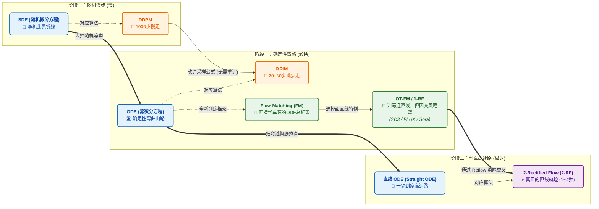

## 研究问题

### 扩散模型加噪流派演进（Noise Schedules & Formulations）

在扩散模型（Diffusion Models）与连续流模型中，前向加噪过程（或条件概率路径）通常可以统一表示为原始数据 $\mathbf{x}_0$与标准高斯噪声 $\boldsymbol{\varepsilon} \sim \mathcal{N}(\mathbf{0}, \mathbf{I})$的线性组合：

$$ \mathbf{x}_t = a_t \mathbf{x}_0 + b_t \boldsymbol{\varepsilon}, \quad \text{其中 } \boldsymbol{\varepsilon} \sim \mathcal{N}(\mathbf{0}, \mathbf{I}) $$

根据信号保留权重 $a_t$和噪声权重 $b_t$的设计哲学不同，主流生成模型可以分为以下三大路径流派：

------

#### 1. 流派一：方差保持型（VP, Variance Preserving）—— 经典主流

- **核心特征**：两个系数平方和为 1（$a_t^2 + b_t^2 = 1$）
- **代表模型**：DDPM, DDIM, Stable Diffusion 1.x / 2.x / XL, OpenAI GLIDE / DALL-E 2

**数学形式：**

遵循 $\alpha_t = 1 - \beta_t$以及累积信号率 $\bar{\alpha}_t = \prod_{i=1}^t \alpha_i$的设计，前向跳步加噪公式为：

$$ \mathbf{x}_t = \sqrt{\bar{\alpha}_t}\mathbf{x}_0 + \sqrt{1 - \bar{\alpha}_t}\boldsymbol{\varepsilon}, \quad \boldsymbol{\varepsilon} \sim \mathcal{N}(\mathbf{0}, \mathbf{I}) $$

明显可以看出，其信号系数与噪声系数的平方和恒等于 1：

$$ \left(\sqrt{\bar{\alpha}_t}\right)^2 + \left(\sqrt{1 - \bar{\alpha}_t}\right)^2 = \bar{\alpha}_t + (1 - \bar{\alpha}_t) = 1 $$

**原理解析：**

假设原始数据 $\mathbf{x}_0$经过标准化后方差为 $1$，由于标准高斯噪声 $\boldsymbol{\varepsilon}$的方差也为 $1$，且二者相互独立，那么在任意时间步 $t$，加噪后图像 $\mathbf{x}_t$的总体方差恒定为：

$$ \mathrm{Var}(\mathbf{x}_t) = \bar{\alpha}_t \mathrm{Var}(\mathbf{x}_0) + (1 - \bar{\alpha}_t) \mathrm{Var}(\boldsymbol{\varepsilon}) = 1 $$

这种设计保证了输入给神经网络的特征尺度在所有时间步上都是稳定的（即“方差保持”），早期极大地降低了 U-Net 的训练难度。但其几何轨迹相当于在高维球面上走圆弧，导致反向生成路径弯曲，需要较多采样步数。

------

#### 2. 流派二：线性插值与矫正流（OT-FM / Rectified Flow）—— 当今最主流

- **核心特征**：在数据和噪声之间进行欧氏空间的线性插值（$a_t + b_t = 1$）
- **代表模型**：Stable Diffusion 3, FLUX.1, Sora, Meta Movie Gen

> **严谨性注记**：
>
> 1. **Flow Matching (FM)** $\neq$**线性插值**：FM 是通用的连续生成训练框架，支持任意可微路径 $\mathbf{x}_t = a_t \mathbf{x}_0 + b_t \boldsymbol{\varepsilon}$（包括兼容传统的 VP/VE 路径）。本节讨论的是 FM 框架下最常用的**最优传输路径（OT-FM）**，即线性插值路线。
> 2. **OT-FM 与 Rectified Flow (RF)**：二者在基础训练阶段的数学公式与代码**完全等价**；区别仅在于后续进阶操作（RF 主打多轮迭代拉直轨迹的 Reflow 蒸馏，而 OT-FM 侧重训练前的 Mini-batch OT 最优传输配对）。

**数学形式：**

彻底抛弃了繁琐的 $\alpha_t, \beta_t$与根号项，将时间步连续化为 $t \in [0, 1]$（其中 $t=0$为纯数据，$t=1$为纯噪声），加噪公式简化为欧氏空间的一条直线：

$$ \mathbf{x}_t = (1 - t)\mathbf{x}_0 + t\boldsymbol{\varepsilon}, \quad \boldsymbol{\varepsilon} \sim \mathcal{N}(\mathbf{0}, \mathbf{I}) $$

此时模型不再直接预测噪声 $\boldsymbol{\varepsilon}$，而是训练神经网络去预测从数据指向噪声的常微分方程（ODE）**速度场（Velocity Field）** $\mathbf{v}_t$：

$$ \mathbf{v}_t = \frac{\mathrm{d}\mathbf{x}_t}{\mathrm{d}t} = \boldsymbol{\varepsilon} - \mathbf{x}_0 $$

**原理解析：**

线性插值使得中间状态（如 $t=0.5$时）的方差降为 $0.5^2 + 0.5^2 = 0.5$，不再保持方差恒定。但现代架构（如 DiT, Diffusion Transformer）内部拥有强大的归一化机制（LayerNorm / AdaLN），完全可以自适应这种方差波动。作为回报，直线轨迹对应着恒定速度的最优传输（Optimal Transport）路径，反向生成时更加平直，从而能够以极少的步数（如 $4\sim 8$步）生成极高质量的图像。

------

#### 3. 流派三：方差爆炸型（VE, Variance Exploding）与 EDM 框架

- **核心特征**：信号不缩小（$a_t = 1$），直接增加噪声
- **代表模型**：Score-SDE (NCSN), Karras EDM, Consistency Models (一致性模型)

**数学形式：**

原图信号权重恒为 $1$，噪声标准差 $\sigma_t$随时间单调递增（通常从 $0.002$放大至 $80$甚至更大）：

$$ \mathbf{x}_t = \mathbf{x}_0 + \sigma_t\boldsymbol{\varepsilon}, \quad \boldsymbol{\varepsilon} \sim \mathcal{N}(\mathbf{0}, \mathbf{I}) $$

**原理解析：**

随着 $\sigma_t$不断增大，$\mathbf{x}_t$的总体方差为 $1 + \sigma_t^2$，呈“爆炸”趋势，直至巨量噪声将原始信号 $\mathbf{x}_0$完全淹没。为了防止极大方差导致神经网络数值崩溃，Karras 在著名的 EDM 框架中提出了**输入缩放（Preconditioning）**机制：不改变物理加噪过程，而是在将 $\mathbf{x}_t$送入网络前，显式乘以缩放系数 $c_{\text{in}}(\sigma_t)$强行将方差拉回 $1$：

$$ \mathbf{x}_{\text{in}} = c_{\text{in}}(\sigma_t)\mathbf{x}_t = \frac{1}{\sqrt{\sigma_{\text{data}}^2 + \sigma_t^2}} \mathbf{x}_t $$

这种将“物理扩散过程”与“神经网络数值稳定性”解耦的设计在数学上极其优雅，直接催生了后来能够实现单步生成的 Consistency Models（一致性模型）。

------

#### 4. 三大流派对比总结

| 路径流派名称                  | 前向加噪公式 $\mathbf{x}_t =$                                | 系数关系                  | 几何轨迹           | 代表模型                            |
| ----------------------------- | ------------------------------------------------------------ | ------------------------- | ------------------ | ----------------------------------- |
| **VP (方差保持路径)**         | $\sqrt{\bar{\alpha}_t}\mathbf{x}_0 + \sqrt{1 - \bar{\alpha}_t}\boldsymbol{\varepsilon}$ | $a_t^2 + b_t^2 = 1$       | 高维球面圆弧       | DDPM, DDIM, SD 1.x/2.x/XL, DALL-E 2 |
| **OT-FM / RF (线性插值路径)** | $(1 - t)\mathbf{x}_0 + t\boldsymbol{\varepsilon}$            | $a_t + b_t = 1$           | 欧氏空间直线       | **SD3, FLUX.1, Sora, Movie Gen**    |
| **VE / EDM (方差爆炸路径)**   | $\mathbf{x}_0 + \sigma_t\boldsymbol{\varepsilon}$            | $a_t = 1, b_t = \sigma_t$ | 信号恒定，噪声发散 | Score-SDE, Karras EDM, CM           |

## 核心方法

#### 第一层：底层的物理规律（怎么开车？）—— SDE vs. ODE vs. 直线 ODE

想象你要从荒漠（噪声）回市区（图片），路上有三种驾驶模式。这就是数学底层的微分方程：

1. SDE（随机微分方程）—— “醉汉走夜路”
   - **一针见血**：每走一步，不仅往家的方向迈一步，还会**随机往旁边歪一下**（中途不断注入新噪声）。
   - **特点**：路线曲折震荡、耗时极长（几百上千步），但因为有随机探索，生成的细节往往很丰富。从同一个起点出发两次，到家的位置不一样。
2. ODE（常微分方程）—— “开启定速巡航的弯曲山路”
   - **一针见血**：去掉了所有的随机乱晃，路径是**100% 确定**的。只要起点固定，终点生成的图就完全一样。
   - **特点**：虽然不乱晃了，但因为早期设计的路本身是**弯弯曲曲的山路**，车开太快（步数太少）容易冲出弯道翻车，所以还是得走个 20~50 步。
3. 直线 ODE（Straight ODE）—— “笔直的高速公路”
   - **一针见血**：不仅方向确定（ODE），而且连弯道都铲平了，起点到终点就是一条**欧氏空间的直线**。
   - **特点**：因为路是笔直的，方向盘都不用打，一脚油门到底（1~4 步）就能直接到家！这是所有现代生成模型梦寐以求的终极形态。

------

#### 第二层：经典时代的方法（修山路的人）—— DDPM vs. DDIM

有了上面的基础，看懂 DDPM 和 DDIM 只需要一秒钟：

1. DDPM（去噪扩散概率模型）—— “一步一掷骰子的老司机”
   - **本质**：它就是离散版的 **SDE（醉汉走路）**。
   - **痛点**：训练时把图片按圆弧轨迹加噪；生成时一步步去噪，每退一步还要人为加一点新噪声进去。必须老老实实走满 1000 步，慢得让人抓狂。
2. DDIM（去噪扩散隐式模型）—— “给 DDPM 装上定速巡航”
   - **本质**：它把 DDPM 改造成了 **ODE（弯曲山路）**。
   - **厉害在哪**：它发现**根本不需要重新训练 DDPM 的模型**，只需要在生成图片时，把 DDPM 公式里“随机加噪”的那一项设为 0，醉汉瞬间就变成了走平滑山路的老司机！因为不乱晃了，它可以“跳步”走，把 1000 步直接压缩到 20~50 步。

------

#### 第三层：现代流派的方法（修高铁的人）—— FM vs. OT-FM vs. Rectified Flow

后来大家发现，DDIM 虽然快了，但走的毕竟还是 DDPM 留下的“弯曲山路”（圆弧加噪 $\sqrt{\bar{\alpha}_t}$）。能不能直接修高速直道？于是进入了现代流派：

1. Flow Matching（FM，流匹配）—— “高铁导航系统总框架”

   > [!TIP]
   >
   > **去噪得分匹配**是训练扩散模型的核心目标函数，而**流匹配**则是训练连续归一化流（CNF）的高效目标函数（因太过流行，现在常直接将其称为“Flow Matching 模型”）。 
   >
   > 在高斯条件路径（$x_t=α_t x+\sigma_t z$）下，因为向量场（或称速度场）和得分函数的训练目标本质上都是原图 $x$ 和噪声 $z$ 的某种线性组，且二者可以代数互转，所以**同一个神经网络既能做流匹配，也能做得分匹配**。
   >
   > > 注：“数学上可以相互转换（理论等价）” 绝不等于 “工程训练时的数值稳定性、收敛速度和扩展性一样好（实践等价）”

   - **一针见血**：以前 DDPM 训练神经网络是问：“请猜猜这张图里混了多少噪声？”；而 Flow Matching 训练网络是直接问：**“请告诉我现在车子该往哪个方向开、车速是多少（直接预测速度场）？”**
   - **包含关系**：它是一个通用大框架，你既可以用它来修弯路（兼容 DDPM 路径），也可以用它来修直路。

2. OT-FM（最优传输流匹配）—— “在地图上拿尺子画直线”
   - **本质**：它是 Flow Matching 框架下**最偷懒、最直接的特例**。
   - **一针见血**：既然 FM 允许随便修路，那我就直接用直线把图片和噪声连起来（$(1-t)x_0 + t\epsilon$），这就是两点之间最短的“最优传输（OT）”路线。现在的 **SD3、FLUX、Sora** 嘴上说的用 Flow Matching，指的其实都是这个**画直线的 OT-FM**。

3. Rectified Flow（RF，矫正流）—— “立交桥拉直大师”
   - **本质**：第一步和 OT-FM **完全是同一个东西**，但它多了一招独门绝技叫 **Reflow（重流/拉直）**。
   - **一针见血**：OT-FM 训练时虽然拿尺子画了直线，但因为是把千万张图和千万个噪声**随机乱连线**，成千上万条直线在半空中**撞车相交**了！神经网络为了避让，开出来的实际轨迹又被迫变成了曲线。
   - **独门绝技**：Rectified Flow 说：“我先按 OT-FM 训好第一代模型（1-RF），然后用它跑一遍，看看哪个噪声对应哪张图不会撞车；我把这些**不撞车的配对**固定下来，重新连直线训练第二代模型（2-RF）！”这样修出来的路，就成了真正不交叉的**“直线 ODE”**。

## 关键发现

- 最重要的实验结论与必要数字
- 什么证据真正支持作者的主张

## 我的提问

### Q1：Rectified Flow（ReFlow）

**现在的超大模型（如 FLUX、SD3、Wan、MiniMax H3）平时都是只做第一步（1-Rectified Flow）**，很少去做原版的 Reflow 了。因为为百亿参数大模型离线生成几百万对数据来做 Reflow 太烧钱了，现在大家做少步数加速，基本都直接跳过去用我们上一条聊到的 **DMD2** 或 **流一致性蒸馏（Flow Consistency Distillation）** 了。

### Q2：1-Rectified Flow 和 OT-FM（Optimal Transport Flow Matching）有区别吗？

**核心结论：**

1. **在“独立耦合（即训练时将噪声与真实数据随机配对）”的标准大模型训练设定下，1-Rectified Flow 和标准的 OT-FM（严格来说叫 Conditional OT-FM）在数学公式、前向插值轨迹以及损失函数上是 100% 完全等价的！** 它们是三个不同研究团队在 **2022 年 9 月至 10 月** 期间几乎同时独立发在 arXiv 上的“撞车”工作，属于殊途同归。
2. **两者的区别仅仅在于“理论出发点”以及“后续如何进一步拉直轨迹的演进方向”不同**：Rectified Flow 选择用模型生成的数据重新训练（Reflow，衍生出 2-Rectified Flow），而 OT-FM 阵营选择在训练采样前直接用算法计算小批量数据的最优传输配对（Mini-batch OT）。

**提出它们的代表性论文（2022 年底的“三驾马车”）**

这几篇论文共同奠定了现代流匹配（SD3、FLUX、Wan、Sora 等）的理论基石：

1. 提出 1-Rectified Flow 的论文（刘强团队 - UT Austin）：
   - **论文**：*Flow Straight and Fast: Learning to Generate and Transfer Data with Rectified Flow* (Liu et al., arXiv 2022.09 / ICLR 2023)
   - **核心贡献**：从“拉直常微分方程（ODE）轨迹以消除路径交叉”的几何视角出发，提出直接连接两个分布的直线插值。把第一阶段用随机配对数据训练出的基础模型定义为 **$1\text{-Rectified Flow}$**，把后续通过“重流（Reflow）”操作迭代拉直的模型定义为 **$2\text{-Rectified Flow}$、$k\text{-Rectified Flow}$**。
2. 提出 OT-FM 的论文（Meta AI 团队 - Yaron Lipman 等人）：
   - **论文**：*Flow Matching for Generative Modeling* (Lipman et al., arXiv 2022.10 / ICLR 2023)
   - **核心贡献**：从连续归一化流（CNF）的概率路径（Probability Paths）视角出发，提出了 **Conditional Flow Matching (CFM)** 框架。并在论文中证明：如果用**最优传输（Optimal Transport, OT）**位移插值来定义条件概率路径（而非传统的扩散路径），轨迹最直、方差最小，这个特例就被命名为 **OT-FM（Optimal Transport Flow Matching）**。
   - [Flow matching guide and code](https://arxiv.org/abs/2412.06264)
3. 将配对推广到真正 Mini-batch OT 的论文（Alexander Tong 等人 & Albergo 等人）：
   - **论文**：*Improving and Generalizing Flow-Based Generative Models with Minibatch Optimal Transport* (Tong et al., 2023) — 提出了 **OT-CFM**。
   - **补充**：同期还有 Albergo 等人的 *Stochastic Interpolants* (2022.09)，三者数学底子完全相通。

**它们的细微区别在哪里？（进阶演进的分岔路口）**

虽然基础公式一样，但由于随机取一个噪声 $x_0$ 和一张真图 $x_1$ 连线（Independent Coupling）并不是全局真正的“最优传输”（不同样本对的连线在空间中依然会交叉，导致学出来的合成向量场仍然是弯曲的），两个学派在**“如何解决轨迹交叉、实现真正的直线”**上走向了不同的分支：

| 对比维度                                  | Rectified Flow 学派 (Liu et al.)                             | OT-FM / OT-CFM 学派 (Lipman / Tong et al.)                   |
| :---------------------------------------- | :----------------------------------------------------------- | :----------------------------------------------------------- |
| **第一阶段基础模型**                      | 叫 **$1\text{-Rectified Flow}$**（随机配对 $(x_0, x_1)$ 训练直线速度场）。 | 叫 **Conditional OT-FM**（仅在单样本条件高斯路径上用了 OT 直线插值，样本间依然是随机配对）。 |
| **如何实现真正的“全局拉直 / 最优传输”？** | **事后拉直（Reflow $\to 2\text{-Rectified Flow}$）**： 先把 $1\text{-RF}$ 训好，然后用它跑完 ODE 生成确定性的配对数据 $(x_0, \hat{x}_1)$，再用这批不交叉的数据重新训练第二代模型。 | **事前配对（Mini-batch OT / OT-CFM）**： 不需要训练两代模型。在训练的每个 step 拿到一个 Batch 的噪声 $\{x_0^{(i)}\}$ 和真图 $\{x_1^{(j)}\}$ 后，先用 **Sinkhorn 算法或匈牙利算法**算出这个 Batch 内距离最近的最优配对 $\pi(i, j)$，再连线算 Loss。 |
| **工业界大模型现状**                      | 无论是 SD3、FLUX 还是 Wan、LTX、MiniMax H3 / 海螺 3.0**，**在预训练阶段跑的其实都是最基础的“随机配对直线流”（所以论文里有人引用 Lipman 叫它 Flow Matching，有人引用 Liu 叫它 Rectified Flow，其实跑的是同一行代码：`(1 - t) * x_0 + t * x_1`）。 |                                                              |

> [!NOTE]
>
> - **轨迹一旦变弯**：你在采样（用欧拉法解 ODE）时，如果步长迈得太大（比如想一步到位 $t: 0 \to 1$），就会沿着切线飞出去，画出一团模糊的平均脸。你必须老老实实切成 20~50 个小步，顺着弯道一点点挪过去。
> - **如果解决了轨迹交叉**（无论是用**事前 Mini-batch OT 配对**，还是用 Rectified Flow 的**事后 ReFlow 蒸馏**）：训练时的连线本身就不怎么交叉了，网络学到的全局轨迹就是**笔直的**，这时候你就能用 1~4 步直接生成高清大图！

顺带一提：**现在的超大模型（如 FLUX、SD3、Wan、MiniMax H3）平时都是只做第一步（1-Rectified Flow）**，很少去做原版的 Reflow 了。因为为百亿参数大模型离线生成几百万对数据来做 Reflow 太烧钱了，现在大家做少步数加速，基本都直接跳过去用我们上一条聊到的 **DMD2** 或 **流一致性蒸馏（Flow Consistency Distillation）** 了。

### Q3：为什么视频模型会如此一致地倒向 Rectified Flow？

因为视频的 Token 数量极其庞大（算力消耗是图像的几十上百倍）。传统 DDPM 走的是弯曲的去噪轨迹，需要很多步；而 **Rectified Flow 将噪声到数据的轨迹拉直成了直线（`x_t = (1 - t) * x_0 + t * ε`）**，使得模型用极少的步数（通常 15~25 步，配合蒸馏甚至只需 4~8 步）就能通过简单的欧拉法（Euler）积分生成高质量视频。

## 局限与疑问

- 论文已知局限
- 我仍不确定或不同意的地方

## 我的判断

是否可信、是否值得复现、与当前工作的关系。

## 下次只看这些

1. 最值得快速回忆的点
2. 第二个关键点
3. 需要采取的行动或后续阅读
