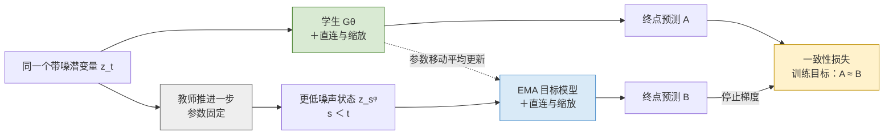

## 研究问题

首篇高效视频扩散模型综述：把加速方法归为<font color="brown">步数蒸馏、高效注意力、模型压缩、缓存/轨迹优化</font>四类，它们分别从减少去噪步数和降低单步开销两个方向解决视频生成推理太贵的问题。

视频扩散转向 DiT 后质量大幅提升，但和图像生成相比，视频要同时处理高分辨率、长时长和多步去噪，推理成本会随 token 数和采样步数两个方向一起增长。这直接决定了交互式创作、实时数字人、直播和世界模拟等应用能否在严格的延迟和显存限制下落地，所以效率必须和质量一样被当作核心目标。

本综述从落地部署的角度系统梳理视频扩散模型的加速采样方法，把增长很快但比较零散的研究整合成统一的技术框架，供研究者和工程师参考。

；许可：[CC BY-NC-ND 4.0](https://creativecommons.org/licenses/by-nc-nd/4.0/)；原图摘录，未改动。")

；许可：[CC BY-NC-ND 4.0](https://creativecommons.org/licenses/by-nc-nd/4.0/)；原表摘录，未改动。")

## 核心方法

| 章节    | 内容           | 对应的加速方向                                     |
| ------- | -------------- | -------------------------------------------------- |
| 第 3 节 | 步数蒸馏       | 减少去噪步数（降低 NFE，即模型调用次数）           |
| 第 4 节 | 高效注意力     | 降低每一步的开销                                   |
| 第 5 节 | 模型压缩       | 降低每一步的开销                                   |
| 第 6 节 | 缓存与轨迹优化 | 两者都有：缓存主要省单步计算，轨迹修改可以减少步数 |

### 2. 预备知识

2.1 视频扩散模型基础

① VAE Latent Space：先压缩，再生成

通过 Video VAE 将视频映射到低维潜空间，**以时空压缩减少扩散计算量，平衡效率与保真度**。文中典型配置为时间约压缩 4 倍，空间高、宽各压缩 8、16 或 32 倍。
$$
x_0\in\mathbb{R}^{C_x\times F_x\times H_x\times W_x}
\xrightarrow{\mathrm{VAE\ Encoder}}
z_0\in\mathbb{R}^{C\times F\times H\times W},
\qquad
F=\left\lfloor\frac{F_x-1}{4}\right\rfloor+1.
$$
② Diffusion Process：学习从噪声到视频的路径

- **扩散建模**：正向向潜变量加噪，模型学习噪声或 score，推理时通过多步反向采样恢复视频；信号与噪声的混合比例由噪声调度决定。
  $$
  z_t=\alpha_t z_0+\sigma_t\epsilon,
  \qquad \epsilon\sim\mathcal{N}(0,I).
  $$

- Flow Matching：沿数据与噪声之间的线性路径，学习速度场，而非直接预测噪声；生成时沿反方向积分。这里 $z_0$ 为数据潜变量，$z_1$为噪声。
  $$
  z_t=(1-t)z_0+t z_1,
  \qquad
  v_{\mathrm{target}}=z_1-z_0,
  \qquad t\in[0,1].
  $$

> [!TIP]
>
> **范式演进（DDPM $\rightarrow$ Flow Matching）：**早期采用离散时间步的 DDPM，现代主流视频 DiT（如 Sora、Wan、HunyuanVideo 等）普遍转向轨迹更直、采样步数更少的**流匹配（Flow Matching / Rectified Flow）**范式，直接拟合从噪声到数据的直线速度场（Velocity Field）$v_\theta(z_t, t, c)$。

③ Model Architecture：关键在于文本与视频如何融合

<font color="brown">双流 MMDiT</font> 将文本与视频 token拼在一起作为联合注意力（如 HunyuanVideo）；<font color="brown">单流 DiT </font>通过交叉注意力将文本注入视觉主干（如 Wan），通常更轻量、更高效。

④ Efficiency and Quality Metrics：既要算得快，也要生成好

评估需要兼顾**效率—质量权衡**：效率看延迟、吞吐、加速比与峰值显存，以及 NFE、FLOPs/MACs；质量看视频级 FVD、帧级 FID/LPIPS，以及综合评测 VBench 等。


；许可：[CC BY-NC-ND 4.0](https://creativecommons.org/licenses/by-nc-nd/4.0/)；原图摘录，未改动。")

(i) **步数蒸馏**：主要通过压缩去噪深度（即减少 NFE）来降低延迟；

(ii) **高效注意力**：把开销大的注意力运算稀疏化或线性化，降低单步复杂度；

(iii) **模型压缩**：通过量化和剪枝减少计算量和显存占用；

(iv) **缓存/轨迹优化**：复用中间状态、重新设计去噪轨迹，省掉冗余计算，从而缩短运行时间。

### 3. 步数蒸馏

**步数蒸馏**将多步教师模型的生成能力迁移到少步或单步学生模型，以减少 NFE、加速生成，主要包括侧重轨迹一致性的**一致性蒸馏**、输出分布对齐的**分布蒸馏**和感知质量提升的**对抗蒸馏**。

；许可：[CC BY-NC-ND 4.0](https://creativecommons.org/licenses/by-nc-nd/4.0/)；原图摘录，未改动。")

#### 3.1 一致性蒸馏

LCD：让不同噪声状态预测同一个干净终点

**LCD 是训练方法，LCM 是训练得到的模型。** 

核心思想：**让同一条去噪轨迹上、不同噪声程度的输入，都能直接预测出同一个干净终点，从而不必逐步走完整条去噪路径。** 



1. 图中的三个角色

- **教师 $f^\phi$**：固定的多步扩散模型，负责把 $z_t$ 推进到噪声更低的 $z_s^\phi$。
- **学生 $G_\theta$**：正在训练，学习直接预测终点。
- **目标模型 $G_\theta^{\mathrm{EMA}}$**：学生参数的移动平均版本，提供稳定监督。

2. 公式：一次“终点预测”怎么算？

$$
f^{\mathrm{pf}}(z_t,t,G_\theta)
=
\underbrace{c_{\mathrm{skip}}(t)z_t}_{\text{输入直连}}
+
\underbrace{c_{\mathrm{out}}(t)G_\theta(z_t,t)}_{\text{网络输出经缩放}}
$$

​            **终点预测 = 保留一部分输入信息 + 加上经过缩放的网络预测。**

- $c_{\mathrm{skip}}$、$c_{\mathrm{out}}$：随噪声等级变化的缩放系数。
- 整体 $f^{\mathrm{pf}}$ 才是干净终点预测，内部 $G_\theta$ 的原始输出不一定是。
- **$f^{\mathrm{pf}}$ 是预测映射，不是图中的教师 $f^\phi$。*即：

$$
A=f^{\mathrm{pf}}(z_t,t,G_\theta),\qquad
B=f^{\mathrm{pf}}(z_s^\phi,s,G_\theta^{\mathrm{EMA}})
$$

$$
\mathcal L_{\mathrm{LCD}}
=
\mathbb E\!\left[d\!\left(A,\operatorname{stopgrad}(B)\right)\right]
$$


**视频适配**：在视频生成领域，一致性蒸馏通常补充加入运动对齐与偏好优化；rCM 进一步融合 MeanFlow 与分布匹配蒸馏（DMD）。

- **运动对齐**：约束学生与 EMA 目标的运动相关表示；VideoLCM 用恒等映射，MCM 用可学习提取器，DCM 用时序潜变量差分。
- **偏好优化**：用奖励模型改善预测结果，主要用于**质量补偿，而非直接加速**。
- **应用扩展**：覆盖人物动画、视频修复、人脸增强和机器人决策，体现较强的任务迁移能力。

**讨论**：综述认为，一致性蒸馏更重视**稳定性与可控性**，但保守的匹配目标限制了极限步数压缩，通常不及现代分布匹配路线激进。

#### 3.2 分布蒸馏

分布蒸馏以 DMD 和 DMD2 等方法为代表。它要求学生生成结果的分布和教师对应的分布一致，而不强求每个时间步上都严格一致。在 DMD 类方法中，教师侧和学生侧的 score 估计器分别记为 $f^{\phi}_{\text{real}}$ 和 $f^{\phi}_{\text{fake}}$，两者都在同一个带噪 latent $\hat z_t$ 上计算，$\hat z_t$ 由当前生成器的输出加噪得到。标准的 DMD 目标为：
$$
\begin{equation}
\mathcal{L}_{\text{dmd}}=D_{\mathrm{KL}}\!\left(\hat{z}_t - t f^\phi_{\text{fake}}(\hat{z}_t,t)\,\Vert\, \hat{z}_t - t f^\phi_{\text{real}}(\hat{z}_t,t)\right),\quad
\mathcal{L}_{\text{critic}}=\mathbb{E}_{t,\epsilon}\big\|\epsilon-\hat{z}_0-f^\phi_{\text{fake}}(\hat{z}_t,t)\big\|_2^2,
\end{equation}
$$
其中，$\hat z_0=G_\theta(\epsilon,1)$ 是学生生成器 $G_\theta$ 当前的输出，$\hat z_t=(1-t)\,\hat z_0+t\,\epsilon$ 是把这个输出重新加噪得到的带噪 latent。$f^{\phi}_{\text{fake}}$ 由一个辅助的 critic 网络学习，$f^{\phi}_{\text{real}}$ 来自教师。为了保持训练稳定，生成器 $G_\theta$ 和参数化 $f^{\phi}_{\text{fake}}$ 的 critic 交替优化（可用TTUR）。

<font color="brown">分布蒸馏</font>因此成为推动视频扩散实现**极少步生成**的主要路线，并可进一步分为**非流式**与**流式**两种设置。

> [!NOTE]
>
> 这儿公式里为什么用速度而不是 score?：
>
> 现在的视频模型基本都是**采用 Rectified Flow 建模，并让网络预测速度 $v$ **，教师网络本身输出的就是速度；而在同一个$\hat z_t$上，score 之差和速度之差只差一个随$t$变化的系数，这个系数会被 DMD 的权重和归一化吸收，所以直接用速度写，结果等价，还省去了换算。

##### 3.2.1 非流式分布蒸馏

- **核心方向**：重点改进分布匹配目标，而非新增运动模块，使**极少步蒸馏更稳定、可部署**。
- **代表方法**：TDM、BLADE 引入轨迹匹配；AVDM2、MagicDistillation 强化 DMD，兼顾高压缩率与优化稳定性。
- **应用扩展**：视频修复增强（FlashVSR、GFix）、人物动画（DiffusionTalker）、可控操纵（EquiVDM）。

##### 3.2.2 流式分布蒸馏

- **生成方式**：按因果顺序逐块生成视频，面向直播、云游戏等**低延迟、持续输出**场景。
- **发展脉络**：CausVid、Self-Forcing 奠定基本框架；后续围绕**因果注意力、滚动生成优化、目标设计和多阶段训练**扩展。
- **核心瓶颈**：实时生成不仅要减少 NFE，还要保证**长时因果生成的训练稳定性**。

> **核心区别：非流式重点解决“极少步生成如何稳定”，流式还需解决“如何低延迟、长时间持续生成”。**

###### CausVid.

[论文 - CausVid](2026-11-04-causvid.md) 

###### Self-Forcing. 

[论文 - Self-Forcing](2026-11-04-self-forcing.md)

Self-Forcing [49] 首次成功将因果模型扩展至稳健的实时生成。为缓解以往方法中存在的暴露偏差（exposure bias），它在训练过程中引入自回归展开（autoregressive rollout），从而弥合训练与测试之间的差异。“Self-Forcing”（自我强制）这一名称强调：模型在训练时以自身先前生成的历史内容为条件，而非像教师强制（teacher forcing）训练那样，仅依赖真实的历史数据块。Self-Forcing [49] 的实验结果表明，这种自条件策略显著提升了长时程生成的稳健性。

这一过程如图 4 所示。在训练中展开这一序列后，生成器 $G_\theta$ 能够逐渐适应 $\mathcal{C}_{<i}$ 中它自己的历史预测，并对其中的误差保持稳健。

；许可：[CC BY-NC-ND 4.0](https://creativecommons.org/licenses/by-nc-nd/4.0/)；原图摘录，未改动。")

随后，训练由一个 DMD 目标函数驱动。该目标作用于用来构建目标的加噪潜变量：$\hat{z}_t = (1-t)\text{cat}([z_0^0,z_0^1,\cdots,z_0^{F-1}])+t\epsilon$：
$$
\begin{equation}
\mathcal{L}_{\text{dmd}}=D_{\mathrm{KL}}\!\left(\hat{z}_t - t f^\phi_{\text{fake}}(\hat{z}_t,t)\,\Vert\, \hat{z}_t - t f^\phi_{\text{real}}(\hat{z}_t,t)\right)
\end{equation}
$$
这一设计缓解了长时程的误差累积，但没有消除它。更重要的是，它保持稳健的核心机制仍然是推演中的自条件化（rollout self-conditioning），而不是一种像预训练那样、能持续从高质量视频数据中吸收监督信号的训练方案。因此，它还算不上一种明确具备可扩展性（scaling）的训练方案。

在这些代表性工作的基础上，后续的流式蒸馏（streaming distillation）方法主要沿四个相对正交的方向发展：<font color="brown">因果注意力设计</font>、<font color="brown">因果推演优化</font>、<font color="brown">DMD 目标设计</font>，以及<font color="brown">多阶段训练</font>。本小节余下的内容就按这四个方向展开。

###### Causal Attention Design.

这一方向关注的是：在因果注意力下，流式模型怎样限制内存增长，同时保持时间一致性。因此，大多数框架用注意力汇聚（attention sink）和窗口化（windowing）来保持时间一致性，同时控制 KV 缓存的开销，例如 Rolling Forcing [79]、Reward Forcing [89]、LongLive [151] 和 VideoSSM [161]。由此可见，对全部历史做注意力已经不可行；但只靠窗口化，仍然无法保证对长程内容的回忆（long-range recall）。

> [!NOTE]
>
> **说明：**
>
> - **注意力汇聚（attention sink）**：一直保留最开始几帧或几个 token 的 KV 缓存，不随窗口滑动而丢弃。这些开头的 token 在注意力中往往权重很高，留着它们可以让注意力分布保持稳定，也给整段视频提供一个固定的全局参照，比如人物外观和场景风格。
> - **窗口化（windowing）**：只保留最近若干个片段的 KV 缓存，通常是滑动窗口。这样缓存大小固定，内存和计算量不会随视频变长而线性增长。
>
> 流式生成要求内存有上限，所以把所有历史都放进注意力计算的做法不可行，只能用窗口加汇聚 token 的方式。代价是窗口之外的中间内容会被丢掉，比如某个物体离开画面后再回来，模型可能已经"忘了"它的样子。这就是"无法保证长程回忆"的意思。

###### Causal Rollout Optimization.

这一方向的重点是改进自回归推演本身，让暴露漂移（exposure drift）随时间累积得慢一些。Rolling Forcing [79] 提出了一种滚动窗口联合去噪方案：窗口内各帧的噪声水平逐级递增。这相当于在滚动窗口内部引入了一定程度的局部非因果性，从而抑制长时程的误差累积。

Self-Forcing++ [118] 的做法不同，它向模型自己生成的长推演结果中注入噪声。Live Avatar [50] 则在蒸馏过程中扰动历史 KV 状态。这两种方法都可以看作"受控扰动"（controlled corruption）策略，目的是让模型在误差累积时依然稳健。

这些后续工作说明，单纯的因果推演还不够：后来的方法越来越依靠<font color="brown">受控扰动</font>，或者依靠有限的局部非因果性，来防止误差不断叠加。

###### DMD-Target Engineering.

这一方向的重点是修改分布匹配的目标，让 DMD 更好地针对流式生成特有的训练目标和失效模式。

这样做的原因是：普通的 DMD 只在一般意义上对齐分布，并没有明确考虑流式生成特有的问题，比如运动显著性（motion saliency）、跨片段一致性（cross-chunk consistency），以及用奖励来决定优先学什么（reward-guided prioritization）。

Reward Forcing [89] 提出了 Re-DMD：用基于运动的视觉语言模型（VLM）奖励来缩放分布匹配的梯度，让模型优先学好动态程度高的区域。TalkingMachines [86] 把流匹配（flow matching）目标和分布匹配损失结合起来，用于实时的音频驱动动画。LongLive [151] 在滚动延伸生成时，只对新生成的片段做蒸馏。这些方法的共同趋势是根据具体任务来设计目标。但它们也说明，只靠更好的目标，无法彻底解决因果生成的不稳定问题。

> [!NOTE]
>
> **说明：**
>
> - **失效模式**：流式生成常见的问题，比如运动越来越少、片段之间衔接不上、长时间生成后外观漂移。
> - **Re-DMD**：用运动奖励给 DMD 梯度加权，运动越明显，权重越大。目的是纠正 DMD 偏向生成静态视频的倾向。
> - **TalkingMachines**：在 DMD 之外加入流匹配损失，等于直接引入来自数据的监督。
> - **LongLive**：在长推演中，前面的片段只作为上下文，DMD 只算在最新的短片段上。原因是双向教师模型只能可靠地评判短视频。
> - **最后一句**：改目标只决定模型"往哪儿学"，误差累积来自条件侧，也就是模型以自己带误差的历史为条件。所以还要配合注意力设计、推演优化和多阶段训练。

###### Multi-Stage Training. 

这一方向的重点是通过分阶段的课程式训练（staged curricula），弥合双向预训练和因果部署之间的差距。流式蒸馏通常默认从双向预训练模型初始化，因为直接从纯因果模型起步，效果一般差很多。但这也带来了"双向到因果"的差距（bidirectional-to-causal gap）：两种架构在生成时的注意力模式不同，所依赖的历史条件也不同，所以把双向模型迁移到因果部署做不到无缝衔接。

为了缩小这一差距，Live Avatar [50] 和 HY-WorldPlay [121] 采用按顺序推进的课程式训练，在 Self-Forcing 之前加入 Diffusion Forcing [8] 作为中间阶段。Causal Forcing [191] 则认为 Diffusion Forcing 不如 Teacher Forcing [191] 稳定，因此采用"Teacher Forcing → ODE 初始化 [83] → Self-Forcing"的流程。

总的来看，双向到因果的差距仍然没有解决。目前的成功往往依赖精心安排的分阶段训练，而不是某个本身就稳定的单一目标。


> [!IMPORTANT]
>
> **讨论（Discussion）：**在所有步数蒸馏方法中，只有分布蒸馏（distribution distillation）能稳定地把生成步数压到 1 到 4 步这一极低区间，所以它在实际的视频加速中处于核心地位 [44, 45]。它的主要弱点不在表达能力，而在于不够稳定：一旦训练中加入因果推演和内存约束，保证训练稳定的各种设计就变得和蒸馏损失本身一样重要。

#### 3.3 对抗蒸馏

**对抗蒸馏（Adversarial Distillation）** 的重点是提升少步生成的感知真实感和运动清晰度。它既可以作为辅助目标，和其他损失（如 DMD）一起使用，也可以单独作为优化目标。代表性方法如 eADD [106]，通过：
$$
\begin{aligned}
\mathcal{L}_{\text{adv}}^{G}
&=-\mathbb{E}_{\epsilon}\big[\log D_{\psi}(G_\theta(\epsilon,1))\big], \\
\mathcal{L}_{\text{adv}}^{D}
&=-\mathbb{E}_{z_0}\big[\log D_{\psi}(z_0)\big]-\mathbb{E}_{\epsilon}\big[\log(1-D_{\psi}(G_\theta(\epsilon,1)))\big].
\label{eq:baseline_gan_loss}
\end{aligned}
$$
引入 GAN 式的监督信号。

这一目标能够增强细节的清晰度，通常与一致性蒸馏或分布蒸馏联合使用，也可用于后期的精修阶段。本小节涵盖联合使用和独立使用对抗目标的两类设计。

##### 3.3.1 联合式对抗蒸馏

尽管对抗蒸馏的思想源于 GAN [58]，但将其应用于视频扩散蒸馏时，GAN 训练固有的不稳定性仍是一项重大挑战。在联合使用的场景中，对抗机制通常作为辅助目标，用于增强基于一致性或分布匹配的蒸馏，而非作为独立的蒸馏路径。因此，在 ADD [106]、LADD [105] 和 DMD2 [27] 等已有方法基础上的近期进展，主要着眼于改进这一辅助对抗组件的集成方式，包括扩大判别器容量等策略。

##### 3.3.2 独立式对抗蒸馏

独立式对抗蒸馏指仅使用对抗目标，而不将其与其他蒸馏范式相结合。在这种设置下，对抗蒸馏从辅助角色转变为主要蒸馏目标，但这种配置往往存在训练不稳定的问题。

为确保收敛，Seaweed-APT [71] 等框架会在已经过一致性蒸馏优化的模型上进行对抗蒸馏。其目标是进一步提升现有少步模型的生成质量，而非从头完成从多步到少步的完整蒸馏过程。

> [!NOTE]
>
> **讨论。** 对抗蒸馏最适合作为少步生成器的质量补偿机制，尤其有助于提升运动真实感和纹理清晰度。对于大规模视频模型而言，将其作为独立目标仍存在过强的训练不稳定性，因此，更可靠的路径是在基于分布匹配或一致性的训练基础上引入对抗蒸馏。

#### **3.4 总结与展望**

步数蒸馏直接减少去噪步数，仍是最有效的加速手段。现在的核心问题已经不是能否做到少步生成，而是压缩更激进、训练规模扩大之后还能否保持稳定。现有的 DMD 类和 LCM 类方法调参成本高，训练容易过早收敛，也难以随训练继续提升。

未来有三个方向：

一是让蒸馏融入大规模训练流程，成为稳定的优化组件，而不是脆弱的事后压缩；

二是和稀疏注意力、剪枝、量化、缓存复用等方法协同设计，同时降低步数和单步开销，并防止多种近似叠加后放大时间漂移和误差；

三是从离线短视频加速 转向流式和实时生成，解决暴露偏差、历史漂移、KV 缓存增长和双向到因果的差距。面向这一场景，下一代方法可能需要针对因果生成设计的蒸馏目标、更鲁棒的自回归展开训练，以及能够更好地衔接预训练、蒸馏和长时程部署的多阶段课程训练。

如果这些问题得到解决，步数蒸馏就有望从一种少步采样技术，发展为实时与长时程视频生成的通用基础。


### 4. 高效注意力

高效注意力通过降低注意力计算与内存开销，减少视频扩散的单步成本；注意力通常是 DiT 主干的主要瓶颈。代表性方向包括 FlashAttention 等 **IO 感知注意力内核**、跳过低贡献交互的**稀疏注意力** ，以及进一步降低计算开销随序列长度增长速度的**线性或混合注意力**。这些方法能够提高吞吐量，但更激进的近似可能削弱**长程时序依赖与全局运动一致性**。

| 方向                          | 做法                                                         | 是否近似                                    |
| ----------------------------- | ------------------------------------------------------------ | ------------------------------------------- |
| IO 感知算子（FlashAttention） | 结果不变，只优化 GPU 显存读写方式，减少数据搬运              | 精确计算，不损失质量                        |
| 稀疏注意力                    | 只计算重要的 token 对，跳过贡献小的部分                      | 近似，复杂度仍是 O(N²) 级别，但常数大幅减小 |
| 线性/混合注意力               | 把 O(N²) 降到 O(N)；混合注意力是把部分层换成线性注意力，其余层保留全注意力 | 近似程度最强，最容易影响长程一致性          |

> [!TIP]
> **SageAttention：** 按技术手段，它属于量化；按优化对象，它属于高效注意力，更准确地叫“低比特／量化注意力”。
>
> | 方法                | 核心加速思路                                                 |
> | ------------------- | ------------------------------------------------------------ |
> | **FlashAttention**  | **少搬数据**：通过分块与算子融合，减少显存读写。             |
> | **SageAttention**   | **用更低精度算**：例如初代对 $QK^⊤$ 使用 INT8 量化，并通过平滑等技术控制误差。 |
> | **SpargeAttention** | **少算低贡献交互**：通过稀疏筛选跳过部分计算，同时结合量化。注意它和 SageAttention 不是同一个方法。 |
>
> `SpargeAttention`跟 `SageAttention` 是**同一个团队（清华大学朱军、陈键飞团队）**。
>
> SageAttention 为什么这么火？：
> - **即插即用**：不用训练，不用校准，直接替换 FlashAttention 就能用，已经成了 ComfyUI、Wan、HunyuanVideo 等生态里的常用组件。
>
>   > SageAttention 的底层 CUDA / Triton 算子，**完全沿用了 FlashAttention 的 Tiling（分块）和 Online Softmax 机制**。
>   >
>   > - **分块计算（tiling）**：把 Q、K、V 切成小块，放进 GPU 上很快的片上存储（SRAM）里算
>   > - **在线 softmax**：一边算一边更新 softmax 的结果，不用等所有分数都算完
>
> - **质量损失很小**：保留了完整的注意力计算，只降精度。
>
> - **能和其他方法叠加**：可以和步数蒸馏、缓存、权重量化、稀疏注意力（SpargeAttn）一起用。
>
> - **提速明显**：论文报告的算子级提速约为 FlashAttention2 的 2～3 倍，具体看版本和显卡；端到端视频生成的提速会小一些。


本节按照从结构最规整、最易部署的设计，到适应性最强、对模型改动最大的方案这一顺序展开：首先介绍静态稀疏注意力，随后讨论动态稀疏注意力，最后从近似质量与硬件可执行性两个维度，回顾需要训练的线性注意力或混合替代方案。

- **4.1 静态稀疏**：事先规定好看哪些位置，不用训练，最容易跑快。
- **4.2 动态稀疏**：根据输入临时决定看哪些位置，更准，但实现更复杂。
- **4.3 线性注意力**：直接换掉 softmax 注意力，复杂度最低，但必须重新训练。

在系统层面，许多后续的高效注意力设计都以 FlashAttention [4] 为基础。它并未提出新的注意力公式，而是通过面向输入／输出（IO）优化的执行方式来加速精确注意力计算。具体而言，它利用 GPU 的存储层级，将 $Q$、$K$、$V$ 划分为适合 SRAM 容量的块，从高带宽显存（HBM）中加载这些块，在片上逐块更新注意力计算，并在完成充分的局部计算后才将中间结果写回。

这种分块策略避免了显式存储完整的  $N \times N$  注意力矩阵，大幅减少了 HBM 数据读写，因此成为后续稀疏注意力和混合设计的实用基础。在这一系统优化基础之上，我们首先介绍结构最规整的静态稀疏注意力，再讨论动态稀疏注意力，最后介绍需要训练的线性注意力或混合替代方案。

#### 4.1 静态稀疏注意力

；许可：[CC BY-NC-ND 4.0](https://creativecommons.org/licenses/by-nc-nd/4.0/)；原图摘录，未改动。")

- **纵轴：Query token**，也就是“谁正在查找信息”。
- **横轴：Key token**，也就是“去哪里找信息”。
- **某一行的蓝色位置**：这一行的 Query 允许参考哪些 Key，并汇总对应的 Value

图示的方法是针对双向注意力的，如果是因果注意力，应该只保留下三角的区域。

；许可：[CC BY-NC-ND 4.0](https://creativecommons.org/licenses/by-nc-nd/4.0/)；原图摘录，未改动。")

基于静态注意力掩码的稀疏注意力机制，不会根据输入调整所选取的 $K$ 和 $V$ token。静态稀疏注意力通常使用通用后端：这些后端接收<font color="brown">注意力掩码</font>和 $Q$、$K$、$V$ 作为输入，所以不需要自己编写前向或反向算子。它的主要优点是能兼容 SageAttention [171]、FlexAttention [25]、Block Sparse Attention [43] 等广泛使用的后端。缺点是，和全注意力相比，它不可避免地会丢掉一部分 $K$、$V$ 值。所以，在部署时更看重结构规则、而不太需要自适应的场景下，静态稀疏很有吸引力。但这也意味着，它的效果上限很大程度上由掩码设计得好不好来决定。

**静态掩码模式**

静态掩码通常同时编码两样东西：时空局部性，以及对硬件友好的块结构。图6对比了六种代表性布局：Efficient-vDiT [23] 的分块（tiled）局部性、GRAT [103] 的分组块结构、PAROAttention [186] 的重排对角带、Radial Attention [66] 的径向稀疏性、Sparse-vDiT [14] 的均匀条纹模式，以及 W.A.L.T [22] 采用的粗粒度块对角调度。这些方法主要有三点不同：局部性先验的覆盖范围有多宽，保留了多少全局结构，以及掩码能否直接映射为高效的分块执行。实践中的启示是，真正的瓶颈在于掩码设计。固定先验一旦漏掉了视频实际需要的交互，静态稀疏性就没有任何自适应机制可以把它们找回来。

**讨论** 

静态稀疏注意力至今仍有吸引力，因为规则的掩码易于实现、基准测试和部署。但它的上限较低：固定掩码先验与实际视频内容之间的任何不匹配，都会变成不可逆的信息损失。正因为这种僵化，后续方法转向了动态稀疏注意力。动态方法会根据当前视频内容自适应地调整激活token或KV的选择模式，代价是额外的路由开销和更复杂的执行。

#### 4.2 动态稀疏注意力

与静态掩码相比，动态稀疏注意力会根据当前输入自适应地调整激活的token或KV模式，因此能更灵活地保留重要的交互。代价是系统必须先估计哪些查询（query）、键（key）或值（value）token需要保持激活，所以路由本身就要消耗计算。而且，算法上的收益往往需要更专门的内核或运行时支持，才能转化为端到端加速。我们沿两个正交维度梳理这一领域：一是选择激活token的**路由策略**，二是**稀疏目标**，即稀疏性只作用于 $\{K, V\}$，还是作用于整个 $\{Q, K, V\}$ 集合。实践中，两者的主要区别在于路由开销由哪一环节承担，以及硬件还能利用多少结构。

##### 4.2.1 动态路由策略

动态路由主要分为三类方法：

1. **基于计算的路由**：对当前的 $Q$、$K$、$V$ 张量做高效的注意力或相似度计算，以此确定路由策略；
2. **先验驱动的路由**：利用外部领域知识，例如用人体姿态关键点选择token，或在视频编辑中保留以物体为中心的区域；
3. **基于统计的路由**：利用历史统计量，估计当前注意力操作的最优稀疏配置。

**基于计算的路由。** 这类方法在执行稀疏注意力之前先压缩 $Q$、$K$、$V$，以较低成本估计token的显著性。代表性方法包括 DraftAttention、RainFusion2.0、VSA 和 SpargeAttention；另一些方法则采用低比特分数估计，如 FlashOmni。实际难点在于，用于路由的代理信号必须既廉价又可靠。一旦路由开销或近似误差过大，理论上的稀疏收益很快就会被抵消。

**先验驱动的路由。** 这类方法利用外部线索决定保留哪些token。Object-Centric Diffusion 让token合并更多地发生在背景区域，DiTVR 使用光流轨迹，Input-Aware Sparse Attention 则使用人体姿态关键点。这些先验在视频编辑或以人为中心的场景中效果可能很好，但当场景结构是开放的、缺乏强先验时，其优势就会减弱。

**基于统计的路由。** 这类方法复用历史统计量（如缓存的 log-sum-exp 值或先前的注意力分布）来近似当前的稀疏掩码。AdaSpa 是这一思路的典型：它利用稀疏索引在不同去噪步之间经验上较为稳定的特点，通过基于LSE缓存的在线搜索恢复这些索引。其优势是路由开销更低，但当内容剧烈变化时，跨步稳定性的假设可能失效，这限制了这类方法的剪枝力度。

##### 4.2.2 稀疏目标

按照稀疏目标，稀疏注意力机制可分为两大类：

1. **仅稀疏化 $K$ 和 $V$ 张量**，以减少KV缓存的内存占用；
2. **对完整的 $\{Q, K, V\}$ 施加稀疏性**，以进一步提升计算吞吐。

在稀疏注意力中，大多数方法侧重于仅对KV稀疏化，在减少KV存储的同时保持生成质量。相比之下，QKV稀疏化主要出现在token合并或查询剪枝范式中，例如以物体为中心的token合并和双向稀疏注意力。

**键与值的稀疏化。** 大多数动态稀疏注意力方法保持查询稠密，只稀疏化键和值，因为查询代表当前正在被更新的token。代表性的仅KV稀疏设计包括 VORTA、VMoBA、Sparse VideoGen、RainFusion2.0、DraftAttention 和 XAttention。设查询token数为 $N_Q$，键token数为 $N_K$，注意力特征维度为 $D$，保留比例为 $\rho \in (0,1]$，则稠密注意力的开销 $\mathcal{O}(N_Q N_K D)$ 降为 $\mathcal{O}(\rho N_Q N_K D)$。这种稀疏方式更安全，但也更保守：正因为查询侧没有改动，质量才更容易保持。

**查询、键与值的稀疏化。** 更激进的一类方法连查询也一并稀疏化：要么直接剪枝查询，要么在注意力之前合并token，从而缩短整个 $\{Q,K,V\}$ 集合。BSA 在3D块内剪除局部冗余的查询，而 Object-Centric Diffusion 对背景token的合并力度大于对物体token。这提高了加速上限，但也会让路由错误变成不可逆的信息损失，因为模型不再保留一组稠密的激活查询。

**讨论。** 动态稀疏注意力比静态稀疏更灵活，因为路由会随内容自适应，而不是固定使用某个掩码。它的主要弱点是节省的效果并不稳固：路由本身要消耗计算，而高度不规则的掩码很难在真实内核上高效执行。因此，许多方法在算法层面看起来很强，端到端效果却不及预期，除非把稀疏模式和实际可执行性放在一起协同设计。

#### 4.3 基于训练的线性注意力

线性注意力将矩阵乘法的顺序改写为
$$
\begin{equation}
A=(QK^{\top})V=Q(K^{\top}V),
\end{equation}
$$
即先计算 $D\times D$ 的矩阵 $K^{\top}V$，再左乘 $Q$。这样，主导开销从序列长度的平方级 $\mathcal{O}(N_Q N_K D)$ 降为约 $\mathcal{O}((N_Q + N_K) D^2)$。在渐近复杂度上，这是大多数稀疏注意力方法达不到的。代价是它与softmax注意力差别很大，所以免训练的直接转换通常效果不好，视频扩散方法必须重新训练或重新设计主干网络。据此，我们把这类算法分为三组：

> [!TIP]
>
> 注意力需要一个相似度函数 $\text{sim}(q, k)$：
>
> - softmax 注意力用的是 $\text{sim}(q,k) = \exp(q^\top k/\sqrt{d})$
> - 用核函数替换softmax，指相似度能写成 $\text{sim}(q,k) = \phi(q)^\top \phi(k)$
>
> 也就是先把 $q$、$k$ **分别**变换成新向量 $\phi(q)$、$\phi(k)$，再做点积。这里的 $\phi$ 叫**特征映射**，能写成这种形式的相似度函数就叫**核函数**。

> [!NOTE]
>
> 2012年之前以核函数为核心的“支持向量机（SVM）”统治了AI界十几年。2012年之后是**深度学习**的时代，神经网络、大模型 走的是另一条“大力出奇迹”的路，SVM 这类核方法在实际工作中用得比以前少了。

1. 完全替换为线性注意力；
2. 线性与稀疏混合的配置；
3. Mamba系列。

因此，实际要回答的问题不是线性注意力是否更便宜，而是它带来的近似是否足够准确，值得为此重新训练整个视频生成模型栈。

**完全替换为线性注意力。** 这类方法在整个主干网络中都用线性注意力取代平方复杂度的自注意力，所以节省体现在端到端层面，而不只是部分模块。实践中，通常要么从头训练一个线性注意力主干，要么把预训练的DiT转换后再重新训练。难点不在渐近收益，而在近似误差：所有注意力层都偏离softmax的行为之后，对运动至关重要的交互就更难保留。

**线性与稀疏注意力的混合配置。** 混合设计对序列的大部分使用线性注意力，同时为关键区域保留softmax注意力。SLA 和 ReHyAt 是这一方向的代表。它比完全替换更可信，因为它承认单靠线性注意力处理视频并非无损。但它仍然高度依赖两点：一是模型能否准确识别哪些块需要精确注意力，二是由此得到的模式能否在内核上高效执行。

> 2026 年 7 月发表的 **SANA-Video 2.0** 使用约 75% 的线性注意力层和 25% 的 softmax 注意力层。

**Mamba系列。** Mamba系列用状态空间模型（SSM）取代注意力，通过类似循环的序列处理方式实现线性扩展。Zigma、UniAnimate、MedSora 和 MANTA 分别是这一方向在不同视频领域中的代表。它们对长上下文建模的价值很明显。但它们不再继承softmax注意力的归纳偏置，所以应视为对主干网络的重新设计，而不是即插即用的加速技巧。

**讨论。** 当超长上下文成为主要开销、且可以接受重新训练时，基于训练的线性注意力很有吸引力。在当前的视频扩散系统中，稀疏与线性混合的设计比完全替换更可信，因为纯线性化仍难以保留对运动至关重要的交互。

#### 4.4 总结与展望

对于需要实际部署的视频扩散模型，高效注意力已经从可有可无的优化手段变成了核心的系统基础设施。目前，稀疏注意力在质量与速度之间的实际权衡最好：它既保留了关键的长程交互，又降低了注意力的主要开销；纯线性化则往往需要更强的近似假设。核心瓶颈在于与硬件的耦合：路由和掩码设计带来的收益，只有在能顺畅地映射为对内核友好、负载均衡的执行时才能真正兑现。近期的进展将取决于算法、掩码结构、量化格式和运行时调度之间的协同设计。

### 5. 模型压缩

模型压缩通过降低数值精度（量化）或去掉冗余计算（剪枝）来降低单步延迟和显存压力。量化把权重和激活值映射成低比特表示，目前更容易落地；剪枝删掉作用小的 token、通道或模块，但通常需要更多训练来弥补质量损失。在视频扩散里，真正的难点不是压缩本身，而是压缩后还能保持时间一致性和视觉质量。

### 6. 缓存/轨迹优化

缓存与轨迹优化通过复用之前的计算结果、重新设计去噪的执行路径来减少冗余计算，从而加速视频扩散模型，而且不一定要改变模型名义上的计算深度。代表性方法包括：特征缓存 [`FastCache`、`MagCache`]、用于因果生成或流式生成的 KV 缓存 [`MemFlow`、`TinyHistory`]、噪声或状态修改 [`Free4D`]、轨迹重设计 [`AYS（Align Your Steps）`、`FIFO-Diffusion`]，以及并行执行 [`xDiT`]。

它们面临的共同挑战是：在保持吞吐量与显存可扩展性的同时，控制长时生成中的漂移（drift）。


### 7. 研究展望

## 关键发现

- 最重要的实验结论与必要数字
- 什么证据真正支持作者的主张

## 我的提问

### Q1：普通模型也让不同噪声状态 $x_t$、$x_s$ 预测同一个 $x_0$，不是已经间接要求一致了吗？LCD 特别在哪？

**A：确实有这种间接要求，但两者的目标不同：**

- **普通训练：猜原图。** 高噪声下原图无法唯一确定，MSE 学到的是条件平均，因此两个预测不一定相同；来自同一原图，也不代表位于同一条生成轨迹。
- **LCD：预测教师轨迹的终点。** 教师从 $x_t$ 推进得到同轨迹上的 $x_s$，再要求两者预测同一终点；这个终点不一定是最初用于加噪的原图。

> **核心区别：普通训练学“原图可能是什么”，LCD 学“沿教师轨迹走到底会生成什么”。**
>
> 一句话：普通模型和 LCD 的网络结构、输出公式都一样，区别在训练目标。普通模型回归随机的 $x_0$，学到的是条件均值（偏糊）；LCD 回归由 $x_t$ 唯一决定的自身预测，学到的是轨迹终点（清晰）。

### Q2：发明新的 Attention，必须自己写算子吗？

<font color="brown">先认识两个工具</font>

**Triton：用 Python 写 GPU 算子的语言** Triton 由 OpenAI 开发，2021 年开源。以前写 GPU 算子基本只能用 CUDA（C++），要自己安排每个线程做什么、怎么分配共享内存，门槛很高。Triton 让你用类似 Python 的语法来写，而且是**按"数据块"思考**：你只需要说明"这个程序处理哪一块数据、怎么算"，线程分配、内存访问优化这类细节交给编译器。性能多数情况下接近手写 CUDA。PyTorch 的 `torch.compile` 底层生成的也是 Triton 代码。

**FlexAttention：PyTorch 自带的"可定制注意力"** FlexAttention 从 PyTorch 2.5 开始提供。以前想改注意力，要么用普通 PyTorch 写，速度慢、占显存；要么自己写算子，门槛高。FlexAttention 在两者之间：你只用几行 Python 描述"怎么改"，它会**自动生成一个类似 FlashAttention 的融合算子**，底层用的正是 Triton。可以把它理解为"一个已经写好、留了修改接口的 Triton 注意力算子"。它有两个接口：

- `mask_mod`：规定哪些位置可以互相看到。用 `create_block_mask` 转成块稀疏的 `block_mask` 后，被遮住的块会**真正跳过不算**。
- `score_mod`：规定 softmax 之前分数怎么改，比如加位置偏置。

```python
'''
一个滑动窗口的例子：
'''
from torch.nn.attention.flex_attention import flex_attention, create_block_mask

def sliding_window(b, h, q_idx, kv_idx):        # 只看前后 256 个 token
    return (q_idx - kv_idx).abs() <= 256

block_mask = create_block_mask(sliding_window, B=None, H=None, Q_LEN=N, KV_LEN=N)
out = flex_attention(q, k, v, block_mask=block_mask)  # 配合 torch.compile 使用速度更快
```

<font color="brown">三个步骤</font>

**第一步：先用 PyTorch 验证效果（不需要写算子）。** 用普通 PyTorch 代码实现想法，比如手动加 mask、模拟量化，确认生成质量没有明显下降。这一步只看效果，不管速度。如果效果不行，就不用往下做了。

> [!TIP]
>
> 普通 mask（如 `scores.masked_fill(~mask, float("-inf"))`*）只是把算好的分数改成* $-\infty$，被遮掉的部分 GPU 照样要算；用 `create_block_mask` 生成块稀疏掩码，再交给编译后的 `flex_attention`，完全被遮住的块会被直接跳过，这样才真正省下计算量。

**第二步：看能不能用 FlexAttention（不需要写算子）。** 如果只改了"看哪些位置"或"分数怎么算"，比如滑动窗口、分块 mask、注意力汇聚、相对位置偏置，FlexAttention 一般就够用了。

**第三步：FlexAttention 表达不了的，才需要写算子。** 比如 SageAttention 改的是计算精度。它的加速来自 GPU 的低精度 Tensor Core 指令，必须有专门的实现，官方代码里同时有 Triton 和 CUDA 两种。改动更大、连计算结构都变了的方法，也需要定制算子。如果要在最新 GPU 上拿到最佳性能，往往还得用 CUDA 或 CUTLASS（NVIDIA 官方的高性能矩阵运算模板库）。


## 局限与疑问

- 论文已知局限
- 我仍不确定或不同意的地方

## 我的判断

是否可信、是否值得复现、与当前工作的关系。

## 下次只看这些

1. 最值得快速回忆的点
2. 第二个关键点
3. 需要采取的行动或后续阅读
